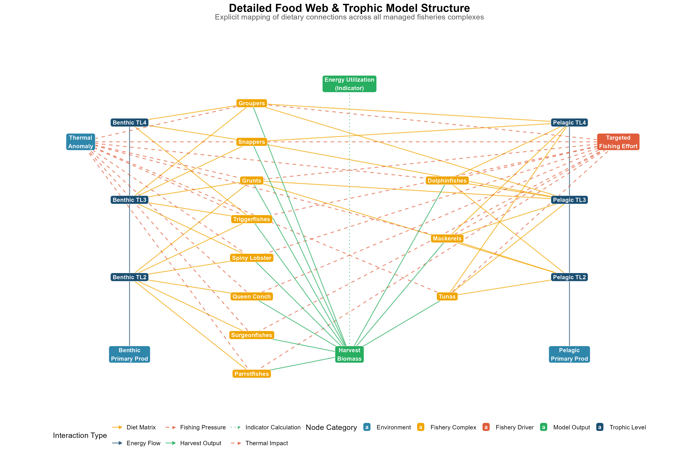

# CaribTTM: Trophic Transfer Model for island-based ecosystem assessments in the U.S. Caribbean

`CaribTTM` is an R package implementing the **trophic transfer model (TTM)** of the integrated trophic frontier framework for U.S. Caribbean fisheries (SEDAR103-DW-20; Karnauskas, Woodstock, Agar, Solis & Vandermeulen 2026). It estimates **guild- and group-level multispecies maximum sustainable yield (MMSY)** from habitat-specific benthic and satellite/ocean-model pelagic primary production. Estimates are made under prevailing oceanographic, habitat, disturbance and fishery conditions, with uncertainty propagated by Monte Carlo and conditioned on data by Sampling-Importance-Resampling (SIR). It also produces the inputs the downstream **stochastic production frontier (SPF)** and MSE need: gear-specific MMSY, gear targeting matrices, effort ceilings and choke groups.

## Highlights

* **Habitat-resolved energy.** Each mapped habitat (km² × net primary production, with unit conversion from g C, g DW, mmol O₂, …) feeds its own trophic-level pools. Species reach those pools through habitat preferences, and habitat quality (e.g., coral cover) affects their refuge-dependent carrying capacity.
* **Time-dynamic.** The model runs in annual steps:
  * SST/DHW, NPP index and other covariates act through response functions.
  * Hurricanes, bleaching and coral disease are applied with recovery curves.
  * Fishing feedback cascades through the trophic pools.
  * Biomass follows logistic dynamics, driven by landings in the historical period and by effort in projections.
* **Defensible MMSY.** MMSY = x · M · K, the Gulland/Schaefer form on natural mortality, with K = P/M. Group-specific x priors come from per-recruit life-history theory (growth, maturity, trap selectivity, steepness). The model reports quantiles, an OFL proxy (median), a P* target, P(overfishing), B/BMSY and energy utilization.
* **Ecological realism.** These processes can each be switched on or off and are tested in the structural ensemble:
  * open recruitment (larval import, e.g., spiny lobster);
  * nursery-habitat dependence;
  * herbivory–coral feedback;
  * no-take areas;
  * ghost fishing by traps lost in storms;
  * lionfish and *Sargassum* drivers;
  * effort dynamics.
* **Full uncertainty.** Every parameter CV is sampled, along with observation error in covariates, landings, effort and disturbance intensities.
  * SIR uses abundance indices (with hyperstability, catchability creep or absolute-survey observation models), assessment OFLs and a stock-reduction catch-feasibility constraint.
  * Sampling uses adaptive importance sampling with Pareto smoothing.
* **Review tools.**
  * out-of-sample validation (held-out indices, leave-one-benchmark-out, retrospective peel);
  * simulation self-test;
  * global sensitivity analysis;
  * structural ensemble;
  * an independent catch-only MSY comparator;
  * value-of-information ranking of data streams;
  * closed-loop management strategy evaluation of SPF-style harvest rules.
* **Automated data acquisition with user override.**
  * Sources: NOAA ERDDAP (Coral Reef Watch SST/DHW, OISST, satellite NPP ensemble, VIIRS chlorophyll and Kd490), MOM6-NWA12 via OPeNDAP, GLORYS12 via Copernicus Marine, NCCOS benthic habitat maps (ArcGIS REST) and NHC HURDAT2 hurricane tracks.
  * Values entered by the user always win.
* **SPF hand-off.** `write_spf_inputs()` writes all tables needed by collaborators' SPF analyses.

## Repository layout

```
R/                      package source (inputs, forcing, simulate, run/SIR, summaries, plots, acquire)
tests/testthat/         unit tests (devtools::test())
Projects/StCroix_Trap/  St. Croix trap fishery case study (data/, data-raw/, run_stcroix.R, output/)
docs/                   user manual, input dictionary, data acquisition, model description,
                        case study, references (Markdown + Quarto book)
inst/legacy/            original proof-of-concept scripts and example figures
```

## Quick start

```r
devtools::install(".")            # or devtools::load_all(".")
library(CaribTTM)

res <- run_ttm(ttm_example_project(n_draws = 200))
reference_points(res)              # group MMSY, OFL proxy, P* target, status
aggregate_mmsy(res, "guild")       # guild MMSY
gear_allocation(res)$effort_ceilings
```

St. Croix case study:

```bash
Rscript -e 'devtools::load_all("."); acquire_project_data("Projects/StCroix_Trap")'   # refresh API data
Rscript Projects/StCroix_Trap/run_stcroix.R
```

## Documentation

| | |
|---|---|
| [User Manual](docs/user_manual.md) | installation, workflow, running, outputs, SPF hand-off |
| [Input Data Dictionary](docs/input_dictionary.md) | every input, units, defaults, St. Croix values |
| [Ecological Review](docs/ecological_review.md) | theory, expert and stakeholder gaps, and the processes added |
| [Data Acquisition & Uncertainty](docs/data_acquisition.md) | APIs, override rules, propagated uncertainties |
| [Model Description](docs/model_description.md) | equations, capabilities, assumptions |
| [St. Croix Case Study](docs/case_study_stcroix.md) | application, results and data-replacement checklist |
| [Review Readiness](docs/review_readiness.md) | anticipated CIE critiques, evidence and open items |
| [References](docs/references.md) | literature |

Build the documentation as a book with `cd docs && quarto render`.

> **Status.** The St. Croix case study combines real public data with clearly flagged placeholders.
>
> * **Real public data:** NCCOS habitat areas, Coral Reef Watch SST/DHW, satellite NPP, HURDAT2 hurricanes, SEDAR 57/80 OFLs, FMP ACLs and literature productivity rates.
> * **Placeholders:** confidential trip-ticket landings and effort, assessment indices, and several biological priors. Every input row carries a `data_status` flag.
>
> Results illustrate the method and are **not** management advice until the placeholders are replaced (see the case-study checklist).

## Legacy proof-of-concept

The original randomized-data prototype and portfolio-approach example figures (generated with randomized data) are preserved in [`inst/legacy/`](inst/legacy/).


