**Suggested citation.** [Authors]. 2026. CaribTTM: a habitat-resolved trophic transfer model for multispecies sustainable yield in U.S. Caribbean fisheries. Model description, data, uncertainty and validation, with application to the St. Croix trap fishery. Draft technical memorandum, SEDAR 103 supporting document.

**Status of this document.** This is a working draft. The model structure, data pipeline, uncertainty framework and diagnostics are complete and tested. Many St. Croix inputs remain **placeholders**:

* confidential landings and effort by gear;
* standardized assessment indices;
* several ecological process magnitudes.

Every placeholder is flagged in the input files and listed in Section 13 and Appendix B. Results in Section 10 illustrate the method and the direction of effects. **They are not management advice** until those inputs are replaced.

**Reproducibility.** The tables in this memorandum are generated from the project input files and the model outputs by `docs/technical_memo/build_memo.R`. Text and numbers therefore come from the same model run. The run reported here took 42.5 min.

# Abstract {-}

Island-based fishery management in the U.S. Caribbean must set catch limits for dozens of species complexes that are rarely assessed, caught together by non-selective gears, and supported by coral reef, seagrass, mangrove and pelagic habitats that are changing quickly. CaribTTM provides one component of the SEDAR 103 integrated trophic frontier framework. It estimates the energetically supported, multispecies maximum sustainable yield (MMSY) of every functional group, guild and gear. The estimates hold under prevailing oceanographic, habitat, disturbance and fishery conditions, and the model produces the inputs a stochastic production frontier (SPF) needs to set effort ceilings.

The model works as follows:

* Habitat-specific net primary production (mapped area × production rate × water-clarity index) is routed through trophic-level energy pools with habitat-specific transfer efficiencies.
* Pool production is partitioned among consumers in proportion to biomass-weighted demand, diet and habitat preference.
* Production is converted to unfished biomass at natural mortality. Sustainable yield is capped at x·M·K, with group-specific x and production shape derived from per-recruit life-history theory.
* Annual biomass dynamics include:
  - historical landings with reporting expansion;
  - effort-driven projections;
  - open larval recruitment (spiny lobster);
  - nursery-habitat dependence;
  - herbivory feedback on coral recovery;
  - no-take areas;
  - ghost fishing by lost traps;
  - thermal performance;
  - lionfish and pelagic *Sargassum*;
  - hurricanes, bleaching and coral disease.
* Environmental and habitat data are acquired automatically from public application programming interfaces (APIs), with user override.
* Every input carries an uncertainty that is propagated by Monte Carlo.
* Draws are conditioned on assessment benchmarks and on the requirement that each stock could have supported its historical landings. Conditioning uses adaptive importance sampling with Pareto-smoothed or truncated weights.
* Robustness tools:
  - out-of-sample validation (held-out indices, leave-one-benchmark-out, retrospective peels);
  - a simulation self-test;
  - global sensitivity and value-of-information analyses;
  - a 14-variant structural ensemble;
  - an independent catch-only comparator;
  - closed-loop evaluation of SPF-style harvest rules.

The St. Croix trap fishery case study covers 1983–2045. It applies the model to 19 Fishery Management Plan complexes and 10 competitor groups across seven benthic habitats and the shelf pelagic zone. The 13 trap-relevant complexes and the two assessed stocks (spiny lobster, SEDAR 57; queen triggerfish, SEDAR 80) form the calibration focus.

# Executive summary {-}


**Purpose.** CaribTTM estimates how much yield each functional group, guild and gear in the St. Croix trap fishery can sustain, given:

* the primary production of the island's habitats;
* how efficiently that production moves up the food web;
* how it is shared among fished and unfished consumers;
* how warming, coral loss, hurricanes, invasive lionfish, *Sargassum* and fishing modify it.

Its outputs (group, guild and gear MMSY, effort ceilings and choke groups) are the biological inputs to the stochastic production frontier being developed for the SEDAR 103 trophic frontier framework.

**What was built.**

* **An R package** with:
  - a habitat-resolved energy budget;
  - theory-consistent population dynamics (natural-mortality basis, per-recruit priors for x and B_MSY/B₀, Pella–Tomlinson production);
  - ecological processes that theory and expert review require: open recruitment, nursery habitats, herbivory–coral feedback, no-take areas and ghost fishing;
  - automated acquisition of eleven public data products, with user override.
* **Full uncertainty propagation**, with adaptive importance sampling conditioned on assessment OFLs and on the feasibility of historical landings.
* **A review toolkit:**
  - out-of-sample validation;
  - a simulation self-test;
  - sensitivity and value-of-information analyses;
  - a 14-variant structural ensemble;
  - an independent catch-only comparator;
  - closed-loop management strategy evaluation.

**Main St. Croix findings.** These are conditional on placeholder landings and effort.

1. **The two assessed stocks are reproduced.**
   * Queen triggerfish MMSY is 23,500 lb (90% interval 12,500–37,300), against an OFL of 22,773. It passes leave-one-out validation: predicted without its OFL, the 90% interval of 10,300–47,900 lb contains the OFL.
   * Spiny lobster MMSY is 250,000 lb (120,000–441,000), 1.5× its OFL. An independent catch-only analysis gives 205,000 lb. Without its OFL, lobster scale is poorly identified (the leave-one-out prediction misses the OFL), so the SEDAR 57 inputs are critical.
2. **Small trap-bycatch groups limit the fishery, not lobster.**
   * Fish traps and diving are already at their multispecies effort ceilings (median 0.95× and 0.96× current effort). Hogfish is the choke group in more than half of draws.
   * Lobster traps could expand by about 28% before queen triggerfish bycatch limits them (73% of draws).
   * At current catch, the probability of overfishing is 35% for hogfish, 16% for porgies and 16% for queen triggerfish. It is 7% for lobster and 9% for Parrotfish 2.
3. **Climate is the largest projected stressor.** By 2043–2045 under SSP5-8.5, MMSY falls by about 43% for Parrotfish 2, 32% for grunts, 25% for spiny lobster and 16–22% for queen triggerfish, hogfish and porgies. Combined stresses double the overfishing probability of queen triggerfish (0.08 to 0.16) and raise that of hogfish by half (0.12 to 0.18).
4. **Management levers work in the expected direction.**
   * Expanding no-take areas or cutting trap effort by 25% lowers the overfishing risk of the choke groups by about a quarter.
   * Open-access effort dynamics roughly double or triple it.
   * In closed-loop tests, the SPF effort-ceiling rule performs slightly better than status quo. A 50% optimistic assessment makes it worse than status quo, which shows the value of accurate assessments for these choke groups.
5. **The ecosystem as a whole is not overfished by Link & Watson's (2019) Ryther criterion** (0.61–0.66 t km⁻² yr⁻¹ in 2022–2024). The Fogarty ratio (0.56–0.60‰) sits in the caution band.
6. **What would most improve the estimates.** The value-of-information analysis ranks four data streams that together account for about 70% of the first-order variance in total trap-group MMSY:
   * fishery-independent biomass surveys (NCRMP), especially of competing benthic invertebrates;
   * benthic primary-production measurements;
   * transfer efficiency;
   * the food-web fraction of colonized pavement.

   Real landings and effort, and the SEDAR 57/80 CPUE series, determine the calibration and are the highest-priority data overall.

**Status.** The model, data pipeline and diagnostics are complete and tested (124 unit tests). Every assumption is listed in a register with its basis and how it is tested. The results illustrate the method. Management use requires replacing the placeholders listed in Section 13.


# Introduction

## Management context

Federal fisheries in the U.S. Caribbean are managed by the Caribbean Fishery Management Council (CFMC) under island-based Fishery Management Plans (FMPs) for Puerto Rico, St. Thomas/St. John and St. Croix. The St. Croix FMP took effect in 2022. Under these plans, annual catch limits (ACLs) are set for species complexes defined mostly by taxonomy and catch composition. Only a handful of stocks have full or data-limited assessments:

* Caribbean spiny lobster (SEDAR 57 and its update);
* queen triggerfish (SEDAR 80);
* yellowtail snapper and stoplight parrotfish in some islands.

Every other complex relies on landings-based catch limits. These limits do not account for the productive capacity of the ecosystem, for interactions among species caught together, or for changing environmental conditions.

SEDAR 103 develops an **integrated trophic frontier framework** to fill this gap (SEDAR103-DW-20). It has three linked steps:

1. A **trophic transfer model** estimates the multispecies maximum sustainable yield (MMSY) that the ecosystem's primary production can support for each functional group and guild.
2. A **stochastic production frontier** (SPF) relates landings to effort, gear and environmental inputs, and identifies the frontier of efficient production.
3. A **management framework** aligns harvest caps with ecological capacity through effort ceilings, choke-group constraints and harvest control rules.

This memorandum documents the first component, the CaribTTM package. It describes how the model was built for, and applied to, the St. Croix trap fishery. The SPF is being developed separately by collaborators, and CaribTTM provides it with tables of group, guild and gear MMSY and effort ceilings. The SPF itself is outside the scope of this memorandum.

## Why a trophic-transfer approach

Single-species assessment needs long, contrast-rich time series of catch and abundance. Most Caribbean complexes lack these. Ecosystem models such as Ecopath with Ecosim (Christensen & Walters 2004) represent food-web interactions explicitly, but they need detailed diet, consumption and biomass data for every group, and their yield estimates are sensitive to poorly known vulnerability parameters.

The trophic transfer approach sits between these extremes. It accepts that the absolute production of a reef system is bounded by:

* the primary production of its habitats;
* the efficiency with which that production is transferred up the food web.

It then asks how that bounded production is shared among exploited and unexploited consumers, and what fraction of each group's production can be harvested sustainably. Ecosystem-level fishing limits were developed on the same logic (Link & Watson 2019), and "energy-to-fish" approaches of this kind have been used to set ecosystem-level fishing caps elsewhere.

The approach is attractive for St. Croix for four reasons:

1. **Habitat data are good.** NOAA's National Centers for Coastal Ocean Science (NCCOS) benthic habitat map covers the shelf, and satellite products give the pelagic and deeper-shelf production.
2. **Two anchors exist.** The assessed lobster and queen triggerfish stocks fix the absolute scale.
3. **The gear is non-selective.** Fish and lobster traps catch dozens of species at once, so effort-based controls informed by multispecies caps fit the fishery better than species-by-species ACLs.
4. **Conditions are changing.** Coral loss, warming, hurricanes, invasive lionfish and *Sargassum* inundations are documented and can be represented as forcing on production, habitat quality and survival.

## Objectives of this work

The work had six objectives:

1. **Upgrade the model.** Extend the proof-of-concept TTM in SEDAR103-DW-20 so that it estimates group- and guild-level MMSY under prevailing perturbations and oceanographic, habitat and fisheries conditions, with defensible theory for each process.
2. **Automate data acquisition.** Acquire every input that has a public API automatically (sea-surface temperature, degree heating weeks, chlorophyll, water clarity, primary production, climate projections, habitat areas, bathymetry, hurricanes, species traits). The user must always be able to override.
3. **Propagate uncertainty.** Carry input and observation uncertainty through to outputs, and condition outputs on assessment benchmarks and on historical landings.
4. **Validate and stress-test the model** to the standard expected of a Center for Independent Experts (CIE) review: out-of-sample validation, simulation self-tests, sensitivity and structural uncertainty, independent comparators, and closed-loop management strategy evaluation.
5. **Apply the model to the St. Croix trap fishery** as a case study, from the start of the commercial landings series used in assessments (1983) to 2045, under climate, hurricane, disease, effort and management scenarios.
6. **Document everything** so that each parameter, process and assumption is traceable to data, literature or explicit expert judgement.

## Structure of this memorandum

* **Section 2** describes the study area and the fishery.
* **Sections 3–7** describe the model: overview, primary production, trophic transfer, carrying capacity and ecological modifiers, and population dynamics and reference points.
* **Section 8** describes the data and how each parameter was obtained.
* **Section 9** describes the uncertainty, calibration, validation and robustness methods.
* **Section 10** reports the St. Croix results.
* **Section 11** discusses them.
* **Sections 12 and 13** summarize the assumptions and the data needs.
* **Section 14** concludes.
* **Appendices:**
  - A: notation;
  - B: the assumptions register;
  - C: complete input tables;
  - D: the code and report review;
  - E: software and reproducibility.


# Study area and fishery

## The St. Croix insular shelf

St. Croix (17.7° N, 64.7° W) is the largest of the U.S. Virgin Islands. It sits on its own insular platform, separated from the Puerto Rico–Virgin Islands platform to the north by the Virgin Islands Basin, whose depths exceed 4,000 m. This isolation is why St. Croix is managed as a separate FMP unit. It also justifies treating the shelf as a closed energy system for resident reef species, while recognizing that larvae of many species (notably spiny lobster) arrive from upstream sources.

The model domain is the shelf bounded by 64.4–65.0° W and 17.6–17.95° N, which takes in:

* Lang Bank to the east;
* Buck Island Reef National Monument (BIRNM) to the northeast;
* the East End Marine Park (EEMP);
* the narrower north and south shelves.

**Benthic habitats** come from the NOAA NCCOS 2002 benthic habitat map of the U.S. Virgin Islands. The map is acquired through its ArcGIS REST service, and its detailed classes are aggregated into seven model habitats (Section 8):

* coral reef (≈42 km²);
* colonized pavement and other colonized hard bottom (≈192 km²);
* seagrass (≈59 km²);
* macroalgae (≈13 km²);
* sand and mud (≈13 km²);
* mangrove (≈1.3 km²);
* deeper shelf at 30–100 m (≈41 km²).

The deeper shelf is not resolved by the NCCOS map ("Unknown" class). An earlier configuration took its area as 388 km², which is mostly off-shelf water. It was re-derived from ETOPO 2022 bathymetry as the 30–100 m depth band, with light-limited production computed from satellite water clarity and surface irradiance (Section 4).

**The pelagic domain** is the shelf plus a ~10 km buffer (≈1,500 km²), the zone where trap and hook-and-line fishing takes place.

## Ecosystem change since 1983

The St. Croix reef ecosystem changed profoundly over the modelled period:

* **Coral cover** fell from roughly 20% or more in the early 1980s to about 3–5% by the 2020s. Causes include white-band disease, hurricanes (Hugo 1989, Marilyn 1995, Lenny 1999, Maria 2017), bleaching (notably 2005, 2023 and 2024, the highest degree-heating-week years in the Coral Reef Watch record) and, since 2021, stony coral tissue loss disease (SCTLD).
* **Sea-surface temperature** has risen by about 1–1.5 °C. Degree heating weeks reached record values in 2023–2024.
* **Lionfish** (*Pterois volitans/miles*) were first recorded in the U.S. Virgin Islands in 2008–2009 and were established by the early 2010s (Schofield 2010).
* **Pelagic *Sargassum*** inundations began in 2011 with the formation of the Great Atlantic *Sargassum* Belt (Gower et al. 2013; Wang et al. 2019). Record years in the satellite record are 2018 and 2021.

These changes alter primary production, habitat quality and the survival of reef-associated fishes. They are represented as model forcing (Section 6).

## The trap fishery

St. Croix's commercial fishery is small-scale and multigear. Fish traps (wire chevron and arrowhead traps) and lobster traps have historically dominated landings. Diving (free and SCUBA, spear and hand) and hook-and-line (bottom handline, rod and reel, and troll for pelagics) make up the rest.

Traps are non-selective and catch, among others:

* spiny lobster;
* queen triggerfish;
* parrotfishes;
* surgeonfishes;
* grunts;
* snappers;
* groupers;
* squirrelfishes;
* goatfishes;
* boxfishes;
* angelfishes;
* hogfish and other wrasses;
* porgies.

Hurricanes repeatedly destroyed large numbers of traps. Even in ordinary years, about 10% of traps are lost; in St. Thomas/St. John, about 650 of roughly 6,500 traps per year (Clark et al. 2012). Derelict traps continue to catch fish (Renchen et al. 2010; Arthur et al. 2014).

Management measures relevant to the trap fishery:

* complex-level ACLs;
* prohibition of harvest of the large parrotfishes (Parrotfish 1: midnight, blue and rainbow parrotfish);
* minimum sizes (e.g., spiny lobster carapace length);
* seasonal and area closures (e.g., the red hind closure on Lang Bank);
* no-take areas within BIRNM and the EEMP.

## Assessed stocks used as anchors

Two stocks have assessment-based overfishing limits (OFLs) that anchor the model's absolute scale:

* **Caribbean spiny lobster** (*Panulirus argus*), St. Croix: OFL 163,823 lb (SEDAR 57 Update; Federal Register 2024-09227).
* **Queen triggerfish** (*Balistes vetula*), St. Croix: OFL 22,773 lb (SEDAR 80; CFMC Scientific and Statistical Committee, April 2024).

Published ACLs for other complexes are used only for comparison, not calibration, because ACLs include management buffers:

* Parrotfish 2;
* Snapper 1–3;
* queen conch;
* dolphinfish.

## Time frame

* **History:** 1983–2024. 1983 is the start of the commercial landings series used in SEDAR 80. Biomass is driven by reported landings expanded for under-reporting.
* **Reference years:** 2022–2024, for current reference points.
* **Projections:** 2025–2045, driven by effort under scenarios.


# Model overview

## Conceptual structure

CaribTTM is an annual, habitat-resolved, energy-budget model coupled to surplus-production dynamics for each functional group. Each year it follows a fixed sequence:

1. **Habitat state.** Mapped habitat areas and qualities are updated for the year. Coral cover is either observed or modelled (growth, bleaching, disease, hurricane loss, herbivory). Other habitats are modified by disturbance multipliers and scenario area trends.
2. **Primary production.** Each benthic habitat supplies net primary production (area × rate × annual index × quality effect), and the pelagic habitat supplies phytoplankton production. A habitat-specific food-web fraction enters the consumer food web, converted from carbon to wet weight.
3. **Trophic-level energy pools.** Production cascades through four trophic-level (TL) pools per pathway, benthic (B_TL1–4) and pelagic (P_TL1–4). Each step is multiplied by the transfer efficiency. The previous year's catch is removed from the pool at the trophic level where it was produced (fishing feedback).
4. **Partitioning.** Each pool's production is shared among the groups that feed on it. Shares are proportional to the group's demand weight, its diet fraction from that pool and its preference for that habitat.
5. **Carrying capacity.** Group production, multiplied by environmental and disturbance effects, is converted into unfished biomass (K = P/M). K is then modified by structural refuge (coral quality) and nursery habitat.
6. **Reference points.** MMSY = x·M·K, with x and the production shape from per-recruit life-history theory.
7. **Biomass dynamics.** Biomass is updated in monthly sub-steps under surplus production. Landings (historical) or effort (projections) set the catch. Other terms add open recruitment, ghost-fishing mortality and immigration, and annual process error is applied.
8. **Feedbacks.** Herbivore biomass sets coral recovery in the following year. Catch feeds back on the energy pools. Projected effort can respond to catch rate or to a management procedure.

The model is implemented as an R package (`CaribTTM`). It runs over Monte Carlo draws of every uncertain input and over a set of scenarios, and is conditioned on data by importance sampling (Section 9).

## Functional groups

The model distinguishes:

* **FMP groups:** 19 St. Croix FMP complexes or sub-complexes that are fished.
  - Parrotfish 1 is included as a harvest-prohibited group.
  - The 13 groups with at least 25% of landings from traps, plus the two assessed stocks, form the **calibration focus**.
  - The others (queen conch, yellowtail snapper, deepwater snappers, jacks and pelagics) are carried in the food web as energy competitors whose landings are removed, but they do not constrain calibration. They are reported as "Outside focus (uncalibrated)".
* **Non-fishery competitor groups:** 10 groups representing the rest of the consumer community, so that FMP groups do not receive energy that in reality supports other taxa:
  - benthic grazers;
  - benthic detritivores and filter feeders;
  - benthic predatory invertebrates;
  - small reef fishes;
  - other invertivore fishes;
  - other reef predators;
  - sharks;
  - small pelagics;
  - squids and pelagic predators;
  - zooplankton.

  Their biomasses and P/B ratios come mainly from the balanced Opitz (1996) Virgin Islands Ecopath model.

## Time structure and scenarios

The historical period (1983–2024) is driven by reported landings and the observed or acquired environmental series. The projection period (2025–2045) is driven by effort. Catchability is estimated in each draw from the last three historical years.

Scenarios modify drivers over the projection period:

* **Climate:** CMIP6 SSP2-4.5 and SSP5-8.5 SST and NPP projections with bleaching years.
* **Disturbance:** a major hurricane in 2030.
* **Effort:** trap effort +30%; trap effort −25%.
* **Disease:** continued SCTLD coral loss.
* **Combined stress.**
* **Management:** no-take area expansion; open-access effort dynamics; +50% dive effort, which tests the herbivory feedback.
* **Habitat:** loss of native seagrass to the invasive *Halophila stipulacea*.

## Outputs

For every draw, scenario, year and group, the model reports:

* biomass;
* carrying capacity (prevailing and unfished-ecosystem);
* production;
* MMSY (prevailing, and without fishing feedback);
* catch by gear;
* fishing mortality;
* the fishable fraction;
* the nursery index;
* ghost-fishing removals.

Summary tables for the SPF hand-off:

* group reference points: MMSY quantiles, OFL proxy = median, P* target = 40th percentile, B/B_MSY, P(overfishing), status;
* guild and complex aggregates;
* the gear targeting matrix;
* gear-specific MMSY;
* effort ceilings with choke groups;
* draw-level MMSY distributions;
* MMSY time series.

Ecosystem-level overfishing indices (Ryther and Fogarty; Link & Watson 2019) are also reported.


# Primary production and energy input

## Habitat-specific net primary production

For each habitat $h$ and year $t$, energy entering the consumer food web (t wet weight yr⁻¹) is

$$
P1_h(t) = A_h\,a_h(t)\;\cdot\;\text{NPP}_h\;\cdot\;I_h(t)\;\cdot\;d_h(t)\;\cdot\;Q_h(t)^{\epsilon_h}\;\cdot\;f_h\;\cdot\;c
$$

where:

* $A_h$ is the mapped area (km²) and $a_h(t)$ a scenario area multiplier (e.g., seagrass loss);
* NPP$_h$ is net primary production (t C km⁻² yr⁻¹);
* $I_h(t)$ is an annual production index relative to its historical mean (water clarity for seagrass and macroalgae, the satellite NPP index for the pelagic habitat);
* $d_h(t)$ is a disturbance multiplier (hurricane loss with exponential recovery);
* $Q_h(t)^{\epsilon_h}$ is an optional habitat-quality elasticity;
* $f_h$ is the **food-web fraction**, the share of NPP that enters the grazing and detrital food web used by the modelled consumers;
* $c$ is the carbon-to-wet-weight conversion (9 g WW per g C; Pauly & Christensen 1995).

### Unit conversion

Published benthic production rates are reported in many units: g C, g dry weight (DW) or mmol O₂, per m² per day or per year. CaribTTM converts each to t C km⁻² yr⁻¹ using:

* the photosynthetic quotient (1 mol O₂ ≈ 1 mol C fixed);
* habitat-appropriate carbon-to-dry-weight ratios (≈ 0.34 g C per g DW for seagrass tissue);
* 365 days per year.

The function `convert_productivity()` documents each conversion. Each habitat's input row records the value as published together with its unit, so conversions can be audited.

### Benthic rates used for St. Croix

The St. Croix values (Appendix C) are literature rates, each recorded with its source and uncertainty:

| Habitat | Rate and source |
|---|---|
| Coral reef | 1,500 t C km⁻² yr⁻¹. This is within the 986–4,108 t C km⁻² yr⁻¹ measured on St. Croix reefs by Adey & Steneck (1985), and bracketed by the Indian Ocean range of Nair & Pillai (1972). CV 0.5. |
| Colonized pavement | 181 mmol O₂ m⁻² d⁻¹, the lagoon-wide net production of turf- and macroalgae-dominated hard bottom (Naumann et al. 2013). |
| Seagrass | 4.2 g DW m⁻² d⁻¹, the annual mean *Thalassia testudinum* productivity in Bon Accord Lagoon, Tobago (Juman 2005a). That lagoon is nutrient-enriched, so the value is at the high end of the CARICOMP range (van Tussenbroek et al. 2014). Applying it to St. Croix is an assumption; CV 0.5. |
| Macroalgae | 582 mmol O₂ m⁻² d⁻¹ (Wanders 1976, Curaçao). |
| Sand and mud | 7 mmol O₂ m⁻² d⁻¹ of microphytobenthic production (Naumann et al. 2013). |
| Mangrove | 400 mmol O₂ m⁻² d⁻¹ (Gattuso et al. 1998). Only the exported litter fraction enters the food web ($f$ = 0.2). |

These rates are the largest single source of uncertainty in absolute scale. They are sampled with CVs of 0.3–0.6, and their contribution to MMSY variance is reported by the value-of-information analysis (Section 9).

### Water-clarity index for light-limited habitats

Seagrass and macroalgal production is light-limited. Interannual changes in water clarity are represented with a bottom-light index derived from the ESA Ocean Colour Climate Change Initiative diffuse attenuation coefficient at 490 nm (Kd490, 1998–2024), as follows:

1. The PAR attenuation coefficient is Kd(PAR) = 0.0864 + 0.884 Kd490 (Morel et al. 2007).
2. Bottom light is exp(−Kd(PAR) z), at representative depths z = 4 m (seagrass) and 8 m (macroalgae). These depths are assumptions.
3. The index is expressed relative to its 1998–2024 mean, with an assumed elasticity of production to bottom light of 1 (light limitation; Duarte 1991).

Before 1998 the index is held at 1, with an uncertainty equal to its interannual standard deviation. St. Croix waters are clear, so the index varies by only about ±2% between years. That small effect is itself informative: water-clarity variation is not a major driver of benthic production at the shelf scale.

### Deeper shelf (30–100 m)

The deeper shelf, including Lang Bank, is light-limited mesophotic habitat. Its area is the ETOPO 2022 depth band from 30 to 100 m within the domain (41.4 km², area CV 0.3).

Its production is computed by integrating a light-limited photosynthesis–irradiance (tanh) curve over the band:

* Surface PAR comes from SeaWiFS and MODIS.
* Kd(PAR) comes from OC-CCI Kd490 (Morel et al. 2007).
* The curve is scaled to the pavement production rate at a 10 m reference depth.

The result, about 170 t C km⁻² yr⁻¹, is used with CV 0.6. Composition surveys of Lang Bank would refine both the rate and the food-web fraction.

## Pelagic production

Pelagic NPP within the shelf-plus-buffer domain is set to 85 g C m⁻² yr⁻¹, the regional magnitude used in SEDAR103-DW-20 Appendix A. The value lies within the satellite NPP ensemble range of Ryan-Keogh et al. (2023).

The annual pelagic production index (1998–2024) is computed within the package. It is the mean of two algorithms, the Vertically Generalized Production Model (VGPM; Behrenfeld & Falkowski 1997) and its Eppley-temperature variant (Eppley 1972), driven by:

* OC-CCI chlorophyll;
* Coral Reef Watch SST;
* SeaWiFS/MODIS PAR;
* day length (Forsythe et al. 1995);
* euphotic depth (Morel & Berthon 1989).

Index uncertainty combines between-algorithm and spatial variability. The computed ensemble gives absolute shelf values of 130–240 g C m⁻² yr⁻¹. These are likely biased high by bottom reflectance in shallow water, which is why the regional magnitude is used for the level and the computed series only for the interannual index.

**Climate projections** of SST and the NPP index for 2025–2045 use the delta method. Changes from a 2005–2014 baseline in CMIP6 CESM2 and ACCESS-ESM1-5 (SSP2-4.5 and SSP5-8.5) are applied to the observed baseline, with between-model spread as uncertainty.

## Food-web fraction

Not all net primary production is available to the fished food web. Some is exported, buried or consumed by microbial loops that do not reach the modelled consumers. The food-web fraction (0.20–0.50 by habitat) is an expert-judgement parameter informed by detritus flows in Ecopath models. It is one of the most influential inputs on absolute MMSY (Section 10). It is sampled with CV 0.3 and tested in the structural ensemble at ×0.67 and ×1.5.


# Trophic transfer and partitioning

## Trophic-level energy pools

Within each benthic habitat and in the pelagic domain, production moves up a Lindeman (1942) chain of four trophic-level pools:

$$
E_{h,1}(t) = P1_h(t), \qquad E_{h,k+1}(t) = \tau_h\,\big[E_{h,k}(t) - R_{h,k}(t)\big], \quad k = 1,2,3
$$

where:

* $\tau_h$ is the trophic transfer efficiency (TTE) of habitat $h$;
* $R_{h,k}(t)$ is the previous year's catch of groups feeding at trophic level $k$, allocated to habitats by each group's habitat use (**fishing feedback**).

Removing catch from the pool where it was produced means heavy fishing of lower-trophic-level groups reduces the energy reaching higher levels, and the reverse.

**TTE.** TTE is 0.15 with CV 0.2 in every pathway. This is the SEDAR103-DW-20 default, slightly above the global mean of about 0.10 (Pauly & Christensen 1995) and consistent with efficient tropical reef systems. TTE is a major lever on absolute scale and is tested at 0.10 and 0.20 in the structural ensemble.

**Two pool variants** are computed every year: $E$, with fishing feedback, and $E_0$, without it. They give prevailing MMSY and unfished-ecosystem MMSY₀ respectively.

## Diet and trophic level

Each group's diet is a vector of fractions over the eight pools (B_TL1–4, P_TL1–4). Its trophic level follows as TL$_i$ = 1 + Σ$_k$ D$_{ik}$ TL$_k$. For St. Croix:

* Diets come from food-habits descriptions (Randall 1967) and the Opitz (1996) diet matrix.
* Each FMP group's pools are adjusted so that its implied trophic level matches the FishBase estimate (Froese & Pauly 2024).

Diets are sampled from a Dirichlet distribution centred on the table, with concentration 40.

## Energy partitioning

The production of pool $k$ in habitat $h$ is shared among consumers in proportion to their **demand**:

$$
s_{ihk} = \frac{w_i\,D_{ik}\,\pi_{ih}}{\sum_j w_j\,D_{jk}\,\pi_{jh}}, \qquad
P_i(t) = \sum_h \sum_k \tau_h\, s_{ihk}\, E_{h,k}(t)
$$

where:

* $w_i$ is the group's demand weight;
* $D_{ik}$ is its diet fraction from pool $k$;
* $\pi_{ih}$ is its relative preference for habitat $h$.

Pelagic pools are shared the same way, without habitat preferences. Summed over consumers, production equals TTE × pool production, so **energy is conserved by construction**. The package's unit tests check this.

**Demand weights.** These follow the partition method recorded in each group's input row. For St. Croix every group uses the `biomass` method, with demand weight $w_i$ = biomass density × P/B. This is the group's production density, as in an Ecopath mass balance:

* **Biomass densities** for FMP fish come from the Opitz (1996) Virgin Islands species biomasses, multiplied by the factor 0.239 that the balanced Table 3.22 model applied to the raw survey biomass.
* **Lobster and competitor groups** use the balanced model directly.
* **Groups with no direct data** use wide priors (CV 1.0): queen conch, pelagics, deepwater snappers, wrasses and porgies.

Because absolute scale is pinned by energy, the partition determines **how** production is shared. It is the parameter the data (benchmarks and catch feasibility) most directly update. In the global sensitivity analysis, each group's own partition is the leading driver of its MMSY.

## Habitat use

Habitat preferences $\pi_{ih}$ (0–1) are expert judgements based on species habitat descriptions (Randall 1967; FishBase and SeaLifeBase habitat fields). Each element is sampled with CV 0.2. They do three things:

1. route energy, since a group can only take energy from habitats it uses;
2. allocate catch to habitats for the fishing feedback;
3. determine the coral quality, nursery and no-take shares the group experiences.

NCRMP occupancy by habitat stratum would replace these judgements once the survey data can be ingested.

## Non-fishery competitors

Energy not claimed by modelled consumers would be credited to the fished groups. Ten non-fishery competitor groups therefore claim their shares of the pools. Their biomasses and P/B ratios come from the Opitz (1996) balanced model, aggregated by trophic role. The benthic predatory invertebrates (crabs, octopus and others) compete strongly with spiny lobster, queen triggerfish and other invertivores. Their biomass is a top driver of total focus-group MMSY (Section 10), which identifies an important data need.


# Carrying capacity and ecological modifiers

## From production to unfished biomass

Group production is converted to the biomass it can sustain, its carrying capacity:

$$
K_i(t) = \frac{P_i(t)\;\phi^P_i(t)\;m_i(t)}{M_i}\;\;\bar Q_i(t)^{\rho_i}\;\;\phi^K_i(t)\;\;N_i(t)^{\nu_i}
$$

where:

* $\phi^P_i$ and $\phi^K_i$ are environmental multipliers on production and capacity;
* $m_i$ is a disturbance multiplier on production;
* $\bar Q_i$ is the habitat quality the group experiences, with refuge exponent $\rho_i$;
* $N_i$ is the nursery-habitat index, with elasticity $\nu_i$.

**Why natural mortality.** In an unfished equilibrium, the production-to-biomass ratio equals total mortality, which then equals natural mortality (Allen 1971). Biomass that production $P$ can sustain without fishing is therefore $P/M$.

The original SEDAR103-DW-20 form divided by the Ecopath P/B instead. For a system already fished in the 1980s, that P/B estimates Z = M + F, so it understates unfished biomass and, combined with x = 0.5, overstates sustainable yield. CaribTTM keeps P/B for what it measures well (each group's production share in the partition) and uses natural mortality for K and MMSY.

Natural mortality for each group is the geometric mean, over the group's species, of the Then et al. (2015) growth-based estimator applied to FishBase growth parameters. Spiny lobster uses M = 0.34 from SEDAR 57. M is sampled with CV 0.3 (0.2 for lobster).

## Environmental responses

Covariates act on production or capacity through response functions:

| Type | Multiplier |
|---|---|
| linear | $\max(0,\,1+s\,(x-x_0))$ |
| log-linear | $\exp(s\,(x-x_0))$ |
| threshold | $\max(0,\,1 - s\,\max(0, x - x_{thr}))$ |
| thermal performance | $\exp[-\tfrac12((x-T_{opt})/\sigma_T)^2] / \exp[-\tfrac12((x_0-T_{opt})/\sigma_T)^2]$ |

$x_0$ defaults to the historical mean, so the multipliers are 1 under average historical conditions. Sensitivities carry CVs.

### Temperature

Thermal performance curves are parameterized from AquaMaps temperature preferences:

* FishBase v24.07 for the reef fishes;
* SeaLifeBase v24.07 for spiny lobster (23.7 / 26.7 / 28.0 °C, minimum / mean / maximum preference) and queen conch (25.3 / 27.0 / 28.0 °C).

The optimum is the mean preference, and the width σ is half the min–max preference range.

These curves describe the **realized niche** (where species occur), not physiological performance, so their use as performance curves is an assumption. It is tested by the `no_thermal` ensemble variant. Deepwater snappers have no curve, because the shelf-surface temperature is a poor proxy for their environment.

### Lionfish

A lionfish invasion covariate is 0 before 2009, rises through 2009–2011, and is 1 from 2012 (first USVI records 2008–2009; Schofield 2010). It reduces carrying capacity log-linearly:

* by up to 10% for small-bodied prey groups and recruits: squirrelfishes, goatfishes, wrasses, grunts, Parrotfish 2 and angelfishes (Albins & Hixon 2008; Green et al. 2012);
* by up to 5% for native mesopredators through competition: shallow groupers and snappers (Albins 2013).

The magnitudes are placeholders with CV 1.0. NCRMP lionfish densities and fishers' timelines would calibrate them.

### Pelagic *Sargassum*

The annual *Sargassum* index is the mean monthly fraction of cloud-free pixels with positive floating-algae signal. It uses the University of South Florida Alternative Floating Algae Index (AFAI; Hu et al. 2015), in 7-day composites distributed on the NOAA AOML ERDDAP server, within an offshore box around the shelf (2016–2024). The index is expressed relative to its 2016–2024 mean:

* **2016–2024:** from AFAI. The record years 2018 and 2021 stand out.
* **2011–2015:** relative magnitudes from Wang et al. (2019), as placeholders.
* **Before 2011:** 0 (Gower et al. 2013).

Mass strandings degrade nearshore seagrass and mangrove nurseries (van Tussenbroek et al. 2017). The index therefore reduces K of nursery-dependent groups by 3% per index unit. Floating *Sargassum* is habitat for dolphinfish and other pelagics (Casazza & Ross 2008), so it increases K of the pelagics group by 3% per unit. Both magnitudes are placeholders with CV 1.0.

## Habitat refuge and coral dynamics

Groups that depend on reef structure for shelter lose capacity as live coral and rugosity decline. This is the mechanism by which coral loss reduces fish carrying capacity. It is represented as $\bar Q_i^{\rho_i}$, where:

* $\bar Q_i$ is the habitat-use-weighted habitat quality;
* $\rho_i$, the refuge dependence, ranges from 0 (pelagics, jacks) to 0.7 (groupers). The values are expert judgement.

**Coral reef quality** is coral cover relative to a reference cover (0.08, about the 2013 NCRMP cover). In historical years with observed cover, the state is set to the observations: approximate TCRMP/NCRMP magnitudes from 2000, and a placeholder decline before that. In projections it follows:

$$
c(t+1) = \Big[c + g\,\Gamma(t)\,c\,(1 - c/c_{max})\Big]\,(1-\beta(t))\,(1-\mu_{dis}(t))\,(1-\eta(t))
$$

where:

* $g$ = 0.10 yr⁻¹ (CV 0.3) is intrinsic growth and $c_{max}$ = 0.30;
* $\beta(t)$ = 0.03 × max(0, DHW − 4) is bleaching mortality (CV 0.3);
* $\mu_{dis}$ is disease mortality, e.g., SCTLD in a scenario;
* $\eta$ is hurricane loss.

These coral parameters are literature-typical Caribbean values. They matter only in projections, because cover is observed throughout the history.

### Herbivory feedback

Parrotfish and surgeonfish grazing keeps macroalgae in check and allows coral recruitment and recovery (Mumby et al. 2006, 2007). In projections, coral growth is multiplied by

$$
\Gamma(t) = \min\!\Big(2,\; \big[G(t-1)/G_{ref}\big]^{\gamma}\Big), \qquad G = \frac{\sum_{herb} B}{\sum_{herb} K_0}
$$

where:

* $G$ is grazing intensity (herbivore biomass relative to unfished biomass) for Parrotfish 1, Parrotfish 2 and surgeonfishes;
* $G_{ref}$ is its 2022–2024 mean;
* $\gamma$ = 1 (CV 0.5) is a placeholder elasticity.

Fishing herbivores therefore slows coral recovery. That reduces the refuge capacity of reef-dependent groups, which is the main ecosystem trade-off behind the parrotfish management measures. The formulation approximates, but does not reproduce, the hysteresis of Mumby et al. (2007). Explicit alternative stable states are a recommended extension.

## Nursery habitats

Many reef fishes and invertebrates settle in, and depend on, seagrass, mangrove or macroalgal nurseries. Adult biomass on reefs scales with nursery availability (Nagelkerken et al. 2002; Mumby et al. 2004; Adams et al. 2006). The nursery index is

$$
N_i(t) = \frac{\sum_{h \in \text{nursery}(i)} A_h(t)\,Q_h(t)}{\sum_{h \in \text{nursery}(i)} A_h(1983)\,Q_h(1983)}
$$

and capacity scales as $N_i^{\nu_i}$. St. Croix uses these elasticities, all placeholders:

| Group | Nursery habitats | ν |
|---|---|---|
| Grunts | seagrass, mangrove | 0.5 |
| Queen conch | seagrass | 0.5 |
| Shallow snappers | mangrove, seagrass | 0.4 |
| Parrotfish 1 | mangrove, seagrass | 0.4 |
| Yellowtail snapper | seagrass | 0.3 |
| Spiny lobster | macroalgae, seagrass | 0.3 |
| Parrotfish 2 | seagrass | 0.2 |
| Hogfish | seagrass | 0.2 |

Nursery loss can come from area trends (e.g., the `Seagrass_loss_Halophila` scenario), hurricanes or quality declines.

## Disturbances

Hurricanes are acquired from the NOAA National Hurricane Center HURDAT2 best-track archive. Every storm passing within 200 km of the island in 1983–2024 is included. Each storm's intensity is

intensity = (max wind − 34 kt) / (137 − 34 kt) × distance decay

where distance decay = 1 within 50 km and declines with a 60 km e-folding scale beyond that. Intensity carries CV 0.3.

Each event applies the `major_hurricane` template losses, scaled by intensity and recovering exponentially:

* primary production of reef, pavement, seagrass, macroalgae and mangrove −25%, half-life 2 yr;
* coral cover −15%;
* fish- and lobster-trap effort −60%, half-life 1.5 yr;
* spiny lobster production −20%.

The companion template for other gears reduces dive and hook-and-line effort by 30% (half-life 1 yr).

A common multiplier with CV 0.5 is applied to all loss magnitudes, because the template magnitudes are placeholders.


# Population dynamics and reference points

## The sustainable-yield cap

The total annual production of a group also supplies natural mortality: it is the prey consumed by predators and the energy that sustains the stock. The total ("x = 1") is therefore an upper bound, not a sustainable yield. CaribTTM uses the data-limited form

$$
\text{MMSY}_i(t) = x_i\,M_i\,K_i(t)
$$

which is Gulland's (1971) estimator when $x = 0.5$. Because $K = P/M$, it equals $x \cdot P$: a fixed fraction of the production the energy budget supplies.

### Life-history priors for x

Age-structured theory shows that MSY/(M·B₀) depends on growth, maturity, gear selectivity and stock–recruitment steepness. For most teleosts it lies well below 0.5 (Beddington & Cooke 1983; Clark 1991; Zhou et al. 2012).

The function `per_recruit_xmsy()` computes x for a set of traits with a Beverton–Holt per-recruit equilibrium:

* von Bertalanffy length at mid-age;
* the length–weight relationship;
* logistic maturity at $L_m$ (Froese & Binohlan 2000);
* logistic gear retention at $L_c$;
* recruitment from steepness $h$ (Mace & Doonan 1988);
* MSY found by grid search followed by local optimization.

The function `life_history_xmsy()` draws, for each group:

* species in proportion to their landings weight;
* M and K with CV 0.2;
* steepness from N(0.75, 0.1).

That value is slightly below the meta-analytic centre for demersal fishes (Shertzer & Conn 2012), a precautionary choice. Trap retention is about 15 cm TL (capped at 0.6 L∞, CV 0.3), an assumption for 1.5–2 inch mesh. Hook-and-line groups are retained at maturity.

For spiny lobster, local steepness is effectively 1 because most recruits are imported. Its x is the open-recruitment-weighted blend of the open (h → 1) and local (h = 0.75) values.

The resulting priors are x = 0.17–0.31 for fishes and 0.32 for lobster, with F_MSY/M = 0.5–1.4 and B_MSY/B₀ = 0.29–0.38. The table below gives them by group.

**Table. Per-recruit life-history priors.**

| group | n_species | M | lc | x_msy | x_msy_cv | x_p05 | x_p95 | Fmsy_over_M | Bmsy_over_B0 |
| --- | --- | --- | --- | --- | --- | --- | --- | --- | --- |
| angelfishes | 4.000 | 0.284 | 15.0 | 0.192 | 0.178 | 0.143 | 0.251 | 0.576 | 0.363 |
| goatfishes | 2.000 | 0.541 | 15.0 | 0.214 | 0.183 | 0.158 | 0.286 | 0.691 | 0.344 |
| groupers_shallow | 8.000 | 0.236 | 15.0 | 0.174 | 0.147 | 0.132 | 0.219 | 0.496 | 0.352 |
| grunts | 10.0 | 0.400 | 15.0 | 0.221 | 0.178 | 0.164 | 0.287 | 0.818 | 0.361 |
| jacks | 11.0 | 0.275 | 59.2 | 0.260 | 0.158 | 0.193 | 0.330 | 2.691 | 0.379 |
| parrotfish_1 | 3.000 | 0.339 | 15.0 | 0.180 | 0.145 | 0.140 | 0.228 | 0.515 | 0.346 |
| parrotfish_2 | 8.000 | 0.730 | 15.0 | 0.226 | 0.294 | 0.153 | 0.351 | 0.684 | 0.328 |
| pelagics | 2.000 | 0.438 | 111.7 | 0.309 | 0.224 | 0.213 | 0.432 | 1.242 | 0.290 |
| porgies | 4.000 | 0.334 | 15.0 | 0.203 | 0.184 | 0.147 | 0.269 | 0.631 | 0.356 |
| queen_triggerfish | 1.000 | 0.325 | 15.0 | 0.189 | 0.154 | 0.148 | 0.235 | 0.558 | 0.352 |
| snappers_deep | 6.000 | 0.374 | 39.1 | 0.269 | 0.191 | 0.196 | 0.366 | 1.395 | 0.342 |
| snappers_shallow | 7.000 | 0.206 | 15.0 | 0.177 | 0.154 | 0.137 | 0.224 | 0.508 | 0.356 |
| spiny_lobster | 1.000 | 0.340 | 8.900 | 0.323 | 0.150 | 0.220 | 0.319 | 1.243 | 0.315 |
| squirrelfishes | 4.000 | 0.973 | 15.0 | 0.249 | 0.318 | 0.162 | 0.421 | 0.752 | 0.328 |
| surgeonfishes | 4.000 | 0.780 | 15.0 | 0.214 | 0.228 | 0.137 | 0.279 | 0.776 | 0.352 |
| wrasses_hogfish | 3.000 | 0.284 | 15.0 | 0.198 | 0.177 | 0.145 | 0.256 | 0.608 | 0.356 |
| yellowtail_snapper | 1.000 | 0.268 | 47.0 | 0.255 | 0.153 | 0.192 | 0.320 | 1.161 | 0.349 |


### Production shape

Schaefer (logistic) dynamics imply B_MSY = K/2, which is inconsistent with the per-recruit B_MSY/B₀ of 0.29–0.38 that sets x. CaribTTM therefore uses **Pella–Tomlinson** production (Pella & Tomlinson 1969; Fletcher 1978). The shape $n$ solves $n^{1/(1-n)} = \beta_i$, where $\beta_i$ is the group's per-recruit B_MSY/B₀ (`bmsy_k`), and the production is scaled so that MSY = $x_i M_i K_i$.

The equation is integrated exactly. The transformed state $y = (B/K)^{1-n}$ obeys the linear equation $dy/dt = -\rho\,(y-1)$, with $\rho = n^{n/(n-1)}\,x\,M$. With $\beta$ = 0.5 ($n$ = 2) this reduces to the logistic, with $\rho = r = 4xM$. Stock status is reported as $B/(\beta K)$.

## Biomass dynamics

$$
\frac{dB_i}{dt} = (1-\phi_i)\,g_i(B_i) \;+\; \phi_i\,2x_iM_i\,\big(K_i\,s_i(t) - B_i\big) \;-\; C_i(t) \;-\; G_i(t) \;+\; I_i(t)
$$

where:

* $g_i$ is the Pella–Tomlinson production;
* $\phi_i$ is the **open-recruitment fraction**;
* $s_i(t)$ is a recruitment-supply index (a connectivity covariate if available) multiplied by the nursery index;
* $C_i$ is catch, $G_i$ ghost-fishing mortality and $I_i$ immigration.

Integration uses 12 monthly sub-steps: exact production, exact linear relaxation of the open component, then catch removal. Annual lognormal process error (σ = 0.05–0.15) is applied at the end of each year.

**Open recruitment.** *Panulirus argus* has a larval phase of 6–9 months, and most settlers on small islands originate upstream (Kough, Paris & Butler 2013). The spiny lobster open-recruitment fraction is 0.8 (CV 0.25).

The open component relaxes towards $K s$ at rate $2xM$. Its yield at F = 2xM therefore equals the same $xMK$ cap, which preserves a single reference-point definition. This understates the true MSY of a fully open population, so it is conservative. Local depletion cannot collapse the imported supply. The `closed_population` ensemble variant sets φ = 0.

**Initial conditions.** Biomass in 1983 is initial depletion × K₀. Depletion is assumed to be 0.4–0.8 by group (CV 0.2–0.3), which reflects a fishery already well developed by the early 1980s.

## Catch, fishable biomass and effort

**Historical period.** Catch equals reported landings by year, gear and group (lb → t), multiplied by the expansion factor (1.5, CV 0.25) and by a lognormal observation error for each record (CV 0.2).

Within each sub-step, catch is capped at 90% of the **fishable** biomass. The fishable fraction is $f_i = 1 - \sum_h u_{ih}\,\text{closed}_h$, where:

* $u_{ih}$ is habitat use;
* closed$_h$ is the no-take share of habitat $h$.

St. Croix uses placeholder shares approximating BIRNM and the EEMP no-take zones (Appendix C). When a stock cannot supply its landings, the shortfall is recorded. The largest annual shortfall enters the calibration as a catch-feasibility likelihood (Section 9).

**Projection period.** Catch is effort-driven: $F_{gi}(t) = q_{gi}\,E_g(t)\,f_i(t)/f_i^{ref}$.

* Catchability $q_{gi}$ is estimated draw by draw from the last three historical years.
* Effort is the reference effort times scenario and disturbance multipliers.
* Changes in no-take area scale fishing mortality through $f_i(t)/f_i^{ref}$.
* With `effort_response` ε > 0, effort follows profitability (open-access dynamics; Smith 1969): it is multiplied each year by (CPUE$_{t-1}$/CPUE$_{ref}$)^ε, bounded to 0.2–3× the reference.
* A management procedure can reset effort each year (Section 9).

**Ghost fishing.** Derelict traps come from two sources:

* chronic loss of 10% of traps per year (Clark et al. 2012), which gives a steady-state derelict-to-active ratio d = λ·t½/ln 2;
* storm losses from the hurricane templates.

They fish at 20% of an active trap's efficiency (CV 0.5) and decay with a 1.5-year half-life. The resulting mortality, $G_i = e \cdot (\text{derelict}/\text{active}) \cdot F^{trap}_{i}(t-1)$, is unaccounted mortality. It is not part of landings and is reported separately.

## Reference points and management outputs

| Output | Definition |
|---|---|
| OFL proxy | median MMSY over 2022–2024 |
| P* target | 40th percentile of MMSY (SEDAR103-DW-20 example) |
| P(overfishing) | probability over draws that catch exceeds MMSY |
| B/B_MSY | $B/(\beta K)$; "Overfished" if below 0.5 (MSST proxy) |
| Status | Prohibited / Outside focus (uncalibrated) / Overfished / Overfishing / Caution (catch above the P* target) / Below target |
| Guild MMSY | sums of draw-level group MMSY, which preserves covariance |
| Gear MMSY | MMSY × the gear's share of the group's catch |
| Effort ceiling | $m_g = \min_i\, \text{MMSY}_{gi}/C_{gi}$ over SIR-calibrated groups caught by gear $g$; the minimizing group is the **choke group** |
| Ecosystem indices | Ryther index (catch per km²) and Fogarty ratio (catch / primary production, per mil), against Link & Watson (2019) thresholds |


# Data and parameterization

## Principles

Inputs follow four rules:

1. **Real data first.** Where a public data product exists, it is acquired automatically through its API, processed reproducibly and stored with its provenance.
2. **The user overrides.** Values entered by the user always take precedence:
   * acquired data fill only blank cells, or rows the user marked `PLACEHOLDER`;
   * acquired disturbances are added only for years the user did not list;
   * `use_acquired = FALSE` ignores acquired data entirely.
3. **Every value has a status and a source.** Every row of every input table carries:
   * a `data_status`: API, derived, published, ASSUMPTION or PLACEHOLDER;
   * a `reference`: a citation, data product or explicit statement of expert judgement.
4. **Every uncertain value has an uncertainty.** A CV, standard deviation or distribution is attached and propagated (Section 9).

## Automated data acquisition

`acquire_project_data()` reads the project's `data_sources.csv` and runs each enabled acquisition method.

| Method | What it acquires |
|---|---|
| `erddap` | Gridded time series from any ERDDAP server (spatial mean and SD over the domain, aggregated to annual values). For St. Croix: Coral Reef Watch CoralTemp monthly SST (1985–), AVHRR Pathfinder 5.3 SST (1983–84 fill), Coral Reef Watch degree heating weeks (annual maximum), and ESA OC-CCI v6 chlorophyll and Kd490 (1998–), all from the NOAA PIFSC OceanWatch server. |
| `vgpm_ensemble` | Pelagic NPP index computed from chlorophyll, SST and PAR with VGPM and Eppley-VGPM (Section 4). |
| `cmip6_delta` | CMIP6 CESM2 and ACCESS-ESM1-5 SST and integrated NPP for SSP2-4.5 and SSP5-8.5, as delta-method projections. |
| `nccos_habitat` | NOAA NCCOS 2002 USVI benthic habitat polygons (ArcGIS REST). Areas are summed into model habitats by `nccos_class_map()`, with class-mapping CVs of 0.15–0.5. |
| `deep_shelf_light` | ETOPO 2022 bathymetry (30–100 m band) and light-limited production. |
| `hurdat2` | NHC HURDAT2 Atlantic best tracks, converted to disturbance events (Section 6). |
| `sargassum_afai` | USF AFAI floating-algae index, 7-day composites on the AOML ERDDAP server (Section 6). |
| `ncrmp_fish` | NCRMP reef visual census, stratified biomass by group (Cochran 1977 stratified estimator). Implemented and tested; NCEI downloads were unavailable during development. |
| Optional | `opendap` (MOM6-NWA12 via NOAA CEFI) and `copernicus` (GLORYS12 bottom temperature), for other regions or deeper habitats. |

Species traits were acquired with a separate data-raw script. It uses the FishBase and SeaLifeBase v24.07 tables (Froese & Pauly 2024; Palomares & Bailly 2024), distributed as Parquet files, to obtain for every FMP species:

* growth (K, L∞);
* length–weight;
* trophic level;
* the Then et al. (2015) M estimator;
* AquaMaps temperature preferences.

**Table. Automated data-acquisition configuration.**

| target | method | enabled | args | notes |
| --- | --- | --- | --- | --- |
| sst | erddap | TRUE | key=crw_sst_monthly;fill_key=pathfinder_sst_monthly;stride_space=2 | Coral Reef Watch CoralTemp monthly SST 1985- (PIFSC OceanWatch ERDDAP); AVHRR Pathfinder 5.3 fills 1983-1984 |
| dhw | erddap | TRUE | key=crw_dhw_max_pifsc;stride_time=7;stride_space=3 | Coral Reef Watch Degree Heating Weeks annual maximum 1985- (PIFSC OceanWatch ERDDAP) |
| kd490 | erddap | TRUE | key=occci_kd490_monthly;years=1998:2024 | ESA OC-CCI v6 Kd490 water clarity 1998- (optional covariate) |
| chla | erddap | TRUE | key=occci_chla_monthly;years=1998:2024;bbox=-65.2;17.4;-64.2;18.1 | ESA OC-CCI v6 chlorophyll-a over shelf + buffer (optional covariate) |
| npp_pelagic_index | vgpm_ensemble | TRUE | bbox=-65.2;17.4;-64.2;18.1;years=1998:2024;habitat=pelagic | Pelagic NPP computed with VGPM + Eppley-VGPM from OC-CCI chl + CRW SST + SeaWiFS/MODIS PAR (PIFSC OceanWatch) |
| npp_pelagic_index_pfeg | npp_ensemble | FALSE | bbox=-65.2;17.4;-64.2;18.1;stride_space=2;habitat=pelagic;fallback_key=viirs_chla | Alternative: pre-computed MODIS/VIIRS NPP ensemble (PFEG ERDDAP; unreachable from the development container) |
| habitat_areas | nccos_habitat | TRUE | layer=6;group_field=DESCRIPTOR | NCCOS USVI 2002 benthic habitat map (ArcGIS REST) |
| hurricanes | hurdat2 | TRUE | template=major_hurricane;template_other=major_hurricane_other_gears;radius_km=200;core_km=50;decay_km=60;intensity_cv=0.3 | NHC HURDAT2 Atlantic best tracks |
| sst_cmip6 | cmip6_delta | TRUE | obs_variable=sst;cmip_var=tos;type=additive;experiments=ssp245/ssp585;models=cesm2/access-esm1-5;baseline=2005:2014 | CMIP6 SST projections (delta method) -> variables sst_ssp245 / sst_ssp585 (PIFSC OceanWatch) |
| npp_cmip6 | cmip6_delta | TRUE | obs_variable=npp_pelagic_index;cmip_var=intpp;type=ratio;experiments=ssp245/ssp585;models=cesm2/access-esm1-5;baseline=2005:2014 | CMIP6 integrated NPP projections (delta method) -> npp_pelagic_index_ssp245 / _ssp585 |
| bottom_temp | copernicus | FALSE | dataset_id=cmems_mod_glo_phy_my_0.083deg_P1M-m;variable=bottomT;units=degC | GLORYS12 bottom temperature (needs copernicusmarine CLI + free account) |
| sst_mom6_hindcast | opendap | FALSE | url=REPLACE_WITH_CEFI_OPENDAP_URL;variable=tos;lon_name=lon;lat_name=lat;units=degC | MOM6-NWA12 (NOAA CEFI; PSL THREDDS rate-limited from the development container) |
| deep_shelf | deep_shelf_light | TRUE | depth_min=30;depth_max=100;npp_ref=793;z_ref=10;ik=4;area_cv=0.3;habitat=deep_hardbottom | Deeper-shelf area from ETOPO 2022 bathymetry (PIFSC) and light-limited NPP from OC-CCI Kd490 + PAR (run after kd490 and npp_pelagic_index) |
| sargassum | sargassum_afai | TRUE | bbox=-65.4;17.3;-64.0;18.3;threshold=0.0005;stride_space=3 | Pelagic Sargassum index: fraction of AFAI-positive pixels (USF AFAI 7-day composites |
|  NOAA AOML ERDDAP) 2016-; 2011-2015 relative magnitudes from Wang et al. 2019 (placeholder); 0 before 2011 |  |  |  |  |


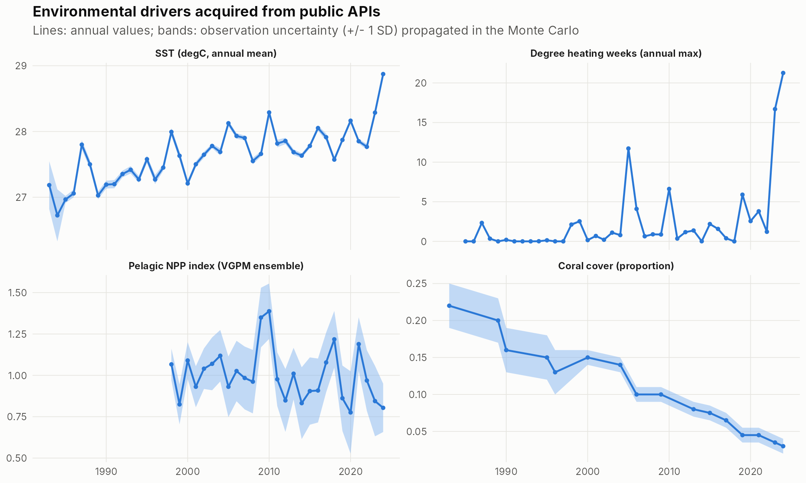{width=100%}


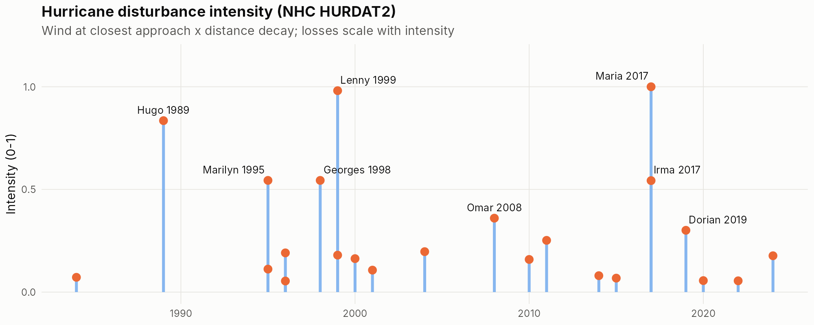{width=100%}


## Habitats

**Table. Habitat inputs (St. Croix; areas merged from API acquisition).**

| Habitat | Type | Area (km²) | Area CV | NPP as entered | NPP (t C km⁻² yr⁻¹) | NPP CV | Food-web fraction | TTE | No-take share |
| --- | --- | --- | --- | --- | --- | --- | --- | --- | --- |
| coral_reef | benthic | 41.7 | 0.150 | 1500 t C km2 yr | 1,500 | 0.500 | 0.350 | 0.150 | 0.250 |
| colonized_pavement | benthic | 192.0 | 0.150 | 181 mmol O2 m2 d | 792.8 | 0.400 | 0.350 | 0.150 | 0.150 |
| seagrass | benthic | 59.4 | 0.150 | 4.2 g DW m2 d | 521.2 | 0.500 | 0.350 | 0.150 | 0.100 |
| macroalgae | benthic | 13.1 | 0.250 | 582 mmol O2 m2 d | 2,549 | 0.500 | 0.250 | 0.150 | 0.150 |
| sand | benthic | 12.7 | 0.251 | 7 mmol O2 m2 d | 30.7 | 0.600 | 0.500 | 0.150 | 0.200 |
| mangrove | benthic | 1.333 | 0.200 | 400 mmol O2 m2 d | 1,752 | 0.300 | 0.200 | 0.150 | 0.000 |
| deep_hardbottom | benthic | 41.4 | 0.300 | 170.4 t C km2 yr | 170.4 | 0.672 | 0.350 | 0.150 | 0.100 |
| pelagic | pelagic | 1,500 | 0.200 | 85 g C m2 yr | 85.0 | 0.250 | 0.400 | 0.150 | 0.000 |


Sources and status by habitat:

| Habitat | Status | Source |
| --- | --- | --- |
| coral_reef | area from NCCOS API; NPP published range; closed_fraction PLACEHOLDER (approximate BIRNM + EEMP no-take share; replace with GIS overlay) | NPP: Caribbean reef net production 986-4108 t C (Adey & Steneck 1985 St. Croix); 1200-3000 for Indian Ocean reefs (Nair & Pillai 1972) |
| colonized_pavement | area from NCCOS API; NPP published; closed_fraction PLACEHOLDER (approximate BIRNM + EEMP no-take share; replace with GIS overlay) | Turf/macroalgae-dominated hardbottom; lagoon-wide Pn 181 +/- 28 mmol O2 m-2 d-1 (Naumann et al. 2013) |
| seagrass | area from NCCOS API; NPP published; closed_fraction PLACEHOLDER (approximate BIRNM + EEMP no-take share; replace with GIS overlay) | Thalassia production 4.2 g DW m-2 d-1, annual mean of 3.9-4.9 (Juman 2005a, Tobago; nutrient-enriched lagoon, so the high end of the CARICOMP range - ASSUMPTION that it applies to St. Croix; CV 0.5); CARICOMP <200->2000 g DW m-2 yr-1 (van Tussenbroek et al. 2014); annual NPP index from bottom light (OC-CCI Kd490; build_light_index.R; depth ASSUMPTION) |
| macroalgae | area from NCCOS API; NPP published; closed_fraction PLACEHOLDER (approximate BIRNM + EEMP no-take share; replace with GIS overlay) | Caribbean macroalgal beds Pn 582 mmol O2 m-2 d-1 (Wanders 1976 via Naumann et al. 2013); annual NPP index from bottom light (OC-CCI Kd490; build_light_index.R; depth ASSUMPTION) |
| sand | area from NCCOS API; NPP published; closed_fraction PLACEHOLDER (approximate BIRNM + EEMP no-take share; replace with GIS overlay) | Microphytobenthos Pn 7 +/- 4 mmol O2 m-2 d-1 (Naumann et al. 2013) |
| mangrove | area from NCCOS API; NPP published | Caribbean mangrove Pn 400 +/- 83 mmol O2 m-2 d-1 (Gattuso et al. 1998); food_web_fraction = litter export |
| deep_hardbottom | API: area from ETOPO 30-100 m; NPP light-limited from Kd490 + PAR; closed_fraction PLACEHOLDER (approximate BIRNM + EEMP no-take share; replace with GIS overlay) | Mesophotic hardbottom 30-100 m (incl. Lang Bank). NPP = colonized pavement NPP scaled by light at depth (Morel et al. 2007 KdPAR; tanh P-I curve) |
| pelagic | area PLACEHOLDER; NPP derived | Shelf + 10 km buffer; regional satellite NPP ensemble (SEDAR103-DW-20 App. A; Ryan-Keogh et al. 2023) ~70-100 g C m-2 yr-1 |


## Functional groups

**Table. FMP functional-group parameters (St. Croix).**

| Group | Complex | Guild | Tier | Trap | Harvest | P/B | M | x | B_MSY/K | Partition (t km⁻²) | Partition CV | Init. depletion | Refuge | Open rec. | Nursery |
| --- | --- | --- | --- | --- | --- | --- | --- | --- | --- | --- | --- | --- | --- | --- | --- |
| spiny_lobster | Spiny lobster | Invertivores | 1.000 | yes | yes | 1.000 | 0.340 | 0.323 | 0.315 | 3.270 | 0.500 | 0.500 | 0.500 | 0.800 | 0.300 |
| queen_conch | Queen conch | Herbivores | 2.000 |  | yes | 0.600 |  | 0.400 | 0.500 | 3.000 | 1.000 | 0.400 | 0.000 | 0.000 | 0.500 |
| parrotfish_1 | Parrotfish 1 (blue midnight rainbow) | Herbivores | 3.000 | yes | no | 0.360 | 0.339 | 0.180 | 0.346 | 18.0 | 0.500 | 0.800 | 0.500 | 0.000 | 0.400 |
| parrotfish_2 | Parrotfish 2 | Herbivores | 2.000 | yes | yes | 0.926 | 0.730 | 0.226 | 0.328 | 7.620 | 0.500 | 0.600 | 0.500 | 0.000 | 0.200 |
| surgeonfishes | Surgeonfish | Herbivores | 3.000 | yes | yes | 0.790 | 0.780 | 0.214 | 0.352 | 2.940 | 0.500 | 0.700 | 0.400 | 0.000 | 0.000 |
| queen_triggerfish | Triggerfish (queen triggerfish) | Invertivores | 1.000 | yes | yes | 0.442 | 0.325 | 0.189 | 0.352 | 0.219 | 0.500 | 0.600 | 0.300 | 0.000 | 0.000 |
| grunts | Grunts | Invertivores | 3.000 | yes | yes | 0.677 | 0.400 | 0.221 | 0.361 | 6.400 | 0.500 | 0.600 | 0.600 | 0.000 | 0.500 |
| snappers_shallow | Snapper 3 (lane gray mutton schoolmaster) | Mesopredators | 3.000 | yes | yes | 0.378 | 0.206 | 0.177 | 0.356 | 6.040 | 0.500 | 0.500 | 0.500 | 0.000 | 0.400 |
| yellowtail_snapper | Snapper 4 (yellowtail) | Mesopredators | 2.000 |  | yes | 0.414 | 0.268 | 0.255 | 0.349 | 6.040 | 0.500 | 0.600 | 0.300 | 0.000 | 0.300 |
| snappers_deep | Snapper 1 & 2 (deepwater) | Piscivores | 3.000 |  | yes | 0.402 | 0.374 | 0.269 | 0.342 | 2.000 | 1.000 | 0.500 | 0.100 | 0.000 | 0.000 |
| groupers_shallow | Groupers (red hind coney graysby) | Piscivores | 2.000 | yes | yes | 0.314 | 0.236 | 0.174 | 0.352 | 2.080 | 0.500 | 0.400 | 0.700 | 0.000 | 0.000 |
| squirrelfishes | Squirrelfish | Invertivores | 3.000 | yes | yes | 1.030 | 0.973 | 0.249 | 0.328 | 0.666 | 0.500 | 0.700 | 0.600 | 0.000 | 0.000 |
| goatfishes | Goatfish | Invertivores | 3.000 | yes | yes | 0.699 | 0.541 | 0.214 | 0.344 | 0.528 | 0.500 | 0.700 | 0.200 | 0.000 | 0.000 |
| boxfishes | Boxfish | Invertivores | 3.000 | yes | yes | 0.800 |  | 0.214 | 0.352 | 0.708 | 0.500 | 0.700 | 0.200 | 0.000 | 0.000 |
| angelfishes | Angelfish | Invertivores | 3.000 | yes | yes | 0.411 | 0.284 | 0.192 | 0.363 | 3.540 | 0.500 | 0.700 | 0.500 | 0.000 | 0.000 |
| wrasses_hogfish | Wrasses (hogfish) | Invertivores | 3.000 | yes | yes | 0.515 | 0.284 | 0.198 | 0.356 | 0.048 | 1.000 | 0.500 | 0.300 | 0.000 | 0.200 |
| jacks | Jacks | Piscivores | 3.000 |  | yes | 0.481 | 0.275 | 0.260 | 0.379 | 7.890 | 0.500 | 0.600 | 0.000 | 0.000 | 0.000 |
| porgies | Porgies | Invertivores | 3.000 | yes | yes | 0.527 | 0.334 | 0.203 | 0.356 | 0.061 | 1.000 | 0.700 | 0.100 | 0.000 | 0.000 |
| pelagics | Pelagics (dolphinfish wahoo) | Pelagic piscivores | 3.000 |  | yes | 0.841 | 0.438 | 0.309 | 0.290 | 0.300 | 1.000 | 0.700 | 0.000 | 0.000 | 0.000 |


Biomass densities (partition values) and P/B ratios were derived from the Opitz (1996) Virgin Islands Ecopath model:

* **Biomass.** For FMP fishes, the species biomasses in Opitz Table 3.6 were summed into FMP complexes and multiplied by 0.239. That factor is the ratio the balanced 50-box model (Table 3.22) applied to the raw survey biomass.
* **P/B.** The geometric mean of the Opitz P/B and the FishBase M estimate. Its CV is the larger of 0.25 and half the absolute log ratio, so disagreement between sources widens the prior.
* **Groups with no direct data.** Queen conch, pelagics, deepwater snappers, wrasses and porgies have partition CV 1.0.

Natural mortality, x and B_MSY/K come from the life-history analysis (Section 7). Nursery and open-recruitment parameters are placeholders (Section 6). The source and status of every group are listed below.

| Group | Status | Source |
| --- | --- | --- |
| spiny_lobster | derived: Opitz (1996) balanced model; nursery_dependence PLACEHOLDER; open_recruitment PLACEHOLDER magnitude; x_msy/M derived (life-history) | Opitz 1996 Table 3.22 Lobsters (B 3.27 g/m2, P/B 1.0); SEDAR 57 M ~0.34; x_msy, M: per-recruit life-history prior (data-raw/build_life_history_priors.R); open recruitment 0.8 (larval supply largely from upstream; Kough, Paris & Butler 2013); x blends per-recruit h=0.99 (open) and h=0.75 (local); nursery dependence expert-informed (Nagelkerken et al. 2002; Mumby et al. 2004; Adams et al. 2006) - PLACEHOLDER magnitude; bmsy_k = per-recruit B_MSY/B0 |
| queen_conch | PLACEHOLDER; prior re-centred by catch-feasibility check; wide prior (floor-density or no direct data); nursery_dependence PLACEHOLDER | Low x_msy reflects depensation/Allee effects; nursery dependence expert-informed (Nagelkerken et al. 2002; Mumby et al. 2004; Adams et al. 2006) - PLACEHOLDER magnitude |
| parrotfish_1 | derived: Opitz (1996) VI species biomass x mass-balance factor; nursery_dependence PLACEHOLDER; x_msy/M derived (life-history) | Opitz 1996 Table 3.6 (raw 75.31 g/m2) x 0.239 (Table 3.22 balance); P/B = geomean(Opitz 0.38, FishBase M_Then 0.34); x_msy, M: per-recruit life-history prior (data-raw/build_life_history_priors.R); nursery dependence expert-informed (Nagelkerken et al. 2002; Mumby et al. 2004; Adams et al. 2006) - PLACEHOLDER magnitude; bmsy_k = per-recruit B_MSY/B0 |
| parrotfish_2 | derived: Opitz (1996) VI species biomass x mass-balance factor; nursery_dependence PLACEHOLDER; x_msy/M derived (life-history) | Opitz 1996 Table 3.6 (raw 31.93 g/m2) x 0.239 (Table 3.22 balance); P/B = geomean(Opitz 1.05, FishBase M_Then 0.82); x_msy, M: per-recruit life-history prior (data-raw/build_life_history_priors.R); nursery dependence expert-informed (Nagelkerken et al. 2002; Mumby et al. 2004; Adams et al. 2006) - PLACEHOLDER magnitude; bmsy_k = per-recruit B_MSY/B0 |
| surgeonfishes | derived: Opitz (1996) VI species biomass x mass-balance factor; x_msy/M derived (life-history) | Opitz 1996 Table 3.6 (raw 12.30 g/m2) x 0.239 (Table 3.22 balance); P/B = geomean(Opitz 0.71, FishBase M_Then 0.88); x_msy, M: per-recruit life-history prior (data-raw/build_life_history_priors.R); bmsy_k = per-recruit B_MSY/B0 |
| queen_triggerfish | derived: Opitz (1996) VI species biomass x mass-balance factor; x_msy/M derived (life-history) | Opitz 1996 Table 3.6 (raw 0.92 g/m2) x 0.239 (Table 3.22 balance); P/B = geomean(Opitz 0.60, FishBase M_Then 0.33); x_msy, M: per-recruit life-history prior (data-raw/build_life_history_priors.R); bmsy_k = per-recruit B_MSY/B0 |
| grunts | derived: Opitz (1996) VI species biomass x mass-balance factor; nursery_dependence PLACEHOLDER; x_msy/M derived (life-history) | Opitz 1996 Table 3.6 (raw 26.80 g/m2) x 0.239 (Table 3.22 balance); P/B = geomean(Opitz 1.00, FishBase M_Then 0.46); x_msy, M: per-recruit life-history prior (data-raw/build_life_history_priors.R); nursery dependence expert-informed (Nagelkerken et al. 2002; Mumby et al. 2004; Adams et al. 2006) - PLACEHOLDER magnitude; bmsy_k = per-recruit B_MSY/B0 |
| snappers_shallow | derived: Opitz (1996) VI species biomass x mass-balance factor; nursery_dependence PLACEHOLDER; x_msy/M derived (life-history) | Opitz 1996 Table 3.6 (raw 25.32 g/m2) x 0.239 (Table 3.22 balance); P/B = geomean(Opitz 0.64, FishBase M_Then 0.22); x_msy, M: per-recruit life-history prior (data-raw/build_life_history_priors.R); nursery dependence expert-informed (Nagelkerken et al. 2002; Mumby et al. 2004; Adams et al. 2006) - PLACEHOLDER magnitude; bmsy_k = per-recruit B_MSY/B0 |
| yellowtail_snapper | derived: Opitz (1996) VI species biomass x mass-balance factor; nursery_dependence PLACEHOLDER; x_msy/M derived (life-history) | Opitz 1996 Table 3.6 (raw 25.33 g/m2) x 0.239 (Table 3.22 balance); P/B = geomean(Opitz 0.64, FishBase M_Then 0.27); x_msy, M: per-recruit life-history prior (data-raw/build_life_history_priors.R); nursery dependence expert-informed (Nagelkerken et al. 2002; Mumby et al. 2004; Adams et al. 2006) - PLACEHOLDER magnitude; bmsy_k = per-recruit B_MSY/B0 |
| snappers_deep | PLACEHOLDER; prior re-centred by catch-feasibility check; wide prior (floor-density or no direct data); x_msy/M derived (life-history) | Hook-and-line fishery; minor trap bycatch; P/B = geomean(Opitz 0.40, FishBase M_Then 0.40); x_msy, M: per-recruit life-history prior (data-raw/build_life_history_priors.R); bmsy_k = per-recruit B_MSY/B0 |
| groupers_shallow | derived: Opitz (1996) VI species biomass x mass-balance factor; x_msy/M derived (life-history) | Opitz 1996 Table 3.6 (raw 8.72 g/m2) x 0.239 (Table 3.22 balance); P/B = geomean(Opitz 0.46, FishBase M_Then 0.21); x_msy, M: per-recruit life-history prior (data-raw/build_life_history_priors.R); bmsy_k = per-recruit B_MSY/B0 |
| squirrelfishes | derived: Opitz (1996) VI species biomass x mass-balance factor; x_msy/M derived (life-history) | Opitz 1996 Table 3.6 (raw 2.79 g/m2) x 0.239 (Table 3.22 balance); P/B = geomean(Opitz 0.90, FishBase M_Then 1.19); x_msy, M: per-recruit life-history prior (data-raw/build_life_history_priors.R); bmsy_k = per-recruit B_MSY/B0 |
| goatfishes | derived: Opitz (1996) VI species biomass x mass-balance factor; x_msy/M derived (life-history) | Opitz 1996 Table 3.6 (raw 2.21 g/m2) x 0.239 (Table 3.22 balance); P/B = geomean(Opitz 1.00, FishBase M_Then 0.49); x_msy, M: per-recruit life-history prior (data-raw/build_life_history_priors.R); bmsy_k = per-recruit B_MSY/B0 |
| boxfishes | derived: Opitz (1996) VI species biomass x mass-balance factor; x_msy/bmsy_k ASSUMPTION (median of other groups) | Opitz 1996 Table 3.6 (raw 2.97 g/m2) x 0.239 (Table 3.22 balance); x_msy: median per-recruit prior of other groups (no FishBase growth data) |
| angelfishes | derived: Opitz (1996) VI species biomass x mass-balance factor; x_msy/M derived (life-history) | Opitz 1996 Table 3.6 (raw 14.85 g/m2) x 0.239 (Table 3.22 balance); P/B = geomean(Opitz 0.70, FishBase M_Then 0.24); x_msy, M: per-recruit life-history prior (data-raw/build_life_history_priors.R); bmsy_k = per-recruit B_MSY/B0 |
| wrasses_hogfish | derived: Opitz (1996) VI species biomass x mass-balance factor; wide prior (floor-density or no direct data); nursery_dependence PLACEHOLDER; x_msy/M derived (life-history) | Opitz 1996 Table 3.6 (raw 0.20 g/m2) x 0.239 (Table 3.22 balance); P/B = geomean(Opitz 0.80, FishBase M_Then 0.33); x_msy, M: per-recruit life-history prior (data-raw/build_life_history_priors.R); nursery dependence expert-informed (Nagelkerken et al. 2002; Mumby et al. 2004; Adams et al. 2006) - PLACEHOLDER magnitude; bmsy_k = per-recruit B_MSY/B0 |
| jacks | derived: Opitz (1996) VI species biomass x mass-balance factor; x_msy/M derived (life-history) | Opitz 1996 Table 3.6 (raw 33.05 g/m2) x 0.239 (Table 3.22 balance); P/B = geomean(Opitz 1.00, FishBase M_Then 0.23); x_msy, M: per-recruit life-history prior (data-raw/build_life_history_priors.R); bmsy_k = per-recruit B_MSY/B0 |
| porgies | derived: Opitz (1996) VI species biomass x mass-balance factor; wide prior (floor-density or no direct data); x_msy/M derived (life-history) | Opitz 1996 Table 3.6 (raw 0.26 g/m2) x 0.239 (Table 3.22 balance); P/B = geomean(Opitz 0.80, FishBase M_Then 0.35); x_msy, M: per-recruit life-history prior (data-raw/build_life_history_priors.R); bmsy_k = per-recruit B_MSY/B0 |
| pelagics | PLACEHOLDER; wide prior (floor-density or no direct data); x_msy/M derived (life-history) | Highly migratory; immigration term represents regional supply (Greater Caribbean model); P/B = geomean(Opitz 1.50, FishBase M_Then 0.47); x_msy, M: per-recruit life-history prior (data-raw/build_life_history_priors.R); bmsy_k = per-recruit B_MSY/B0 |
| zooplankton | derived: Opitz (1996) balanced model | Opitz 1996 Table 3.22 (biomass-weighted P/B of matched groups) |
| benthic_grazers | derived: Opitz (1996) balanced model | Opitz 1996 Table 3.22 (biomass-weighted P/B of matched groups) |
| benthic_detritivores_filter | derived: Opitz (1996) balanced model | Opitz 1996 Table 3.22 (biomass-weighted P/B of matched groups) |
| small_reef_fish | derived: Opitz (1996) balanced model | Opitz 1996 Table 3.22 (biomass-weighted P/B of matched groups) |
| small_pelagics | derived: Opitz (1996) balanced model | Opitz 1996 Table 3.22 (biomass-weighted P/B of matched groups) |
| other_reef_predators | derived: Opitz (1996) balanced model | Opitz 1996 Table 3.22 (biomass-weighted P/B of matched groups) |
| sharks_apex | derived: Opitz (1996) balanced model | Opitz 1996 Table 3.22 (biomass-weighted P/B of matched groups) |
| benthic_predatory_inverts | derived: Opitz (1996) balanced model | Opitz 1996 Table 3.22 (biomass-weighted P/B of matched groups) |
| other_invertivore_fishes | ASSUMPTION (no matched Opitz group; wide prior) | Pufferfishes, mojarras, small wrasses, flounders (non-FMP). B = 8 t/km2 and P/B = 1.2 are assumed values within the range of Opitz (1996) small invertivore fish groups; partition CV 0.5 |
| squids_pelagic_predators | derived: Opitz (1996) balanced model | Opitz 1996 Table 3.22 (biomass-weighted P/B of matched groups) |


**Table. Non-fishery competitor groups.**

| Group | Guild | P/B | Partition (t km⁻²) | Partition CV | Status |
| --- | --- | --- | --- | --- | --- |
| zooplankton | Non-fishery | 40.0 | 32.0 | 0.500 | derived: Opitz (1996) balanced model |
| benthic_grazers | Non-fishery | 1.260 | 209.0 | 0.500 | derived: Opitz (1996) balanced model |
| benthic_detritivores_filter | Non-fishery | 1.740 | 1,160 | 0.500 | derived: Opitz (1996) balanced model |
| small_reef_fish | Non-fishery | 2.020 | 12.0 | 0.500 | derived: Opitz (1996) balanced model |
| small_pelagics | Non-fishery | 3.200 | 14.6 | 0.500 | derived: Opitz (1996) balanced model |
| other_reef_predators | Non-fishery | 0.380 | 2.520 | 0.500 | derived: Opitz (1996) balanced model |
| sharks_apex | Non-fishery | 0.298 | 0.714 | 0.500 | derived: Opitz (1996) balanced model |
| benthic_predatory_inverts | Non-fishery | 1.390 | 62.4 | 0.500 | derived: Opitz (1996) balanced model |
| other_invertivore_fishes | Non-fishery | 1.200 | 8.000 | 0.500 | ASSUMPTION (no matched Opitz group; wide prior) |
| squids_pelagic_predators | Non-fishery | 1.300 | 1.500 | 0.500 | derived: Opitz (1996) balanced model |


## Diets and habitat preferences

**Table. Diet composition by trophic-level pool (B = benthic, P = pelagic pathway).**

| group | B_TL1 | B_TL2 | B_TL3 | B_TL4 | P_TL1 | P_TL2 | P_TL3 | P_TL4 |
| --- | --- | --- | --- | --- | --- | --- | --- | --- |
| spiny_lobster | 0.100 | 0.700 | 0.200 | 0.000 | 0.000 | 0.000 | 0.000 | 0.000 |
| queen_conch | 1.000 | 0.000 | 0.000 | 0.000 | 0.000 | 0.000 | 0.000 | 0.000 |
| parrotfish_1 | 1.000 | 0.000 | 0.000 | 0.000 | 0.000 | 0.000 | 0.000 | 0.000 |
| parrotfish_2 | 1.000 | 0.000 | 0.000 | 0.000 | 0.000 | 0.000 | 0.000 | 0.000 |
| surgeonfishes | 0.832 | 0.168 | 0.000 | 0.000 | 0.000 | 0.000 | 0.000 | 0.000 |
| queen_triggerfish | 0.000 | 0.281 | 0.619 | 0.100 | 0.000 | 0.000 | 0.000 | 0.000 |
| grunts | 0.000 | 0.494 | 0.367 | 0.038 | 0.000 | 0.062 | 0.038 | 0.000 |
| snappers_shallow | 0.000 | 0.137 | 0.391 | 0.272 | 0.000 | 0.000 | 0.091 | 0.109 |
| yellowtail_snapper | 0.000 | 0.094 | 0.247 | 0.159 | 0.000 | 0.141 | 0.253 | 0.106 |
| snappers_deep | 0.000 | 0.000 | 0.352 | 0.048 | 0.000 | 0.176 | 0.376 | 0.048 |
| groupers_shallow | 0.000 | 0.151 | 0.451 | 0.298 | 0.000 | 0.000 | 0.050 | 0.050 |
| squirrelfishes | 0.000 | 0.349 | 0.351 | 0.000 | 0.000 | 0.150 | 0.150 | 0.000 |
| goatfishes | 0.000 | 0.690 | 0.310 | 0.000 | 0.000 | 0.000 | 0.000 | 0.000 |
| boxfishes | 0.114 | 0.542 | 0.344 | 0.000 | 0.000 | 0.000 | 0.000 | 0.000 |
| angelfishes | 0.080 | 0.744 | 0.176 | 0.000 | 0.000 | 0.000 | 0.000 | 0.000 |
| wrasses_hogfish | 0.000 | 0.349 | 0.651 | 0.000 | 0.000 | 0.000 | 0.000 | 0.000 |
| jacks | 0.000 | 0.000 | 0.358 | 0.142 | 0.000 | 0.000 | 0.358 | 0.142 |
| porgies | 0.000 | 0.564 | 0.436 | 0.000 | 0.000 | 0.000 | 0.000 | 0.000 |
| pelagics | 0.000 | 0.000 | 0.000 | 0.000 | 0.000 | 0.000 | 0.600 | 0.400 |
| zooplankton | 0.100 | 0.000 | 0.000 | 0.000 | 0.900 | 0.000 | 0.000 | 0.000 |
| benthic_grazers | 1.000 | 0.000 | 0.000 | 0.000 | 0.000 | 0.000 | 0.000 | 0.000 |
| benthic_detritivores_filter | 0.700 | 0.000 | 0.000 | 0.000 | 0.300 | 0.000 | 0.000 | 0.000 |
| small_reef_fish | 0.300 | 0.400 | 0.000 | 0.000 | 0.000 | 0.300 | 0.000 | 0.000 |
| small_pelagics | 0.000 | 0.000 | 0.000 | 0.000 | 0.000 | 1.000 | 0.000 | 0.000 |
| other_reef_predators | 0.000 | 0.200 | 0.600 | 0.000 | 0.000 | 0.000 | 0.200 | 0.000 |
| sharks_apex | 0.000 | 0.000 | 0.300 | 0.300 | 0.000 | 0.000 | 0.200 | 0.200 |
| benthic_predatory_inverts | 0.200 | 0.600 | 0.200 | 0.000 | 0.000 | 0.000 | 0.000 | 0.000 |
| other_invertivore_fishes | 0.000 | 0.900 | 0.000 | 0.000 | 0.000 | 0.100 | 0.000 | 0.000 |
| squids_pelagic_predators | 0.000 | 0.000 | 0.000 | 0.000 | 0.000 | 0.500 | 0.500 | 0.000 |


**Table. Habitat preferences (expert judgement; CV 0.2).**

| group | coral_reef | colonized_pavement | seagrass | macroalgae | sand | mangrove | deep_hardbottom |
| --- | --- | --- | --- | --- | --- | --- | --- |
| spiny_lobster | 1.000 | 0.800 | 0.600 | 0.400 | 0.200 | 0.300 | 0.500 |
| queen_conch | 0.000 | 0.300 | 1.000 | 0.500 | 0.800 | 0.000 | 0.000 |
| parrotfish_1 | 1.000 | 0.700 | 0.300 | 0.300 | 0.000 | 0.500 | 0.200 |
| parrotfish_2 | 1.000 | 0.800 | 0.500 | 0.500 | 0.000 | 0.200 | 0.300 |
| surgeonfishes | 1.000 | 1.000 | 0.300 | 0.400 | 0.000 | 0.000 | 0.300 |
| queen_triggerfish | 0.800 | 1.000 | 0.500 | 0.300 | 0.600 | 0.000 | 0.600 |
| grunts | 1.000 | 0.600 | 1.000 | 0.300 | 0.700 | 0.600 | 0.200 |
| snappers_shallow | 1.000 | 0.700 | 0.600 | 0.300 | 0.400 | 0.700 | 0.300 |
| yellowtail_snapper | 1.000 | 0.800 | 0.500 | 0.300 | 0.200 | 0.200 | 0.600 |
| snappers_deep | 0.000 | 0.300 | 0.000 | 0.000 | 0.000 | 0.000 | 1.000 |
| groupers_shallow | 1.000 | 0.800 | 0.100 | 0.200 | 0.000 | 0.000 | 0.700 |
| squirrelfishes | 1.000 | 0.600 | 0.000 | 0.000 | 0.000 | 0.000 | 0.500 |
| goatfishes | 0.200 | 0.400 | 0.800 | 0.300 | 1.000 | 0.000 | 0.200 |
| boxfishes | 0.700 | 0.500 | 0.800 | 0.300 | 0.600 | 0.000 | 0.000 |
| angelfishes | 1.000 | 0.800 | 0.000 | 0.200 | 0.000 | 0.000 | 0.500 |
| wrasses_hogfish | 0.800 | 1.000 | 0.500 | 0.300 | 0.300 | 0.000 | 0.300 |
| jacks | 0.600 | 0.500 | 0.200 | 0.100 | 0.300 | 0.200 | 0.500 |
| porgies | 0.300 | 0.500 | 0.800 | 0.300 | 1.000 | 0.000 | 0.200 |
| pelagics | 0.000 | 0.000 | 0.000 | 0.000 | 0.000 | 0.000 | 0.000 |
| zooplankton | 1.000 | 1.000 | 1.000 | 1.000 | 1.000 | 1.000 | 1.000 |
| benthic_grazers | 1.000 | 1.000 | 1.000 | 1.000 | 0.500 | 0.500 | 0.600 |
| benthic_detritivores_filter | 0.600 | 0.800 | 1.000 | 0.800 | 1.000 | 1.000 | 0.800 |
| small_reef_fish | 1.000 | 0.800 | 0.500 | 0.500 | 0.200 | 0.500 | 0.600 |
| small_pelagics | 0.000 | 0.000 | 0.000 | 0.000 | 0.000 | 0.000 | 0.000 |
| other_reef_predators | 1.000 | 0.800 | 0.500 | 0.400 | 0.400 | 0.500 | 0.600 |
| sharks_apex | 0.800 | 0.600 | 0.400 | 0.200 | 0.300 | 0.300 | 0.800 |
| benthic_predatory_inverts | 1.000 | 1.000 | 1.000 | 0.800 | 0.800 | 0.800 | 0.800 |
| other_invertivore_fishes | 0.600 | 0.600 | 1.000 | 0.500 | 1.000 | 0.600 | 0.300 |
| squids_pelagic_predators | 0.000 | 0.000 | 0.000 | 0.000 | 0.000 | 0.000 | 0.000 |


## Environmental covariates and responses

**Table. Environmental covariates (summary).**

| Variable | Years | Mean | Min | Max | Units | Status |
| --- | --- | --- | --- | --- | --- | --- |
| chla | 1998–2024 | 0.146 | 0.109 | 0.213 | mg m-3 | API |
| coral_cover | 1983–2024 | 0.108 | 0.030 | 0.220 | proportion | PLACEHOLDER; approximate |
| dhw | 1985–2024 | 2.347 | 0.000 | 21.3 | degC-weeks | API |
| kd490 | 1998–2024 | 0.043 | 0.038 | 0.049 | m-1 | API |
| light_macroalgae | 1983–2024 | 1.000 | 0.960 | 1.038 | relative bottom light (1998-2024 mean = 1) | ASSUMPTION; derived |
| light_seagrass | 1983–2024 | 1.000 | 0.980 | 1.019 | relative bottom light (1998-2024 mean = 1) | ASSUMPTION; derived |
| lionfish | 1983–2024 | 0.345 | 0.000 | 1.000 | relative invasion stage (0 = absent, 1 = established) | PLACEHOLDER (timeline from first USVI records 2008-2009; Schofield 2010) |
| npp_pelagic_index | 1998–2024 | 1.000 | 0.776 | 1.388 | relative | API (computed) |
| npp_pelagic_index_abs | 1998–2024 | 207.2 | 161.6 | 290.8 | g C m-2 yr-1 | API (computed) |
| npp_pelagic_index_ssp245 | 1998–2045 | 1.003 | 0.776 | 1.388 |  | API; API (CMIP6) |
| npp_pelagic_index_ssp585 | 1998–2045 | 1.018 | 0.776 | 1.388 |  | API; API (CMIP6) |
| sargassum | 1983–2024 | 0.274 | 0.000 | 1.938 | relative (fraction of AFAI-positive pixels / product-period mean) | literature: no basin-scale blooms before 2011; PLACEHOLDER; API |
| sst | 1983–2024 | 27.6 | 26.7 | 28.9 | degC | API |
| sst_ssp245 | 1983–2045 | 27.9 | 26.7 | 28.9 |  | API; API (CMIP6) |
| sst_ssp585 | 1983–2045 | 28.0 | 26.7 | 28.9 |  | API; API (CMIP6) |


**Table. Environmental responses.**

| Group | Variable | Type | Target | Sensitivity | Sens. CV | T_opt | T width | Status |
| --- | --- | --- | --- | --- | --- | --- | --- | --- |
| pelagics | npp_pelagic_index | loglinear | K | 0.500 | 0.500 |  |  | PLACEHOLDER |
| angelfishes | sst | thermal_performance | production |  | 0.000 | 27.0 | 2.040 | derived: FishBase/AquaMaps temperature preference |
| boxfishes | sst | thermal_performance | production |  | 0.000 | 25.7 | 2.530 | derived: FishBase/AquaMaps temperature preference |
| goatfishes | sst | thermal_performance | production |  | 0.000 | 26.6 | 2.370 | derived: FishBase/AquaMaps temperature preference |
| groupers_shallow | sst | thermal_performance | production |  | 0.000 | 27.0 | 1.760 | derived: FishBase/AquaMaps temperature preference |
| grunts | sst | thermal_performance | production |  | 0.000 | 26.9 | 1.550 | derived: FishBase/AquaMaps temperature preference |
| jacks | sst | thermal_performance | production |  | 0.000 | 26.8 | 2.440 | derived: FishBase/AquaMaps temperature preference |
| parrotfish_1 | sst | thermal_performance | production |  | 0.000 | 27.3 | 2.200 | derived: FishBase/AquaMaps temperature preference |
| parrotfish_2 | sst | thermal_performance | production |  | 0.000 | 27.4 | 1.030 | derived: FishBase/AquaMaps temperature preference |
| pelagics | sst | thermal_performance | production |  | 0.000 | 26.1 | 5.100 | derived: FishBase/AquaMaps temperature preference |
| porgies | sst | thermal_performance | production |  | 0.000 | 26.4 | 2.470 | derived: FishBase/AquaMaps temperature preference |
| queen_triggerfish | sst | thermal_performance | production |  | 0.000 | 25.9 | 2.750 | derived: FishBase/AquaMaps temperature preference |
| snappers_shallow | sst | thermal_performance | production |  | 0.000 | 25.9 | 2.720 | derived: FishBase/AquaMaps temperature preference |
| squirrelfishes | sst | thermal_performance | production |  | 0.000 | 27.3 | 2.110 | derived: FishBase/AquaMaps temperature preference |
| surgeonfishes | sst | thermal_performance | production |  | 0.000 | 27.2 | 1.960 | derived: FishBase/AquaMaps temperature preference |
| wrasses_hogfish | sst | thermal_performance | production |  | 0.000 | 26.8 | 2.160 | derived: FishBase/AquaMaps temperature preference |
| yellowtail_snapper | sst | thermal_performance | production |  | 0.000 | 25.9 | 3.100 | derived: FishBase/AquaMaps temperature preference |
| squirrelfishes | lionfish | loglinear | K | -0.100 | 1.000 |  |  | PLACEHOLDER magnitude |
| goatfishes | lionfish | loglinear | K | -0.100 | 1.000 |  |  | PLACEHOLDER magnitude |
| wrasses_hogfish | lionfish | loglinear | K | -0.100 | 1.000 |  |  | PLACEHOLDER magnitude |
| grunts | lionfish | loglinear | K | -0.100 | 1.000 |  |  | PLACEHOLDER magnitude |
| parrotfish_2 | lionfish | loglinear | K | -0.100 | 1.000 |  |  | PLACEHOLDER magnitude |
| angelfishes | lionfish | loglinear | K | -0.100 | 1.000 |  |  | PLACEHOLDER magnitude |
| groupers_shallow | lionfish | loglinear | K | -0.050 | 1.000 |  |  | PLACEHOLDER magnitude |
| snappers_shallow | lionfish | loglinear | K | -0.050 | 1.000 |  |  | PLACEHOLDER magnitude |
| grunts | sargassum | loglinear | K | -0.030 | 1.000 |  |  | PLACEHOLDER magnitude |
| snappers_shallow | sargassum | loglinear | K | -0.030 | 1.000 |  |  | PLACEHOLDER magnitude |
| queen_conch | sargassum | loglinear | K | -0.030 | 1.000 |  |  | PLACEHOLDER magnitude |
| parrotfish_1 | sargassum | loglinear | K | -0.030 | 1.000 |  |  | PLACEHOLDER magnitude |
| spiny_lobster | sargassum | loglinear | K | -0.030 | 1.000 |  |  | PLACEHOLDER magnitude |
| pelagics | sargassum | loglinear | K | 0.030 | 1.000 |  |  | PLACEHOLDER magnitude |
| spiny_lobster | sst | thermal_performance | production |  | 0.000 | 26.7 | 2.150 | derived: SeaLifeBase/AquaMaps temperature preference |
| queen_conch | sst | thermal_performance | production |  | 0.000 | 27.0 | 1.350 | derived: SeaLifeBase/AquaMaps temperature preference |


## Fishery data

**Landings and effort** by year, gear and complex for 1983–2024 are **placeholders**. They were built to match recent ACL-era magnitudes, with plausible historical trends and gear splits. Two published values are used directly:

* the 2021 queen conch landings (30,535 lb);
* the expansion factor magnitude, informed by Puerto Rico (≈2.0; SEDAR103-DW-20).

Replacing these with the SEFSC Caribbean Commercial Landings trip-ticket data is the highest-priority data need (Section 13).

**Table. Mean annual landings 2022–2024 by group and gear (lb; PLACEHOLDER except where stated).**

| group | gear | landings_lb |
| --- | --- | --- |
| angelfishes | dive | 425.0 |
| angelfishes | trap_fish | 3,332 |
| boxfishes | trap_fish | 5,706 |
| boxfishes | trap_lobster | 674.0 |
| goatfishes | dive | 987.0 |
| goatfishes | trap_fish | 4,156 |
| groupers_shallow | dive | 3,003 |
| groupers_shallow | hook_line | 3,952 |
| groupers_shallow | trap_fish | 6,652 |
| grunts | dive | 1,999 |
| grunts | hook_line | 3,777 |
| grunts | trap_fish | 13,662 |
| jacks | dive | 2,188 |
| jacks | hook_line | 12,079 |
| jacks | trap_fish | 4,279 |
| parrotfish_1 | trap_fish | 0.000 |
| parrotfish_2 | dive | 29,453 |
| parrotfish_2 | trap_fish | 35,971 |
| pelagics | hook_line | 84,975 |
| porgies | hook_line | 984.0 |
| porgies | trap_fish | 2,087 |
| queen_conch | dive | 28,024 |
| queen_triggerfish | dive | 1,520 |
| queen_triggerfish | hook_line | 754.0 |
| queen_triggerfish | trap_fish | 11,253 |
| queen_triggerfish | trap_lobster | 830.0 |
| snappers_deep | hook_line | 44,981 |
| snappers_shallow | dive | 2,981 |
| snappers_shallow | hook_line | 4,946 |
| snappers_shallow | trap_fish | 4,807 |
| spiny_lobster | dive | 58,448 |
| spiny_lobster | trap_fish | 16,752 |
| spiny_lobster | trap_lobster | 32,481 |
| squirrelfishes | hook_line | 2,670 |
| squirrelfishes | trap_fish | 5,859 |
| surgeonfishes | dive | 9,686 |
| surgeonfishes | trap_fish | 14,617 |
| wrasses_hogfish | dive | 4,316 |
| wrasses_hogfish | trap_fish | 2,051 |
| yellowtail_snapper | dive | 2,140 |
| yellowtail_snapper | hook_line | 29,141 |
| yellowtail_snapper | trap_fish | 7,530 |


**Abundance indices.** The SEDAR 57 lobster trap CPUE, SEDAR 80 queen triggerfish trap CPUE and NCRMP parrotfish density series are placeholders. They are all assigned role = validate (held out), so the calibration uses only real information.

**Table. Abundance indices (all held out for validation).**

| index | group | role | data_status | year |
| --- | --- | --- | --- | --- |
| NCRMP_parrotfish_density | parrotfish_1;parrotfish_2 | validate | PLACEHOLDER | 2013–2023 |
| SEDAR80_QT_trap_CPUE | queen_triggerfish | validate | PLACEHOLDER | 1985–2019 |
| SEDAR57_lobster_trap_CPUE | spiny_lobster | validate | PLACEHOLDER | 2012–2021 |


**Management benchmarks.**

**Table. Management benchmarks.**

| group | metric | value_lb | use_in_sir | sir_cv | year | data_status | reference |
| --- | --- | --- | --- | --- | --- | --- | --- |
| spiny_lobster | OFL | 163,823 | TRUE | 0.400 | 2,024 | published | SEDAR 57 Update; Federal Register 2024-09227 (St. Croix FMP) |
| spiny_lobster | ABC | 144,478 | FALSE |  | 2,024 | published | SEDAR 57 Update; Federal Register 2024-09227 |
| spiny_lobster | ACL | 137,254 | FALSE |  | 2,024 | published | Framework action (2024-2026) St. Croix spiny lobster ACL |
| queen_triggerfish | OFL | 22,773 | TRUE | 0.400 | 2,025 | published | SEDAR 80; CFMC SSC April 2024 meeting summary |
| queen_triggerfish | ABC | 18,808 | FALSE |  | 2,025 | published | SEDAR 80; CFMC SSC April 2024 (Tier 3b) |
| queen_triggerfish | ACL | 18,808 | FALSE |  | 2,026 | published | Framework Action 3 final rule (Federal Register 2026-05251) |
| parrotfish_2 | ACL | 72,365 | FALSE |  | 2,022 | published | St. Croix FMP final rule (Federal Register 2022-19409) |
| snappers_shallow | ACL | 14,156 | FALSE |  | 2,022 | published | St. Croix FMP final rule (Snapper 3) |
| snappers_deep | ACL | 69,366 | FALSE |  | 2,022 | published | St. Croix FMP: Snapper 1 (61455) + Snapper 2 (7911) |
| queen_conch | ACL | 50,000 | FALSE |  | 2,021 | published | NOAA ACL monitoring page (St. Croix FMP) |
| pelagics | ACL | 86,633 | FALSE |  | 2,021 | published | NOAA ACL monitoring page (dolphinfish only) |


## Disturbances and scenarios

**Table. Hurricanes affecting St. Croix (NHC HURDAT2, 1983–2024).**

| year | event | intensity | intensity_cv | notes |
| --- | --- | --- | --- | --- |
| 1,996 | Hurricane Bertha (AL021996) | 0.191 | 0.300 | closest approach 94 km; max wind 75 kt |
| 2,001 | Hurricane Dean (AL052001) | 0.107 | 0.300 | closest approach 45 km; max wind 45 kt |
| 2,015 | Hurricane Erika (AL052015) | 0.068 | 0.300 | closest approach 77 km; max wind 45 kt |
| 2,019 | Hurricane Dorian (AL052019) | 0.301 | 0.300 | closest approach 11 km; max wind 65 kt |
| 2,024 | Hurricane Ernesto (AL052024) | 0.177 | 0.300 | closest approach 58 km; max wind 55 kt |
| 1,998 | Hurricane Georges (AL071998) | 0.544 | 0.300 | closest approach 32 km; max wind 90 kt |
| 2,000 | Hurricane Debby (AL072000) | 0.163 | 0.300 | closest approach 87 km; max wind 65 kt |
| 2,010 | Hurricane Earl (AL072010) | 0.159 | 0.300 | closest approach 146 km; max wind 115 kt |
| 2,022 | Hurricane Fiona (AL072022) | 0.055 | 0.300 | closest approach 129 km; max wind 55 kt |
| 1,996 | Hurricane Hortense (AL081996) | 0.054 | 0.300 | closest approach 162 km; max wind 70 kt |
| 2,014 | Hurricane Gonzalo (AL082014) | 0.080 | 0.300 | closest approach 165 km; max wind 90 kt |
| 2,011 | Hurricane Irene (AL092011) | 0.252 | 0.300 | closest approach 11 km; max wind 60 kt |
| 1,989 | Hurricane Hugo (AL111989) | 0.835 | 0.300 | closest approach 13 km; max wind 120 kt |
| 2,004 | Hurricane Jeanne (AL112004) | 0.197 | 0.300 | closest approach 65 km; max wind 60 kt |
| 2,017 | Hurricane Irma (AL112017) | 0.543 | 0.300 | closest approach 87 km; max wind 155 kt |
| 1,995 | Hurricane Luis (AL131995) | 0.112 | 0.300 | closest approach 171 km; max wind 120 kt |
| 2,020 | Hurricane Laura (AL132020) | 0.056 | 0.300 | closest approach 52 km; max wind 40 kt |
| 1,999 | Hurricane Jose (AL141999) | 0.180 | 0.300 | closest approach 70 km; max wind 60 kt |
| 1,995 | Hurricane Marilyn (AL151995) | 0.544 | 0.300 | closest approach 14 km; max wind 90 kt |
| 2,008 | Hurricane Omar (AL152008) | 0.360 | 0.300 | closest approach 97 km; max wind 115 kt |
| 2,017 | Hurricane Maria (AL152017) | 1.000 | 0.300 | closest approach 47 km; max wind 150 kt |
| 1,999 | Hurricane Lenny (AL161999) | 0.981 | 0.300 | closest approach 43 km; max wind 135 kt |
| 1,984 | Hurricane Klaus (AL181984) | 0.072 | 0.300 | closest approach 96 km; max wind 50 kt |
| 1,996 | Hurricane Bertha (AL021996) (other gears) | 0.191 | 0.300 | closest approach 94 km; max wind 75 kt |
| 2,001 | Hurricane Dean (AL052001) (other gears) | 0.107 | 0.300 | closest approach 45 km; max wind 45 kt |
| 2,015 | Hurricane Erika (AL052015) (other gears) | 0.068 | 0.300 | closest approach 77 km; max wind 45 kt |
| 2,019 | Hurricane Dorian (AL052019) (other gears) | 0.301 | 0.300 | closest approach 11 km; max wind 65 kt |
| 2,024 | Hurricane Ernesto (AL052024) (other gears) | 0.177 | 0.300 | closest approach 58 km; max wind 55 kt |
| 1,998 | Hurricane Georges (AL071998) (other gears) | 0.544 | 0.300 | closest approach 32 km; max wind 90 kt |
| 2,000 | Hurricane Debby (AL072000) (other gears) | 0.163 | 0.300 | closest approach 87 km; max wind 65 kt |
| 2,010 | Hurricane Earl (AL072010) (other gears) | 0.159 | 0.300 | closest approach 146 km; max wind 115 kt |
| 2,022 | Hurricane Fiona (AL072022) (other gears) | 0.055 | 0.300 | closest approach 129 km; max wind 55 kt |
| 1,996 | Hurricane Hortense (AL081996) (other gears) | 0.054 | 0.300 | closest approach 162 km; max wind 70 kt |
| 2,014 | Hurricane Gonzalo (AL082014) (other gears) | 0.080 | 0.300 | closest approach 165 km; max wind 90 kt |
| 2,011 | Hurricane Irene (AL092011) (other gears) | 0.252 | 0.300 | closest approach 11 km; max wind 60 kt |
| 1,989 | Hurricane Hugo (AL111989) (other gears) | 0.835 | 0.300 | closest approach 13 km; max wind 120 kt |
| 2,004 | Hurricane Jeanne (AL112004) (other gears) | 0.197 | 0.300 | closest approach 65 km; max wind 60 kt |
| 2,017 | Hurricane Irma (AL112017) (other gears) | 0.543 | 0.300 | closest approach 87 km; max wind 155 kt |
| 1,995 | Hurricane Luis (AL131995) (other gears) | 0.112 | 0.300 | closest approach 171 km; max wind 120 kt |
| 2,020 | Hurricane Laura (AL132020) (other gears) | 0.056 | 0.300 | closest approach 52 km; max wind 40 kt |
| 1,999 | Hurricane Jose (AL141999) (other gears) | 0.180 | 0.300 | closest approach 70 km; max wind 60 kt |
| 1,995 | Hurricane Marilyn (AL151995) (other gears) | 0.544 | 0.300 | closest approach 14 km; max wind 90 kt |
| 2,008 | Hurricane Omar (AL152008) (other gears) | 0.360 | 0.300 | closest approach 97 km; max wind 115 kt |
| 2,017 | Hurricane Maria (AL152017) (other gears) | 1.000 | 0.300 | closest approach 47 km; max wind 150 kt |
| 1,999 | Hurricane Lenny (AL161999) (other gears) | 0.981 | 0.300 | closest approach 43 km; max wind 135 kt |
| 1,984 | Hurricane Klaus (AL181984) (other gears) | 0.072 | 0.300 | closest approach 96 km; max wind 50 kt |


**Table. Disturbance templates (hurricanes).**

| year | event | intensity | habitat | p1_loss | quality_loss | half_life_yr | gear | effort_loss | effort_half_life_yr | group | production_loss |
| --- | --- | --- | --- | --- | --- | --- | --- | --- | --- | --- | --- |
|  | major_hurricane | 1.000 | coral_reef;colonized_pavement;seagrass;macroalgae;mangrove | 0.250 | 0.150 | 2.000 | trap_fish;trap_lobster | 0.600 | 1.500 | spiny_lobster | 0.200 |
|  | major_hurricane_other_gears | 1.000 | none | 0.000 | 0.000 | 1.000 | dive;hook_line | 0.300 | 1.000 |  | 0.000 |


**Table. Scenario definitions.**

| scenario | driver | target | start_year | end_year | value | notes |
| --- | --- | --- | --- | --- | --- | --- |
| Climate_SSP245 | cov_from | sst=sst_ssp245 | 2,025 | 2,045 |  | CMIP6 (CESM2 + ACCESS-ESM1-5) SST delta projection |
| Climate_SSP245 | cov_from | npp_pelagic_index=npp_pelagic_index_ssp245 | 2,025 | 2,045 |  | CMIP6 integrated NPP delta projection |
| Climate_SSP245 | cov_set | dhw | 2,032 | 2,032 | 10.0 | Bleaching year (PLACEHOLDER frequency/magnitude) |
| Climate_SSP245 | cov_set | dhw | 2,041 | 2,041 | 10.0 | Bleaching year (PLACEHOLDER) |
| Climate_SSP585 | cov_from | sst=sst_ssp585 | 2,025 | 2,045 |  | CMIP6 SST delta projection |
| Climate_SSP585 | cov_from | npp_pelagic_index=npp_pelagic_index_ssp585 | 2,025 | 2,045 |  | CMIP6 integrated NPP delta projection |
| Climate_SSP585 | cov_set | dhw | 2,028 | 2,028 | 12.0 | Bleaching year (PLACEHOLDER frequency/magnitude) |
| Climate_SSP585 | cov_set | dhw | 2,033 | 2,033 | 14.0 | Bleaching year (PLACEHOLDER) |
| Climate_SSP585 | cov_set | dhw | 2,038 | 2,038 | 14.0 | Bleaching year (PLACEHOLDER) |
| Climate_SSP585 | cov_set | dhw | 2,043 | 2,043 | 16.0 | Bleaching year (PLACEHOLDER) |
| Major_hurricane_2030 | disturbance | major_hurricane | 2,030 | 2,030 | 1.000 | Hurricane template from disturbances.csv (PLACEHOLDER loss magnitudes) |
| Major_hurricane_2030 | disturbance | major_hurricane_other_gears | 2,030 | 2,030 | 1.000 | Hurricane template from disturbances.csv (PLACEHOLDER loss magnitudes) |
| Trap_effort_plus30 | effort_mult | trap_fish;trap_lobster | 2,025 | 2,045 | 1.300 | Unmanaged trap effort surge |
| Trap_reduction_minus25 | effort_mult | trap_fish;trap_lobster | 2,025 | 2,045 | 0.750 | Trap reduction program (cf. St. Thomas) |
| Coral_disease_SCTLD | coral_disease | coral_reef | 2,025 | 2,032 | 0.080 | Continued SCTLD-driven coral loss (PLACEHOLDER rate) |
| Combined_stress | cov_from | sst=sst_ssp585 | 2,025 | 2,045 |  | CMIP6 SSP5-8.5 delta projection (API) |
| Combined_stress | cov_from | npp_pelagic_index=npp_pelagic_index_ssp585 | 2,025 | 2,045 |  | CMIP6 SSP5-8.5 delta projection (API) |
| Combined_stress | cov_set | dhw | 2,030 | 2,030 | 12.0 | Bleaching year (PLACEHOLDER magnitude) |
| Combined_stress | disturbance | major_hurricane | 2,033 | 2,033 | 1.000 | Hurricane template from disturbances.csv (PLACEHOLDER loss magnitudes) |
| Combined_stress | disturbance | major_hurricane_other_gears | 2,033 | 2,033 | 1.000 | Hurricane template from disturbances.csv (PLACEHOLDER loss magnitudes) |
| Combined_stress | effort_mult | trap_fish;trap_lobster | 2,025 | 2,045 | 1.300 | Trap effort x1.3 (hypothetical) |
| MPA_expansion | closed_fraction | coral_reef | 2,026 | 2,045 | 0.400 | No-take reef area raised to 40% (from 25%) |
| MPA_expansion | closed_fraction | colonized_pavement | 2,026 | 2,045 | 0.300 | No-take pavement raised to 30% (from 15%) |
| Open_access_effort | effort_response | all | 2,025 | 2,045 | 0.500 | Effort follows catch rate (elasticity 0.5; Smith 1969 open-access dynamics) |
| Parrotfish_harvest_plus50 | effort_mult | dive | 2,025 | 2,045 | 1.500 | Dive effort (main parrotfish gear) +50%: tests herbivory-coral feedback |
| Seagrass_loss_Halophila | area_trend | seagrass | 2,025 | 2,045 | -0.020 | Native seagrass loss 2%/yr (invasive Halophila stipulacea displacement; PLACEHOLDER rate) |


## Settings

**Table. Model settings (St. Croix).**

| key | value | notes |
| --- | --- | --- |
| project_name | St. Croix trap fishery case study | Shown in outputs |
| hist_start | 1983 | First historical year: start of the commercial landings series used in SEDAR 80 (1983-2019); public satellite SST from 1981 (Pathfinder) / 1985 (CRW) |
| hist_end | 2024 | Last historical year; reference points use the final ref_years |
| proj_end | 2045 | Final projection year (effort-driven) |
| ref_years | 3 | Years averaged for reference points (2022-2024) |
| substeps | 12 | Monthly Euler steps for biomass dynamics |
| c_to_ww | 9 | g wet weight per g C (Pauly & Christensen 1995) |
| c_to_ww_cv | 0.1 | ASSUMPTION: 10% uncertainty on the C:WW conversion |
| n_draws | 12000 | Monte Carlo draws per sampling round (prior + adaptive rounds) |
| seed | 103 | Random seed (SEDAR 103) |
| diet_concentration | 40 | Dirichlet concentration for diet uncertainty |
| catch_expansion | 1.5 | Reported-to-total landings expansion (PR logbook expansion ~2.0; USVI unquantified - SEDAR103-DW-20) |
| catch_expansion_cv | 0.25 | ASSUMPTION: +/-25% on the unquantified USVI expansion factor |
| fishing_feedback | TRUE | Remove previous-year catch from TL pools |
| pstar | 0.40 | Percentile of MMSY used as management target (SEDAR103-DW-20 example) |
| gear_alloc_method | catch_share | catch_share or slide |
| q_years | 3 | Years used to estimate projection catchability |
| coral_growth | 0.10 | Coral cover intrinsic growth (yr-1) |
| coral_max_cover | 0.30 | Coral cover carrying capacity (proportion) |
| bleach_dhw_threshold | 4 | DHW (degC-weeks) where bleaching mortality starts |
| bleach_mort_per_dhw | 0.03 | Proportional coral loss per DHW above threshold |
| bleach_mort_cv | 0.3 | ASSUMPTION: 30% uncertainty on bleaching mortality per DHW |
| dhw_variable | dhw | Covariate name holding annual max DHW |
| sir_resample | 2000 | Number of SIR resamples (0 = off) |
| index_min_cv | 0.2 | Minimum CV applied to index observations |
| sir_catch_feasibility | TRUE | Stock-reduction-analysis penalty when simulated stock cannot support observed landings |
| catch_feasibility_cv | 0.25 | Tolerance of the catch-feasibility penalty (self-reported landings with ~20% error) |
| bbmsy_overfished | 0.5 | B/BMSY threshold for Overfished status (MSST proxy) |
| domain_lon_min | -65.0 | St. Croix shelf bounding box (data acquisition) |
| domain_lon_max | -64.4 | St. Croix shelf bounding box (east) |
| domain_lat_min | 17.6 | St. Croix shelf bounding box (south) |
| domain_lat_max | 17.95 | St. Croix shelf bounding box (north) |
| use_acquired | TRUE | Merge API-acquired data in data/acquired/ (user values take precedence) |
| landings_cv | 0.2 | Observation CV of each landings record (self-reported trip tickets) |
| effort_cv | 0.1 | Observation CV of each effort record |
| pref_cv | 0.2 | CV on habitat preferences |
| coral_growth_cv | 0.3 | ASSUMPTION: 30% uncertainty on intrinsic coral growth |
| disturbance_loss_cv | 0.5 | Uncertainty (CV) of a common multiplier on hurricane loss magnitudes (placeholder losses) |
| holdout_from_year |  | Set (e.g. 2015) to hold later index observations out of calibration; validation designs are also evaluated by re-weighting |
| ryther_low | 1 | Practical not-to-exceed Ryther index ~1 t/km2/yr (range 0.3-1.1; Link & Watson 2019) |
| ryther_high | 3 | Extreme Ryther threshold (3 t/km2/yr; Link & Watson 2019) |
| fogarty_low | 0.22 | Fogarty ratio thresholds (per mil; Link & Watson 2019) |
| fogarty_high | 0.92 | Upper Fogarty threshold (0.92 per mil; Link & Watson 2019) |
| sir_adaptive_rounds | 4 | Adaptive importance-sampling rounds (proposal refit on partition priors; exact mixture correction) |
| sir_feasibility_groups | trap | Calibration focuses on the trap fishery: only trap-relevant groups (and assessed stocks) constrain the posterior |
| cores | 4 | Parallel cores for Stage-1 draws |
| effort_creep | 0.02 | Annual catchability creep applied to fishery-dependent CPUE indices (~2%/yr; Palomares & Pauly 2019) |
| effort_response | 0 | Elasticity of projected effort to catch rate; 0 = scenario-driven effort (see Open_access_effort scenario) |
| ghost_efficiency | 0.2 | PLACEHOLDER: lost-trap catch rate relative to active traps (derelict traps in USVI kept fishing: Renchen et al. 2010; Clark et al. 2012; Arthur et al. 2014) |
| ghost_efficiency_cv | 0.5 | ASSUMPTION: wide (50%) uncertainty on ghost-trap efficiency |
| ghost_half_life | 1.5 | ASSUMPTION: years for half of lost traps to stop fishing (trap degradation; replace with USVI decay data) |
| ghost_gears | trap_fish;trap_lobster | Gears whose lost traps keep fishing |
| herbivore_groups | parrotfish_1;parrotfish_2;surgeonfishes | Grazers controlling coral recovery (Mumby et al. 2006) |
| herbivory_elasticity | 1 | Coral growth x (grazing/reference)^gamma in projections (PLACEHOLDER magnitude) |
| herbivory_elasticity_cv | 0.5 | ASSUMPTION: wide (50%) uncertainty on herbivory elasticity |
| psis | TRUE | Pareto-smoothed importance weights |
| ghost_background_loss | 0.10 | Annual trap loss outside storms ~10% (about 650 of 6,500 traps per year in St. Thomas/St. John; Clark et al. 2012) |


# Uncertainty, calibration, validation and robustness

## Monte Carlo propagation of input and observation uncertainty

Each Monte Carlo draw samples one complete parameter set. The sampled quantities are:

* **Habitats.** Area (lognormal, by CV), NPP (lognormal), food-web fraction and TTE (beta), and the carbon-to-wet-weight conversion.
* **Groups.** P/B, natural mortality, x, partition values, initial depletion and immigration (lognormal or beta), and open-recruitment fraction (beta).
* **Diets.** A Dirichlet draw (concentration 40).
* **Habitat preferences.** Each element is perturbed with a lognormal error (CV 0.2).
* **Environmental responses.** Sensitivities are sampled by their CVs: lionfish, *Sargassum* and the other coefficients.
* **Coral.** Bleaching mortality per DHW, coral growth and herbivory elasticity.
* **Ghost fishing.** Ghost-trap efficiency.
* **Observation errors.** Each covariate value is perturbed by its acquired standard deviation (spatial SD, between-model SD or between-algorithm spread). Each landings record and each effort record gets its own lognormal error (CV 0.2 and 0.1). The catch expansion factor is sampled (CV 0.25), and so is each hurricane's intensity (CV 0.3), plus a common multiplier on all disturbance-loss magnitudes (CV 0.5).
* **Process error.** A seed for annual process deviations.

Drivers are rebuilt for every draw, so the observation errors propagate. The draws use reproducible per-draw random-number streams (L'Ecuyer-CMRG), so results do not depend on the number of processor cores.

## Calibration by importance sampling

### Likelihood components

Draws are weighted by the likelihood of the data that inform the calibration.

1. **Assessment benchmarks.** The model's 2022–2024 MMSY for spiny lobster and for queen triggerfish is compared with each assessment OFL under lognormal error with CV 0.4. An OFL is the catch at F_MSY given current biomass. It equals MSY only near B_MSY, so treating it as an observation of MMSY is an explicit assumption (Appendix B, C1). The CV absorbs the mismatch, and the leave-one-benchmark-out test quantifies its consequences.
2. **Catch feasibility.** This is stock-reduction-analysis logic (Kimura & Tagart 1982; Walters et al. 2006; Martell & Froese 2013). For each focus group, the largest annual shortfall between expanded landings and the catch the simulated stock could supply is penalized as 0.5·(log(1 − shortfall)/0.25)². This bounds productivity from below: a draw whose stock collapses under the observed landings is implausible.
3. **Indices** (when real series are available). These are fitted with the observation model $I_t = q\,(1+c)^{t-t_0}\,B_t^{\beta}$:
   * catchability creep $c$ is 2% per year for fishery-dependent CPUE (Palomares & Pauly 2019);
   * $\beta$ allows hyperstability (Harley et al. 2001);
   * $q$ is profiled analytically for relative indices;
   * absolute survey indices (density × area) use a lognormal detectability prior on $q$.

In the St. Croix configuration, all indices are placeholders and are therefore **held out**. Only the two OFLs and catch feasibility condition the posterior. Calibration is restricted to the trap fishery: the 13 trap groups and the two assessed stocks.

### Adaptive importance sampling

Plain sampling-importance-resampling (SIR) from wide priors fails when many groups must be feasible at once. A draw must satisfy all 15 focus groups simultaneously, so the joint acceptance probability is the product of the per-group probabilities. CaribTTM therefore uses **adaptive factorized importance sampling**:

1. The first round samples the prior.
2. After each round, every group whose own likelihood components conflict with its prior gets a new lognormal proposal for its partition value. The new proposal is fitted to that group's importance-weighted posterior, with the variance inflated by 1.5.
3. Each group's adaptation uses its own **marginal** prior-to-proposal ratio, so noise from other groups' corrections does not enter.
4. The final weights use the joint likelihood and the exact deterministic-mixture correction for all proposals used (Owen & Zhou 2000). The posterior is therefore the same as plain SIR; only the efficiency differs.

St. Croix uses four rounds of 12,000 draws in the main run.

### Weight stabilization and diagnostics

The final log weights go through **Pareto-smoothed importance sampling** (Vehtari et al. 2024). A generalized Pareto distribution is fitted to the upper tail of the weights (Zhang & Stephens 2009), and the largest weights are replaced by its expected order statistics.

The fitted shape $\hat k$ is the reliability diagnostic:

* below 0.5: good;
* 0.5–0.7: acceptable;
* 0.7 or above: unreliable. Smoothing is then not trusted, and the weights are instead **truncated** at mean(w)·√S (Ionides 2008). The method used is reported.

The report also gives:

* effective sample size, before and after stabilization;
* the number of unique resampled draws;
* the largest weight;
* the top-10 weight share;
* posterior shrinkage of every sampled input, against prior moments corrected for the adaptive proposal.

### Three-stage execution

1. **Stage 1.** Simulates the Baseline history for every draw, in parallel, with a memory-light store: biomass, reference-year means, parameter summaries and importance corrections.
2. **Stage 2.** Computes the weights and resamples.
3. **Stage 3.** Simulates every scenario for the retained draws only. Parameters are regenerated from their stored random-number streams, in parallel.

## Validation

* **Held-out indices.** Indices with role = validate are predicted from the posterior fitted without them. Coverage of the 50% and 90% predictive intervals, log RMSE, MASE against a naive forecast and anomaly correlation are reported.
* **Leave-one-benchmark-out.** Each OFL is dropped in turn. The posterior is refitted without it, and the held-out OFL is located in its predictive distribution (PIT value, inside the 90% interval or not).
* **Retrospective peel.** Refits with the final 1–n years of data removed measure how far estimates move as data accumulate (`retrospective_peel()`).
* **Simulation self-test.**
  1. A "true" state is drawn from the prior, using the importance ratio to undo the adaptive proposal.
  2. Pseudo-data are simulated with the same observation errors: indices, and benchmarks with CV 0.4.
  3. The SIR is refitted with the true draw excluded.
  4. Over 100 replicates, the median relative error (bias) and the coverage of the 50% and 90% intervals are reported for each focus group.

## Robustness and decision support

* **Global sensitivity analysis.** A rank regression of MMSY on every sampled input over the prior draws (resampled to the prior), giving standardized rank regression coefficients, partial rank correlations and the rank-model R².
* **Structural ensemble.** Fourteen variants of the model structure, each calibrated separately, with group MMSY pooled at equal weight:
  - `base`;
  - `gulland_PB`: the original x = 0.5 on P/B with Schaefer dynamics;
  - `schaefer_shape`;
  - `x_msy_low` (−25%);
  - `closed_population`;
  - `no_nursery`;
  - `no_herbivory_feedback`;
  - `no_ghost_fishing`;
  - `no_lionfish_sargassum`;
  - `tte_0.10` and `tte_0.20`;
  - `no_thermal`;
  - `fwf_low` and `fwf_high`.
* **Independent comparator.** A CMSY-style catch-only stock-reduction analysis (Martell & Froese 2013; Froese et al. 2017). It uses Schaefer dynamics, the same expanded landings, log-uniform priors on r (resilience class from M) and K, start depletion 0.5–0.9 and end depletion 0.2–0.8. It shares no energy-budget assumption with the TTM.
* **Value of information.** The first-order variance share (Sobol' main effect) of log MMSY for every input, estimated by quantile binning over the prior draws and corrected for binning noise (Saltelli et al. 2008; Oakley & O'Hagan 2004). Inputs are mapped to the data stream that would inform them.
* **Closed-loop management strategy evaluation.** 150 operating models are drawn from the SIR posterior and projected under five management procedures:
  1. status-quo effort;
  2. a fixed 25% trap reduction;
  3. the SPF effort-ceiling rule. Every three years, an assessment estimates each focus group's MMSY with CV 0.3, and each gear's effort is reset so that no focus group's catch by that gear exceeds its share of the P* target, with changes capped at ±25%;
  4. the same rule with a 50% optimistic assessment bias;
  5. an empirical catch-rate rule.

  Performance over 2036–2045 is summarized as:
  - the probability that any focus group falls below 0.5 B_MSY in any year;
  - the annual rate of such years;
  - median minimum B/B_MSY;
  - focus-group catch;
  - catch variability;
  - effort.


# Results: St. Croix trap fishery

All values are in lb yr⁻¹ unless stated, for the Baseline scenario and the 2022–2024 reference years. Landings are expanded by 1.5. **Absolute values for unassessed groups are conditional on placeholder landings and priors** (Section 13).


## Summary of results

**Calibration.** The run used 60,000 prior draws in five adaptive rounds of 12,000 and took 42.5 minutes on four cores.

* The raw importance weights had an effective sample size (ESS) of 20.
* The weight tail was too heavy for reliable Pareto smoothing (k̂ = 2.2), so the weights were truncated (Ionides 2008). This gave ESS 125, with 307 unique draws among 2,000 resamples and a largest weight of 1.3%.
* Reported quantiles are therefore stable, but the posterior is still represented by a few hundred distinct parameter sets. Larger runs, or a sequential Monte Carlo sampler, would sharpen the tails.
* Every retained draw supports all historical landings of the focus groups (shortfall 0).

**Assessed stocks.**

* **Queen triggerfish:** median MMSY 23,497 lb (90% interval 12,541–37,329) against the SEDAR 80 OFL of 22,773 lb (ratio 1.03). Current expanded catch is 15,466 lb, B/B_MSY 1.83 and P(overfishing) 0.16.
* **Spiny lobster:** median MMSY 249,798 lb (120,321–441,273), 1.52× the SEDAR 57 OFL. Catch is 121,353 lb, B/B_MSY 2.44 and P(overfishing) 0.07.

The lobster gap is consistent with an OFL being a catch at F_MSY under current conditions while MMSY is an equilibrium cap. It is within the CV of 0.4 used for the OFL.

**Trap groups.** The groups with the least headroom are:

* **hogfish:** MMSY 8,201 lb against catch 7,003 lb; P(overfishing) 0.35;
* **porgies:** 5,890 against 3,338; P(overfishing) 0.16.

These are low-production groups caught mainly as trap bycatch. The theory-based priors (x ≈ 0.20, B_MSY/B₀ ≈ 0.36) give them much less headroom than the original x = 0.5 form did.

The large herbivore and invertivore complexes have wide intervals and MMSY well above their catches:

* Parrotfish 2: 155,615 lb, 2.2× its ACL;
* grunts: 315,880 lb;
* shallow snappers (Snapper 3): 187,034 lb, 13× its ACL.

These scales are the least constrained by data (Section 10.11). Uncalibrated groups (conch, yellowtail, deepwater snappers, jacks, pelagics) are reported for completeness without a status.

**Gears.** Effort ceilings, as multipliers of 2022–2024 effort, are:

| Gear | Ceiling at median MMSY | Ceiling at P* target | Choke group |
|---|---|---|---|
| Fish traps | 0.95 | 0.90 | hogfish (54% of draws) |
| Dive | 0.96 | 0.92 | hogfish (56%) |
| Lobster traps | 1.28 | 1.21 | queen triggerfish (73%) |
| Hook and line | 1.21 | 1.10 | queen triggerfish (61%) |

Fish-trap and dive effort are therefore at or just above the multispecies sustainable level, set by their bycatch of small reef fishes.

**Processes.**

* The no-take areas leave 83–88% of each focus group's biomass fishable.
* Ghost fishing (chronic plus storm losses) removed the equivalent of 3–11% of landings over 1983–2024: about 5% for lobster, 9% for queen triggerfish and 11% for boxfishes. This mortality is not counted in the landings record.
* Nursery indices changed by less than 3% over the history, because mapped habitat areas are static. They respond in the seagrass-loss scenario.

**Scenarios** (2043–2045, against Baseline):

* **SSP5-8.5** lowers MMSY by about 25% for lobster (now with its SeaLifeBase thermal curve), 43% for Parrotfish 2, 32% for grunts, 18% for queen triggerfish, 16% for hogfish and 22% for porgies.
* **Combined stress** raises P(overfishing) for queen triggerfish from 0.08 to 0.16 and for hogfish from 0.12 to 0.18.
* **Open-access effort dynamics** raise it to 0.20, 0.24 and 0.29 for queen triggerfish, hogfish and lobster.
* **Management measures:**
  - the 25% trap reduction lowers queen triggerfish risk to 0.06;
  - the no-take expansion lowers it to 0.06, and hogfish risk to 0.09.
* **+50% dive effort** (the herbivory test) raises hogfish and lobster risk (0.16 each), because divers also take those groups.
* **Native seagrass loss** of 2% per year lowers lobster MMSY by 13% and grunts by 21% through the nursery pathway.

**Validation.**

* **Leave-one-benchmark-out:**
  - The queen triggerfish OFL lies inside the predictive interval of a fit that excludes it (PIT 0.66).
  - The lobster OFL does not (prediction 774,000 lb). Lobster scale is identified only by assessment information, because the 1980s Opitz biomass prior is high relative to the modern stock.
* **Held-out indices:** the three placeholder series are covered at 90%, with MASE about 1.0–1.2. Because they are synthetic, this only demonstrates the procedure.
* **Simulation self-test:** 90% interval coverage is 0.79–0.93 and median bias is −19% to +12% across the 13 groups. Bias is 0.0% for queen triggerfish and −6% for lobster.

**Sensitivity and value of information.** Total focus-group MMSY is driven by:

* the biomass of the competing benthic predatory invertebrates (negative);
* the transfer efficiency, NPP and food-web fraction of colonized pavement, which is 53% of the benthic domain;
* reef NPP;
* the lobster partition.

The rank model explains 76% of the variance. Grouped by data stream, the first-order variance shares are:

| Data stream | Share of variance |
|---|---|
| Biomass surveys | 24% |
| Primary-production measurements | 18% |
| Transfer efficiency | 18% |
| Food-web flows | 10% |

For individual stocks, biomass surveys dominate: 46% for lobster, 37% for queen triggerfish and 57% for hogfish. Landings and the expansion factor show no prior variance share, because they act through calibration rather than through prior MMSY. Their value is shown instead by how strongly catch feasibility shapes the posterior.

**Structural uncertainty.** The 14 structural variants each took 7,500 draws (five rounds). The assessed stocks are structurally robust:

* lobster: pooled MMSY 279,000 lb (90% 146,000–554,000), between-variant CV 0.07;
* queen triggerfish: 23,300 lb (13,600–40,300), CV 0.10.

The unassessed herbivore and invertivore complexes are not: Parrotfish 2 CV 0.44, grunts 0.38.

The variants quantify each structural choice (variant medians against base):

* **Original form** (`gulland_PB`: x = 0.5 on P/B, Schaefer shape). MMSY rises for hogfish (+67%), porgies (+52%), queen triggerfish (+39%) and Parrotfish 2 (+91%). This is the effect of the theory correction.
* **Closed lobster population.** Lobster MMSY falls by 14%.
* **No thermal effects.** Lobster +13%, Parrotfish 2 +39%.
* **Food-web fraction ×1.5.** Parrotfish 2 MMSY triples.
* **Other variants.** Schaefer shape, nursery, ghost fishing, and lionfish/*Sargassum* change trap-group MMSY by less than 25%.

The herbivory feedback acts only in projections, so it does not change reference-year MMSY. Its effect appears in the `Parrotfish_harvest_plus50` scenario. The low-TTE variant has a small effective sample (ESS 8), so its medians are less precise.

**Independent comparator.** The catch-only (CMSY-style) analysis, which uses only landings and resilience, gives results close to the TTM and the OFLs for the assessed stocks:

* queen triggerfish: 28,400 lb (TTM 23,500; OFL 22,800);
* spiny lobster: 205,000 lb (TTM 250,000; OFL 164,000).

It also agrees closely for porgies, hogfish and Parrotfish 2 (TTM/CMSY 0.75–1.24). For grunts, shallow snappers and angelfishes the TTM is 8–19× higher. Those catch-only estimates are bounded by the placeholder landings, while the energy budget sees large unexploited production. This is where real landings and survey biomass would discriminate between the two views.

**Management strategy evaluation** (150 operating models, 2036–2045). The probability that any focus group falls below 0.5 B_MSY in some year is:

| Procedure | Probability |
|---|---|
| Status quo | 0.33 |
| 25% trap reduction | 0.31 |
| SPF effort-ceiling rule | 0.31 |
| SPF rule, +50% biased assessment | 0.41 |
| Catch-rate rule | 0.41 |

Queen triggerfish (0.17), hogfish (0.13) and porgies (0.06) account for the risk. The unbiased ceiling rule raises focus-group catch by about 11% over status quo at similar risk. The biased version raises catch by 68% at much higher risk, which quantifies the cost of optimistic assessments. The catch-rate rule lets effort drift upward (1.48×), because CPUE stays high while the choke groups decline.

**Ecosystem overfishing.** The Ryther index (0.61–0.66 t km⁻² yr⁻¹ in 2022–2024) is below the practical limit of 1. The Fogarty ratio (0.56–0.60‰) is in the 0.22–0.92‰ caution band.


## Calibration diagnostics

**Table. Importance-sampling diagnostics.**

| n_prior | ESS | ESS_raw | unique_resampled | max_weight | top10_weight_share | pareto_k_hat | weight_method |
| --- | --- | --- | --- | --- | --- | --- | --- |
| 60,000 | 124.9 | 20.2 | 307.0 | 0.013 | 0.125 | 2.174 | truncated |


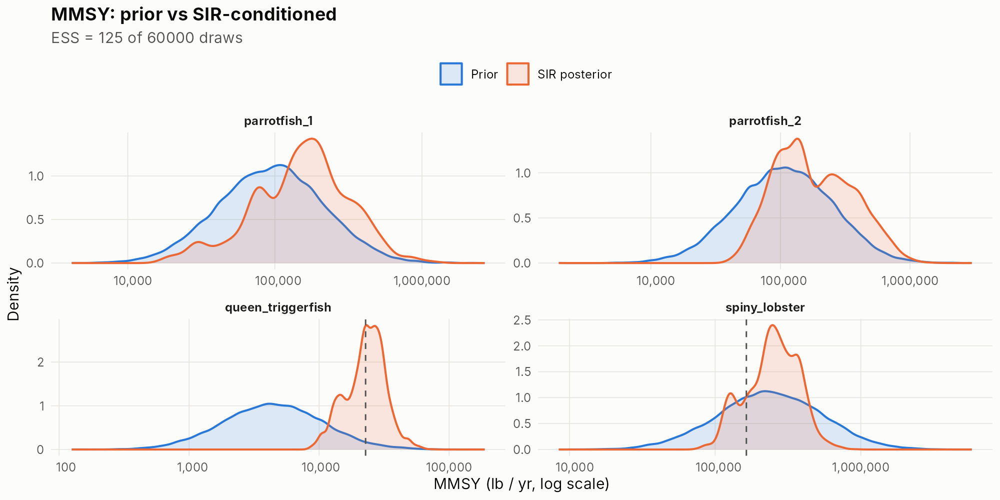{width=100%}


## Energy budget

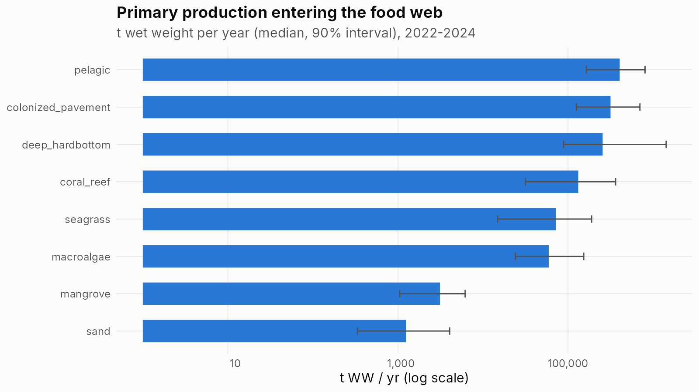{width=100%}


## Group reference points

**Table. Group reference points, Baseline, 2022–2024 (lb yr⁻¹).**

| Group | Status | MMSY p05 | MMSY p50 | MMSY p95 | P* target | Catch | B/B_MSY | P(overfishing) | P(overfished) |
| --- | --- | --- | --- | --- | --- | --- | --- | --- | --- |
| spiny_lobster | Below target | 120,321 | 249,798 | 441,273 | 233,002 | 121,353 | 2.44 | 0.069 | 0.000 |
| queen_conch | Outside focus (uncalibrated) | 5,295 | 21,229 | 131,984 | 15,470 | 0.973 | 0.00 | 0.002 | 0.659 |
| parrotfish_1 | Prohibited | 30,990 | 162,400 | 463,707 | 133,716 | 0.000 | 2.75 | 0.000 | 0.000 |
| parrotfish_2 | Below target | 64,134 | 155,615 | 570,872 | 136,762 | 70,634 | 3.06 | 0.090 | 0.000 |
| surgeonfishes | Below target | 53,671 | 124,686 | 501,952 | 111,947 | 26,847 | 2.57 | 0.003 | 0.000 |
| queen_triggerfish | Below target | 12,541 | 23,497 | 37,329 | 22,007 | 15,466 | 1.83 | 0.155 | 0.031 |
| grunts | Below target | 83,145 | 315,880 | 881,866 | 270,015 | 21,707 | 3.04 | 0.000 | 0.000 |
| snappers_shallow | Below target | 44,124 | 187,034 | 467,583 | 155,049 | 14,089 | 2.92 | 0.000 | 0.000 |
| yellowtail_snapper | Outside focus (uncalibrated) | 114,558 | 313,526 | 1,159,174 | 269,875 | 43,324 | 2.92 | 0.001 | 0.001 |
| snappers_deep | Outside focus (uncalibrated) | 10,387 | 76,025 | 335,889 | 58,236 | 35,868 | 1.77 | 0.012 | 0.422 |
| groupers_shallow | Below target | 19,718 | 55,711 | 143,712 | 43,752 | 15,247 | 2.86 | 0.013 | 0.000 |
| squirrelfishes | Below target | 18,253 | 57,639 | 222,069 | 53,097 | 9,400 | 3.06 | 0.004 | 0.000 |
| goatfishes | Below target | 6,805 | 23,597 | 68,086 | 19,572 | 5,757 | 2.55 | 0.023 | 0.000 |
| boxfishes | Below target | 13,577 | 33,743 | 135,635 | 29,109 | 6,918 | 2.80 | 0.006 | 0.000 |
| angelfishes | Below target | 29,389 | 134,861 | 487,461 | 110,747 | 4,113 | 2.76 | 0.000 | 0.000 |
| wrasses_hogfish | Below target | 4,157 | 8,201 | 26,263 | 7,375 | 7,003 | 2.03 | 0.352 | 0.026 |
| jacks | Outside focus (uncalibrated) | 51,299 | 283,016 | 1,031,919 | 243,652 | 20,453 | 2.55 | 0.000 | 0.000 |
| porgies | Below target | 2,698 | 5,890 | 21,926 | 4,746 | 3,338 | 1.98 | 0.160 | 0.052 |
| pelagics | Outside focus (uncalibrated) | 2,327 | 30,022 | 196,292 | 21,849 | 68,700 | 1.08 | 0.788 | 0.358 |


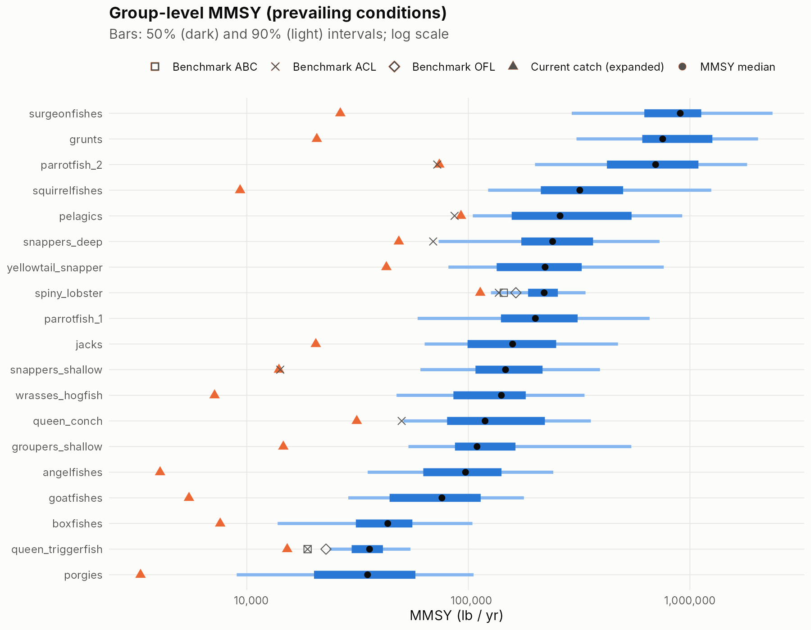{width=100%}


**Table. Comparison with management benchmarks.**

| group | metric | value_lb | MMSY_p05_lb | MMSY_p50_lb | MMSY_p95_lb | ratio_MMSYp50_to_benchmark |
| --- | --- | --- | --- | --- | --- | --- |
| parrotfish_2 | ACL | 72,365 | 64,134 | 155,615 | 570,872 | 2.15 |
| pelagics | ACL | 86,633 | 2,327 | 30,022 | 196,292 | 0.35 |
| queen_conch | ACL | 50,000 | 5,295 | 21,229 | 131,984 | 0.42 |
| queen_triggerfish | OFL | 22,773 | 12,541 | 23,497 | 37,329 | 1.03 |
| queen_triggerfish | ABC | 18,808 | 12,541 | 23,497 | 37,329 | 1.25 |
| queen_triggerfish | ACL | 18,808 | 12,541 | 23,497 | 37,329 | 1.25 |
| snappers_deep | ACL | 69,366 | 10,387 | 76,025 | 335,889 | 1.10 |
| snappers_shallow | ACL | 14,156 | 44,124 | 187,034 | 467,583 | 13.21 |
| spiny_lobster | OFL | 163,823 | 120,321 | 249,798 | 441,273 | 1.52 |
| spiny_lobster | ABC | 144,478 | 120,321 | 249,798 | 441,273 | 1.73 |
| spiny_lobster | ACL | 137,254 | 120,321 | 249,798 | 441,273 | 1.82 |


## Guild MMSY

**Table. Guild MMSY (lb yr⁻¹; draw-level sums).**

| name | MMSY_p50_lb | catch_lb | P_overfishing |
| --- | --- | --- | --- |
| Invertivores | 927,797 | 194,189 | 0.000 |
| Herbivores | 542,810 | 111,086 | 0.000 |
| Mesopredators | 541,175 | 58,126 | 0.000 |
| Piscivores | 443,150 | 62,410 | 0.000 |
| Pelagic piscivores | 30,022 | 68,700 | 0.788 |


## Gear effort ceilings and choke groups

**Table. Gear effort ceilings and choke groups.**

| gear | effort_ref | effort_multiplier_p05 | effort_multiplier_p50 | effort_multiplier_p95 | effort_multiplier_target | choke_group | P_choke | choke_alternatives |
| --- | --- | --- | --- | --- | --- | --- | --- | --- |
| trap_fish | 2,191 | 0.67 | 0.95 | 1.62 | 0.90 | wrasses_hogfish | 0.54 | wrasses_hogfish (54%); queen_triggerfish (16%); porgies (11%); parrotfish_2 (8%); spiny_lobster (7%); groupers_shallow (3%); goatfishes (2%); boxfishes (0%); squirrelfishes (0%); surgeonfishes (0%) |
| trap_lobster | 917.2 | 0.80 | 1.28 | 2.18 | 1.21 | queen_triggerfish | 0.73 | queen_triggerfish (73%); spiny_lobster (25%); boxfishes (2%) |
| dive | 1,528 | 0.67 | 0.96 | 1.82 | 0.92 | wrasses_hogfish | 0.56 | wrasses_hogfish (56%); queen_triggerfish (20%); parrotfish_2 (11%); spiny_lobster (9%); groupers_shallow (3%); goatfishes (2%); surgeonfishes (0%) |
| hook_line | 2,073 | 0.79 | 1.21 | 2.16 | 1.10 | queen_triggerfish | 0.61 | queen_triggerfish (61%); porgies (34%); groupers_shallow (3%); squirrelfishes (1%); grunts (0%) |


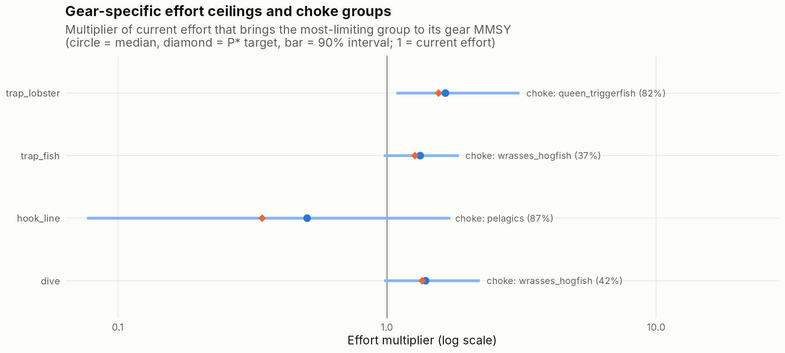{width=100%}


## Ecological process diagnostics

**Table. Ecological process diagnostics (Baseline medians).**

| group | fishable_fraction | nursery_index_hist_end | nursery_index_proj_end | ghost_removals_hist_lb | landings_hist_lb | ghost_share_of_catch |
| --- | --- | --- | --- | --- | --- | --- |
| spiny_lobster | 0.844 | 0.984 | 1.000 | 260,779 | 5,474,573 | 0.048 |
| parrotfish_2 | 0.841 | 0.989 | 1.000 | 176,907 | 3,012,452 | 0.059 |
| surgeonfishes | 0.840 | 1.000 | 1.000 | 81,933 | 1,247,169 | 0.066 |
| queen_triggerfish | 0.847 | 1.000 | 1.000 | 71,728 | 761,808 | 0.094 |
| grunts | 0.862 | 0.974 | 1.000 | 74,993 | 982,565 | 0.076 |
| snappers_shallow | 0.875 | 0.979 | 1.000 | 26,467 | 591,598 | 0.045 |
| groupers_shallow | 0.855 | 1.000 | 1.000 | 39,437 | 713,418 | 0.055 |
| squirrelfishes | 0.881 | 1.000 | 1.000 | 30,621 | 400,045 | 0.077 |
| goatfishes | 0.859 | 1.000 | 1.000 | 22,309 | 253,283 | 0.088 |
| boxfishes | 0.845 | 1.000 | 1.000 | 33,411 | 297,695 | 0.112 |
| angelfishes | 0.835 | 1.000 | 1.000 | 19,684 | 197,091 | 0.100 |
| wrasses_hogfish | 0.845 | 0.989 | 1.000 | 10,123 | 302,448 | 0.033 |
| porgies | 0.855 | 1.000 | 1.000 | 11,542 | 148,445 | 0.078 |


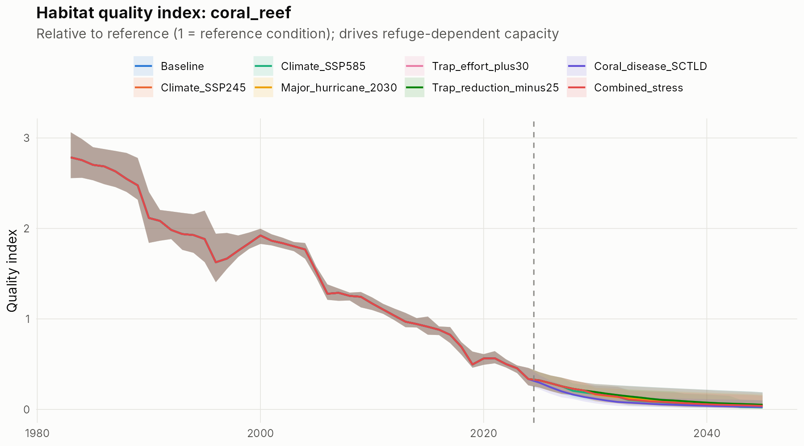{width=100%}


## Scenarios

**Table. Scenario results for calibrated trap groups, 2043–2045.**

| Scenario | Group | MMSY p50 | Catch | B/B_MSY | P(overfishing) | Status |
| --- | --- | --- | --- | --- | --- | --- |
| Baseline | spiny_lobster | 317,146 | 154,355 | 2.20 | 0.102 | Below target |
| Baseline | parrotfish_2 | 194,279 | 80,813 | 2.49 | 0.026 | Below target |
| Baseline | surgeonfishes | 141,866 | 32,672 | 2.54 | 0.001 | Below target |
| Baseline | queen_triggerfish | 27,585 | 16,786 | 1.67 | 0.083 | Below target |
| Baseline | grunts | 365,151 | 22,455 | 2.62 | 0.000 | Below target |
| Baseline | snappers_shallow | 208,570 | 14,221 | 2.58 | 0.000 | Below target |
| Baseline | groupers_shallow | 61,354 | 15,430 | 2.34 | 0.006 | Below target |
| Baseline | squirrelfishes | 66,637 | 10,042 | 2.73 | 0.000 | Below target |
| Baseline | goatfishes | 27,176 | 6,736 | 2.58 | 0.015 | Below target |
| Baseline | boxfishes | 38,011 | 7,908 | 2.53 | 0.000 | Below target |
| Baseline | angelfishes | 157,964 | 4,414 | 2.64 | 0.000 | Below target |
| Baseline | wrasses_hogfish | 10,000 | 6,903 | 1.70 | 0.123 | Below target |
| Baseline | porgies | 6,693 | 3,666 | 1.87 | 0.046 | Below target |
| Climate_SSP245 | spiny_lobster | 284,258 | 138,530 | 2.21 | 0.110 | Below target |
| Climate_SSP245 | parrotfish_2 | 154,685 | 60,365 | 2.35 | 0.032 | Below target |
| Climate_SSP245 | surgeonfishes | 133,317 | 29,628 | 2.46 | 0.001 | Below target |
| Climate_SSP245 | queen_triggerfish | 24,849 | 15,343 | 1.69 | 0.092 | Below target |
| Climate_SSP245 | grunts | 295,046 | 18,457 | 2.59 | 0.000 | Below target |
| Climate_SSP245 | snappers_shallow | 188,561 | 13,374 | 2.66 | 0.000 | Below target |
| Climate_SSP245 | groupers_shallow | 55,565 | 13,775 | 2.39 | 0.009 | Below target |
| Climate_SSP245 | squirrelfishes | 63,217 | 9,610 | 2.75 | 0.000 | Below target |
| Climate_SSP245 | goatfishes | 24,603 | 6,062 | 2.54 | 0.017 | Below target |
| Climate_SSP245 | boxfishes | 33,406 | 6,990 | 2.53 | 0.000 | Below target |
| Climate_SSP245 | angelfishes | 140,666 | 3,978 | 2.62 | 0.000 | Below target |
| Climate_SSP245 | wrasses_hogfish | 9,136 | 6,204 | 1.75 | 0.126 | Below target |
| Climate_SSP245 | porgies | 6,125 | 3,351 | 1.87 | 0.049 | Below target |
| Climate_SSP585 | spiny_lobster | 239,194 | 123,845 | 2.31 | 0.123 | Below target |
| Climate_SSP585 | parrotfish_2 | 111,657 | 43,314 | 2.44 | 0.032 | Below target |
| Climate_SSP585 | surgeonfishes | 113,762 | 26,297 | 2.54 | 0.001 | Below target |
| Climate_SSP585 | queen_triggerfish | 22,467 | 13,948 | 1.70 | 0.096 | Below target |
| Climate_SSP585 | grunts | 249,111 | 15,087 | 2.71 | 0.000 | Below target |
| Climate_SSP585 | snappers_shallow | 174,045 | 12,552 | 2.80 | 0.000 | Below target |
| Climate_SSP585 | groupers_shallow | 44,550 | 12,060 | 2.51 | 0.043 | Below target |
| Climate_SSP585 | squirrelfishes | 56,166 | 8,407 | 2.77 | 0.001 | Below target |
| Climate_SSP585 | goatfishes | 22,967 | 5,370 | 2.56 | 0.029 | Below target |
| Climate_SSP585 | boxfishes | 29,423 | 6,030 | 2.55 | 0.002 | Below target |
| Climate_SSP585 | angelfishes | 118,905 | 3,684 | 2.68 | 0.000 | Below target |
| Climate_SSP585 | wrasses_hogfish | 8,438 | 5,673 | 1.75 | 0.165 | Below target |
| Climate_SSP585 | porgies | 5,197 | 3,043 | 1.89 | 0.093 | Below target |
| Major_hurricane_2030 | spiny_lobster | 315,988 | 150,748 | 2.15 | 0.089 | Below target |
| Major_hurricane_2030 | parrotfish_2 | 193,531 | 79,651 | 2.45 | 0.019 | Below target |
| Major_hurricane_2030 | surgeonfishes | 141,555 | 32,300 | 2.51 | 0.001 | Below target |
| Major_hurricane_2030 | queen_triggerfish | 27,468 | 16,472 | 1.65 | 0.086 | Below target |
| Major_hurricane_2030 | grunts | 363,687 | 21,873 | 2.55 | 0.000 | Below target |
| Major_hurricane_2030 | snappers_shallow | 207,945 | 13,915 | 2.52 | 0.000 | Below target |
| Major_hurricane_2030 | groupers_shallow | 60,822 | 15,038 | 2.32 | 0.007 | Below target |
| Major_hurricane_2030 | squirrelfishes | 66,021 | 9,966 | 2.72 | 0.000 | Below target |
| Major_hurricane_2030 | goatfishes | 27,104 | 6,650 | 2.54 | 0.015 | Below target |
| Major_hurricane_2030 | boxfishes | 37,966 | 7,860 | 2.50 | 0.000 | Below target |
| Major_hurricane_2030 | angelfishes | 157,718 | 4,223 | 2.57 | 0.000 | Below target |
| Major_hurricane_2030 | wrasses_hogfish | 9,972 | 6,741 | 1.66 | 0.122 | Below target |
| Major_hurricane_2030 | porgies | 6,664 | 3,677 | 1.84 | 0.060 | Below target |
| Trap_effort_plus30 | spiny_lobster | 316,641 | 172,005 | 2.16 | 0.145 | Below target |
| Trap_effort_plus30 | parrotfish_2 | 194,275 | 92,342 | 2.45 | 0.040 | Below target |
| Trap_effort_plus30 | surgeonfishes | 141,853 | 37,906 | 2.50 | 0.000 | Below target |
| Trap_effort_plus30 | queen_triggerfish | 27,580 | 19,194 | 1.51 | 0.113 | Below target |
| Trap_effort_plus30 | grunts | 365,118 | 27,096 | 2.61 | 0.000 | Below target |
| Trap_effort_plus30 | snappers_shallow | 208,440 | 15,911 | 2.58 | 0.000 | Below target |
| Trap_effort_plus30 | groupers_shallow | 61,339 | 17,258 | 2.30 | 0.021 | Below target |
| Trap_effort_plus30 | squirrelfishes | 66,627 | 11,817 | 2.68 | 0.000 | Below target |
| Trap_effort_plus30 | goatfishes | 27,176 | 8,030 | 2.51 | 0.030 | Below target |
| Trap_effort_plus30 | boxfishes | 38,010 | 9,839 | 2.46 | 0.002 | Below target |
| Trap_effort_plus30 | angelfishes | 157,842 | 5,565 | 2.63 | 0.000 | Below target |
| Trap_effort_plus30 | wrasses_hogfish | 9,998 | 7,212 | 1.65 | 0.137 | Below target |
| Trap_effort_plus30 | porgies | 6,692 | 3,991 | 1.76 | 0.093 | Below target |
| Trap_reduction_minus25 | spiny_lobster | 317,631 | 144,073 | 2.25 | 0.075 | Below target |
| Trap_reduction_minus25 | parrotfish_2 | 194,282 | 72,845 | 2.56 | 0.011 | Below target |
| Trap_reduction_minus25 | surgeonfishes | 141,877 | 28,614 | 2.58 | 0.001 | Below target |
| Trap_reduction_minus25 | queen_triggerfish | 27,589 | 14,749 | 1.82 | 0.061 | Below target |
| Trap_reduction_minus25 | grunts | 365,179 | 18,639 | 2.63 | 0.000 | Below target |
| Trap_reduction_minus25 | snappers_shallow | 208,686 | 12,779 | 2.58 | 0.000 | Below target |
| Trap_reduction_minus25 | groupers_shallow | 61,368 | 13,612 | 2.42 | 0.006 | Below target |
| Trap_reduction_minus25 | squirrelfishes | 66,646 | 8,398 | 2.75 | 0.000 | Below target |
| Trap_reduction_minus25 | goatfishes | 27,177 | 5,637 | 2.61 | 0.013 | Below target |
| Trap_reduction_minus25 | boxfishes | 38,011 | 6,206 | 2.58 | 0.000 | Below target |
| Trap_reduction_minus25 | angelfishes | 158,080 | 3,428 | 2.64 | 0.000 | Below target |
| Trap_reduction_minus25 | wrasses_hogfish | 10,001 | 6,560 | 1.74 | 0.121 | Below target |
| Trap_reduction_minus25 | porgies | 6,693 | 3,301 | 1.95 | 0.035 | Below target |
| Coral_disease_SCTLD | spiny_lobster | 313,070 | 153,292 | 2.20 | 0.102 | Below target |
| Coral_disease_SCTLD | parrotfish_2 | 192,821 | 80,380 | 2.49 | 0.019 | Below target |
| Coral_disease_SCTLD | surgeonfishes | 141,117 | 32,557 | 2.54 | 0.001 | Below target |
| Coral_disease_SCTLD | queen_triggerfish | 27,549 | 16,742 | 1.67 | 0.083 | Below target |
| Coral_disease_SCTLD | grunts | 363,613 | 22,371 | 2.62 | 0.000 | Below target |
| Coral_disease_SCTLD | snappers_shallow | 207,185 | 14,127 | 2.59 | 0.000 | Below target |
| Coral_disease_SCTLD | groupers_shallow | 60,708 | 15,175 | 2.34 | 0.006 | Below target |
| Coral_disease_SCTLD | squirrelfishes | 65,745 | 9,923 | 2.73 | 0.000 | Below target |
| Coral_disease_SCTLD | goatfishes | 27,163 | 6,735 | 2.57 | 0.015 | Below target |
| Coral_disease_SCTLD | boxfishes | 37,960 | 7,898 | 2.52 | 0.000 | Below target |
| Coral_disease_SCTLD | angelfishes | 157,006 | 4,401 | 2.63 | 0.000 | Below target |
| Coral_disease_SCTLD | wrasses_hogfish | 9,966 | 6,896 | 1.70 | 0.123 | Below target |
| Coral_disease_SCTLD | porgies | 6,691 | 3,664 | 1.87 | 0.046 | Below target |
| Combined_stress | spiny_lobster | 237,712 | 127,529 | 2.13 | 0.124 | Below target |
| Combined_stress | parrotfish_2 | 111,065 | 47,642 | 2.26 | 0.049 | Below target |
| Combined_stress | surgeonfishes | 113,651 | 30,037 | 2.45 | 0.001 | Below target |
| Combined_stress | queen_triggerfish | 22,340 | 15,638 | 1.49 | 0.162 | Below target |
| Combined_stress | grunts | 248,712 | 17,379 | 2.61 | 0.000 | Below target |
| Combined_stress | snappers_shallow | 173,655 | 13,538 | 2.68 | 0.000 | Below target |
| Combined_stress | groupers_shallow | 44,354 | 13,304 | 2.40 | 0.048 | Below target |
| Combined_stress | squirrelfishes | 56,479 | 9,848 | 2.69 | 0.001 | Below target |
| Combined_stress | goatfishes | 22,855 | 6,224 | 2.42 | 0.033 | Below target |
| Combined_stress | boxfishes | 29,261 | 7,337 | 2.45 | 0.004 | Below target |
| Combined_stress | angelfishes | 118,779 | 4,387 | 2.61 | 0.000 | Below target |
| Combined_stress | wrasses_hogfish | 8,379 | 5,726 | 1.64 | 0.181 | Below target |
| Combined_stress | porgies | 5,178 | 3,181 | 1.75 | 0.095 | Below target |
| MPA_expansion | spiny_lobster | 317,639 | 142,407 | 2.27 | 0.070 | Below target |
| MPA_expansion | parrotfish_2 | 194,282 | 72,378 | 2.56 | 0.011 | Below target |
| MPA_expansion | surgeonfishes | 141,878 | 28,105 | 2.58 | 0.001 | Below target |
| MPA_expansion | queen_triggerfish | 27,588 | 15,372 | 1.77 | 0.064 | Below target |
| MPA_expansion | grunts | 365,179 | 20,267 | 2.62 | 0.000 | Below target |
| MPA_expansion | snappers_shallow | 208,680 | 12,672 | 2.58 | 0.000 | Below target |
| MPA_expansion | groupers_shallow | 61,368 | 13,659 | 2.43 | 0.006 | Below target |
| MPA_expansion | squirrelfishes | 66,646 | 9,045 | 2.74 | 0.000 | Below target |
| MPA_expansion | goatfishes | 27,177 | 6,255 | 2.59 | 0.015 | Below target |
| MPA_expansion | boxfishes | 38,011 | 7,086 | 2.55 | 0.000 | Below target |
| MPA_expansion | angelfishes | 158,083 | 3,720 | 2.64 | 0.000 | Below target |
| MPA_expansion | wrasses_hogfish | 10,001 | 6,301 | 1.80 | 0.094 | Below target |
| MPA_expansion | porgies | 6,693 | 3,461 | 1.92 | 0.038 | Below target |
| Open_access_effort | spiny_lobster | 317,594 | 225,440 | 1.96 | 0.287 | Below target |
| Open_access_effort | parrotfish_2 | 194,270 | 104,842 | 2.33 | 0.052 | Below target |
| Open_access_effort | surgeonfishes | 141,879 | 47,500 | 2.44 | 0.006 | Below target |
| Open_access_effort | queen_triggerfish | 27,560 | 19,980 | 1.41 | 0.203 | Below target |
| Open_access_effort | grunts | 365,037 | 29,874 | 2.56 | 0.004 | Below target |
| Open_access_effort | snappers_shallow | 208,373 | 18,288 | 2.58 | 0.000 | Below target |
| Open_access_effort | groupers_shallow | 61,253 | 19,937 | 2.23 | 0.074 | Below target |
| Open_access_effort | squirrelfishes | 66,580 | 13,013 | 2.67 | 0.003 | Below target |
| Open_access_effort | goatfishes | 27,175 | 8,959 | 2.46 | 0.046 | Below target |
| Open_access_effort | boxfishes | 38,011 | 11,383 | 2.47 | 0.003 | Below target |
| Open_access_effort | angelfishes | 158,125 | 6,178 | 2.64 | 0.000 | Below target |
| Open_access_effort | wrasses_hogfish | 9,998 | 8,361 | 1.48 | 0.239 | Below target |
| Open_access_effort | porgies | 6,691 | 3,996 | 1.65 | 0.129 | Below target |
| Parrotfish_harvest_plus50 | spiny_lobster | 316,421 | 181,835 | 2.09 | 0.159 | Below target |
| Parrotfish_harvest_plus50 | parrotfish_2 | 194,274 | 95,523 | 2.42 | 0.041 | Below target |
| Parrotfish_harvest_plus50 | surgeonfishes | 141,848 | 38,650 | 2.50 | 0.000 | Below target |
| Parrotfish_harvest_plus50 | queen_triggerfish | 27,580 | 17,429 | 1.64 | 0.085 | Below target |
| Parrotfish_harvest_plus50 | grunts | 365,099 | 23,518 | 2.62 | 0.000 | Below target |
| Parrotfish_harvest_plus50 | snappers_shallow | 208,441 | 15,920 | 2.57 | 0.000 | Below target |
| Parrotfish_harvest_plus50 | groupers_shallow | 61,333 | 16,966 | 2.31 | 0.019 | Below target |
| Parrotfish_harvest_plus50 | squirrelfishes | 66,624 | 10,041 | 2.73 | 0.000 | Below target |
| Parrotfish_harvest_plus50 | goatfishes | 27,176 | 7,233 | 2.55 | 0.024 | Below target |
| Parrotfish_harvest_plus50 | boxfishes | 38,010 | 7,908 | 2.53 | 0.000 | Below target |
| Parrotfish_harvest_plus50 | angelfishes | 157,808 | 4,643 | 2.64 | 0.000 | Below target |
| Parrotfish_harvest_plus50 | wrasses_hogfish | 9,998 | 7,984 | 1.49 | 0.165 | Below target |
| Parrotfish_harvest_plus50 | porgies | 6,692 | 3,666 | 1.87 | 0.046 | Below target |
| Seagrass_loss_Halophila | spiny_lobster | 275,987 | 132,717 | 2.14 | 0.072 | Below target |
| Seagrass_loss_Halophila | parrotfish_2 | 177,363 | 74,204 | 2.54 | 0.040 | Below target |
| Seagrass_loss_Halophila | surgeonfishes | 140,924 | 32,427 | 2.55 | 0.001 | Below target |
| Seagrass_loss_Halophila | queen_triggerfish | 27,274 | 16,530 | 1.70 | 0.088 | Below target |
| Seagrass_loss_Halophila | grunts | 289,654 | 18,756 | 2.75 | 0.000 | Below target |
| Seagrass_loss_Halophila | snappers_shallow | 175,738 | 12,814 | 2.85 | 0.000 | Below target |
| Seagrass_loss_Halophila | groupers_shallow | 61,222 | 15,301 | 2.36 | 0.006 | Below target |
| Seagrass_loss_Halophila | squirrelfishes | 66,653 | 10,048 | 2.73 | 0.000 | Below target |
| Seagrass_loss_Halophila | goatfishes | 26,554 | 6,446 | 2.58 | 0.016 | Below target |
| Seagrass_loss_Halophila | boxfishes | 37,014 | 7,560 | 2.54 | 0.000 | Below target |
| Seagrass_loss_Halophila | angelfishes | 158,016 | 4,415 | 2.64 | 0.000 | Below target |
| Seagrass_loss_Halophila | wrasses_hogfish | 8,996 | 6,485 | 1.76 | 0.138 | Below target |
| Seagrass_loss_Halophila | porgies | 6,265 | 3,563 | 1.88 | 0.063 | Below target |


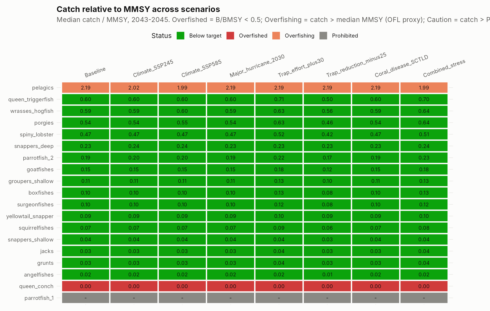{width=100%}


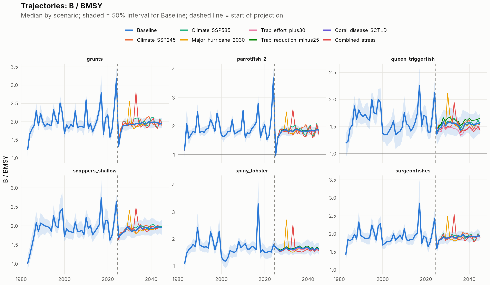{width=100%}


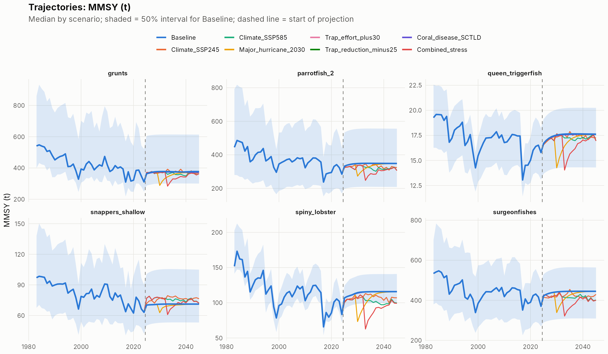{width=100%}


## Validation

**Table. Leave-one-benchmark-out validation.**

| held_out | benchmark_lb | pred_p05 | pred_p50 | pred_p95 | PIT | inside90 | ratio_pred_to_benchmark | ess |
| --- | --- | --- | --- | --- | --- | --- | --- | --- |
| spiny_lobster OFL | 163,823 | 229,141 | 774,435 | 2,167,595 | 0.020 | FALSE | 4.727 | 96.4 |
| queen_triggerfish OFL | 22,773 | 10,311 | 16,442 | 47,933 | 0.656 | TRUE | 0.722 | 17.0 |


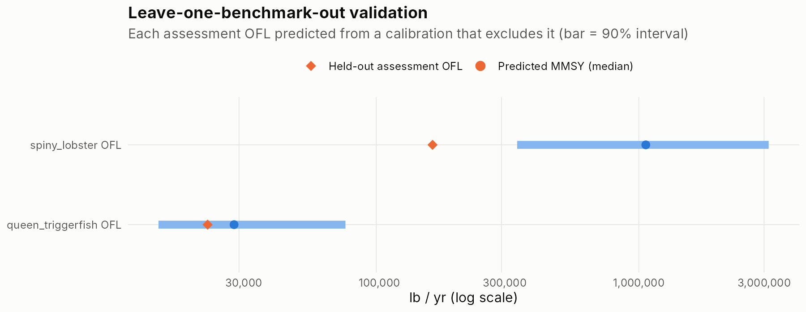{width=100%}


**Table. Held-out index validation (placeholder series).**

| index | group | mode | n_obs | coverage50 | coverage90 | rmse_log | MASE_vs_naive | cor_anomaly |
| --- | --- | --- | --- | --- | --- | --- | --- | --- |
| SEDAR57_lobster_trap_CPUE | spiny_lobster | scale-free anomalies (whole series held out) | 10.0 | 0.900 | 1.000 | 0.166 | 1.108 | 0.135 |
| SEDAR80_QT_trap_CPUE | queen_triggerfish | scale-free anomalies (whole series held out) | 35.0 | 0.914 | 1.000 | 0.177 | 1.160 | 0.096 |
| NCRMP_parrotfish_density | parrotfish_1;parrotfish_2 | scale-free anomalies (whole series held out) | 6.000 | 0.833 | 1.000 | 0.145 | 1.043 | 0.347 |


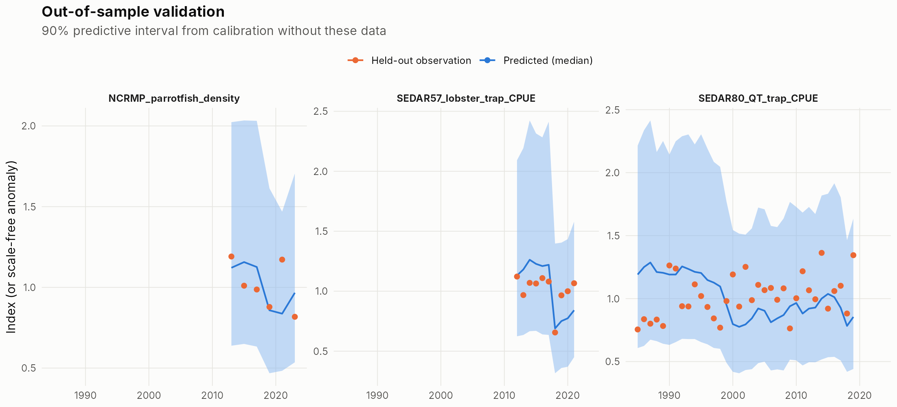{width=100%}


**Table. Simulation self-test (100 replicates).**

| group | median_rel_error | MARE | coverage50 | coverage90 | median_ess |
| --- | --- | --- | --- | --- | --- |
| angelfishes | -0.007 | 0.641 | 0.39 | 0.79 | 33.0 |
| boxfishes | -0.188 | 0.572 | 0.44 | 0.85 | 33.0 |
| goatfishes | -0.103 | 0.395 | 0.58 | 0.91 | 33.0 |
| groupers_shallow | 0.122 | 0.449 | 0.43 | 0.86 | 33.0 |
| grunts | -0.165 | 0.466 | 0.47 | 0.90 | 33.0 |
| parrotfish_2 | 0.003 | 0.477 | 0.59 | 0.88 | 33.0 |
| porgies | -0.114 | 0.445 | 0.45 | 0.80 | 33.0 |
| queen_triggerfish | 0.000 | 0.190 | 0.54 | 0.89 | 33.0 |
| snappers_shallow | 0.031 | 0.361 | 0.50 | 0.88 | 33.0 |
| spiny_lobster | -0.065 | 0.217 | 0.49 | 0.87 | 33.0 |
| squirrelfishes | 0.024 | 0.474 | 0.52 | 0.87 | 33.0 |
| surgeonfishes | -0.152 | 0.397 | 0.52 | 0.93 | 33.0 |
| wrasses_hogfish | -0.101 | 0.372 | 0.41 | 0.83 | 33.0 |


## Sensitivity and structural uncertainty

**Table. Global sensitivity: six most influential inputs per output.**

| output | input | SRRC | PRCC | R2_rank_model |
| --- | --- | --- | --- | --- |
| MMSY_groupers_shallow | partition:groupers_shallow | 0.498 | 0.762 | 0.823 |
| MMSY_groupers_shallow | pb:groupers_shallow | 0.381 | 0.669 | 0.823 |
| MMSY_groupers_shallow | tte:colonized_pavement | 0.350 | 0.637 | 0.823 |
| MMSY_groupers_shallow | x_msy:groupers_shallow | 0.234 | 0.483 | 0.823 |
| MMSY_groupers_shallow | npp:colonized_pavement | 0.204 | 0.434 | 0.823 |
| MMSY_groupers_shallow | fwf:colonized_pavement | 0.167 | 0.367 | 0.823 |
| MMSY_grunts | partition:grunts | 0.530 | 0.779 | 0.820 |
| MMSY_grunts | pb:grunts | 0.418 | 0.700 | 0.820 |
| MMSY_grunts | partition:benthic_predatory_inverts | -0.300 | -0.575 | 0.820 |
| MMSY_grunts | x_msy:grunts | 0.239 | 0.490 | 0.820 |
| MMSY_grunts | tte:colonized_pavement | 0.209 | 0.440 | 0.820 |
| MMSY_grunts | npp:colonized_pavement | 0.166 | 0.363 | 0.820 |
| MMSY_parrotfish_2 | partition:parrotfish_2 | 0.531 | 0.767 | 0.805 |
| MMSY_parrotfish_2 | partition:benthic_detritivores_filter | -0.357 | -0.627 | 0.805 |
| MMSY_parrotfish_2 | x_msy:parrotfish_2 | 0.340 | 0.607 | 0.805 |
| MMSY_parrotfish_2 | pb:parrotfish_2 | 0.272 | 0.522 | 0.805 |
| MMSY_parrotfish_2 | npp:colonized_pavement | 0.224 | 0.450 | 0.805 |
| MMSY_parrotfish_2 | fwf:colonized_pavement | 0.184 | 0.382 | 0.805 |
| MMSY_queen_triggerfish | partition:queen_triggerfish | 0.515 | 0.765 | 0.814 |
| MMSY_queen_triggerfish | tte:colonized_pavement | 0.362 | 0.641 | 0.814 |
| MMSY_queen_triggerfish | pb:queen_triggerfish | 0.318 | 0.592 | 0.814 |
| MMSY_queen_triggerfish | partition:benthic_predatory_inverts | -0.294 | -0.562 | 0.814 |
| MMSY_queen_triggerfish | npp:colonized_pavement | 0.251 | 0.501 | 0.814 |
| MMSY_queen_triggerfish | x_msy:queen_triggerfish | 0.221 | 0.455 | 0.814 |
| MMSY_snappers_shallow | pb:snappers_shallow | 0.490 | 0.761 | 0.828 |
| MMSY_snappers_shallow | partition:snappers_shallow | 0.467 | 0.745 | 0.828 |
| MMSY_snappers_shallow | tte:colonized_pavement | 0.277 | 0.553 | 0.828 |
| MMSY_snappers_shallow | x_msy:snappers_shallow | 0.239 | 0.497 | 0.828 |
| MMSY_snappers_shallow | tte:pelagic | 0.213 | 0.455 | 0.828 |
| MMSY_snappers_shallow | npp:colonized_pavement | 0.164 | 0.366 | 0.828 |
| MMSY_spiny_lobster | partition:spiny_lobster | 0.542 | 0.772 | 0.803 |
| MMSY_spiny_lobster | partition:benthic_predatory_inverts | -0.369 | -0.638 | 0.803 |
| MMSY_spiny_lobster | tte:colonized_pavement | 0.258 | 0.501 | 0.803 |
| MMSY_spiny_lobster | x_msy:spiny_lobster | 0.244 | 0.481 | 0.803 |
| MMSY_spiny_lobster | npp:colonized_pavement | 0.236 | 0.468 | 0.803 |
| MMSY_spiny_lobster | pb:spiny_lobster | 0.219 | 0.441 | 0.803 |
| total_focus_MMSY | partition:benthic_predatory_inverts | -0.355 | -0.582 | 0.758 |
| total_focus_MMSY | tte:colonized_pavement | 0.336 | 0.562 | 0.758 |
| total_focus_MMSY | npp:colonized_pavement | 0.315 | 0.537 | 0.758 |
| total_focus_MMSY | fwf:colonized_pavement | 0.256 | 0.460 | 0.758 |
| total_focus_MMSY | npp:coral_reef | 0.210 | 0.390 | 0.758 |
| total_focus_MMSY | partition:spiny_lobster | 0.192 | 0.361 | 0.758 |


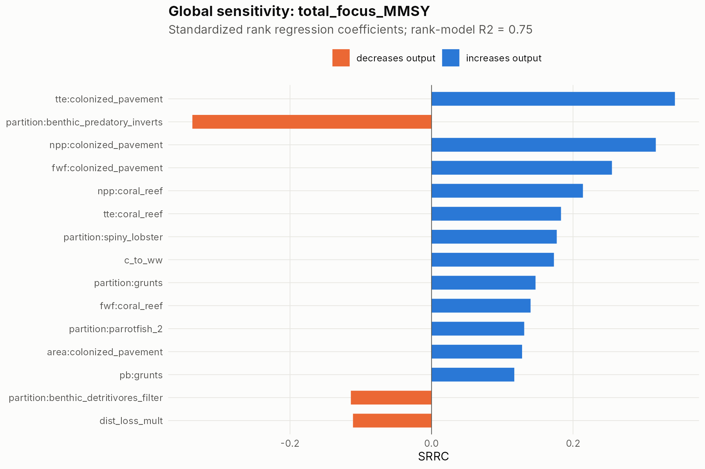{width=100%}


**Table. Structural ensemble, pooled.**

| group | MMSY_p05_lb | MMSY_p50_lb | MMSY_p95_lb | between_variant_cv |
| --- | --- | --- | --- | --- |
| spiny_lobster | 146,300 | 279,019 | 554,007 | 0.07 |
| queen_conch | 4,983 | 23,725 | 125,071 | 0.28 |
| parrotfish_1 | 33,265 | 121,710 | 527,921 | 0.46 |
| parrotfish_2 | 48,772 | 166,507 | 649,267 | 0.44 |
| surgeonfishes | 40,362 | 128,445 | 445,216 | 0.25 |
| queen_triggerfish | 13,616 | 23,296 | 40,269 | 0.10 |
| grunts | 69,488 | 316,705 | 1,234,703 | 0.38 |
| snappers_shallow | 37,572 | 168,205 | 678,842 | 0.48 |
| yellowtail_snapper | 92,558 | 368,139 | 1,390,318 | 0.32 |
| snappers_deep | 9,112 | 58,799 | 414,773 | 0.50 |
| groupers_shallow | 15,419 | 57,485 | 221,276 | 0.33 |
| squirrelfishes | 16,944 | 57,187 | 195,969 | 0.31 |
| goatfishes | 8,669 | 24,851 | 75,591 | 0.20 |
| boxfishes | 10,094 | 38,017 | 134,715 | 0.30 |
| angelfishes | 25,799 | 109,448 | 496,744 | 0.41 |
| wrasses_hogfish | 3,541 | 8,069 | 19,619 | 0.16 |
| jacks | 78,714 | 355,414 | 1,686,038 | 0.25 |
| porgies | 2,290 | 6,176 | 17,079 | 0.17 |
| pelagics | 1,938 | 27,023 | 419,844 | 0.48 |
| zooplankton | 20,263,066 | 53,166,857 | 145,538,347 | 0.23 |
| benthic_grazers | 10,801,631 | 30,744,448 | 85,060,842 | 0.16 |
| benthic_detritivores_filter | 75,372,246 | 135,879,576 | 263,275,945 | 0.20 |
| small_reef_fish | 2,021,199 | 4,980,637 | 13,808,933 | 0.25 |
| small_pelagics | 1,895,090 | 6,586,659 | 21,312,591 | 0.34 |
| other_reef_predators | 81,315 | 323,475 | 1,364,370 | 0.32 |
| sharks_apex | 13,575 | 54,589 | 237,640 | 0.49 |
| benthic_predatory_inverts | 9,149,220 | 22,410,812 | 53,830,553 | 0.28 |
| other_invertivore_fishes | 1,187,915 | 3,075,765 | 7,796,693 | 0.19 |
| squids_pelagic_predators | 57,687 | 347,010 | 1,967,964 | 0.59 |


**Table. Structural ensemble by variant (selected groups).**

| Variant | Group | MMSY p50 (lb) | ESS |
| --- | --- | --- | --- |
| base | spiny_lobster | 290,544 | 22.1 |
| base | parrotfish_2 | 140,966 | 22.1 |
| base | queen_triggerfish | 21,361 | 22.1 |
| base | wrasses_hogfish | 7,182 | 22.1 |
| base | porgies | 5,640 | 22.1 |
| gulland_PB | spiny_lobster | 282,279 | 50.0 |
| gulland_PB | parrotfish_2 | 269,755 | 50.0 |
| gulland_PB | queen_triggerfish | 29,820 | 50.0 |
| gulland_PB | wrasses_hogfish | 11,960 | 50.0 |
| gulland_PB | porgies | 8,493 | 50.0 |
| schaefer_shape | spiny_lobster | 285,667 | 18.1 |
| schaefer_shape | parrotfish_2 | 149,662 | 18.1 |
| schaefer_shape | queen_triggerfish | 24,528 | 18.1 |
| schaefer_shape | wrasses_hogfish | 7,325 | 18.1 |
| schaefer_shape | porgies | 6,768 | 18.1 |
| x_msy_low | spiny_lobster | 254,205 | 12.9 |
| x_msy_low | parrotfish_2 | 115,005 | 12.9 |
| x_msy_low | queen_triggerfish | 22,089 | 12.9 |
| x_msy_low | wrasses_hogfish | 7,660 | 12.9 |
| x_msy_low | porgies | 4,090 | 12.9 |
| closed_population | spiny_lobster | 250,245 | 29.0 |
| closed_population | parrotfish_2 | 165,474 | 29.0 |
| closed_population | queen_triggerfish | 22,454 | 29.0 |
| closed_population | wrasses_hogfish | 8,255 | 29.0 |
| closed_population | porgies | 5,596 | 29.0 |
| no_nursery | spiny_lobster | 297,275 | 22.8 |
| no_nursery | parrotfish_2 | 141,195 | 22.8 |
| no_nursery | queen_triggerfish | 22,404 | 22.8 |
| no_nursery | wrasses_hogfish | 7,272 | 22.8 |
| no_nursery | porgies | 5,988 | 22.8 |
| no_herbivory_feedback | spiny_lobster | 290,544 | 22.1 |
| no_herbivory_feedback | parrotfish_2 | 140,966 | 22.1 |
| no_herbivory_feedback | queen_triggerfish | 21,361 | 22.1 |
| no_herbivory_feedback | wrasses_hogfish | 7,182 | 22.1 |
| no_herbivory_feedback | porgies | 5,640 | 22.1 |
| no_ghost_fishing | spiny_lobster | 294,028 | 25.3 |
| no_ghost_fishing | parrotfish_2 | 138,276 | 25.3 |
| no_ghost_fishing | queen_triggerfish | 22,333 | 25.3 |
| no_ghost_fishing | wrasses_hogfish | 7,085 | 25.3 |
| no_ghost_fishing | porgies | 6,178 | 25.3 |
| no_lionfish_sargassum | spiny_lobster | 268,361 | 26.8 |
| no_lionfish_sargassum | parrotfish_2 | 154,267 | 26.8 |
| no_lionfish_sargassum | queen_triggerfish | 20,794 | 26.8 |
| no_lionfish_sargassum | wrasses_hogfish | 9,276 | 26.8 |
| no_lionfish_sargassum | porgies | 5,270 | 26.8 |
| tte_0.10 | spiny_lobster | 265,701 | 7.9 |
| tte_0.10 | parrotfish_2 | 140,386 | 7.9 |
| tte_0.10 | queen_triggerfish | 22,199 | 7.9 |
| tte_0.10 | wrasses_hogfish | 7,691 | 7.9 |
| tte_0.10 | porgies | 6,836 | 7.9 |
| tte_0.20 | spiny_lobster | 282,655 | 46.5 |
| tte_0.20 | parrotfish_2 | 161,298 | 46.5 |
| tte_0.20 | queen_triggerfish | 23,832 | 46.5 |
| tte_0.20 | wrasses_hogfish | 9,221 | 46.5 |
| tte_0.20 | porgies | 6,523 | 46.5 |
| no_thermal | spiny_lobster | 327,597 | 20.1 |
| no_thermal | parrotfish_2 | 195,906 | 20.1 |
| no_thermal | queen_triggerfish | 24,965 | 20.1 |
| no_thermal | wrasses_hogfish | 8,585 | 20.1 |
| no_thermal | porgies | 6,651 | 20.1 |
| fwf_low | spiny_lobster | 253,847 | 14.8 |
| fwf_low | parrotfish_2 | 175,872 | 14.8 |
| fwf_low | queen_triggerfish | 23,757 | 14.8 |
| fwf_low | wrasses_hogfish | 8,723 | 14.8 |
| fwf_low | porgies | 6,881 | 14.8 |
| fwf_high | spiny_lobster | 293,763 | 38.0 |
| fwf_high | parrotfish_2 | 423,903 | 38.0 |
| fwf_high | queen_triggerfish | 26,796 | 38.0 |
| fwf_high | wrasses_hogfish | 8,257 | 38.0 |
| fwf_high | porgies | 7,205 | 38.0 |


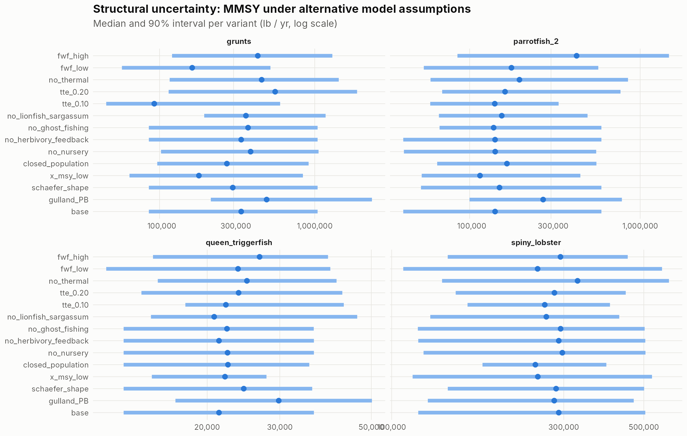{width=100%}


## Independent comparator

**Table. TTM MMSY vs catch-only MSY.**

| group | CMSY_p05_lb | CMSY_p50_lb | CMSY_p95_lb | r_p50 | n_viable | resilience | MMSY_p05_lb | MMSY_p50_lb | MMSY_p95_lb | OFL_lb | ratio_TTM_to_catch_only |
| --- | --- | --- | --- | --- | --- | --- | --- | --- | --- | --- | --- |
| angelfishes | 4,397 | 6,975 | 9,878 | 0.10 | 5,552 | low | 29,389 | 134,861 | 487,461 |  | 19.34 |
| boxfishes | 10,777 | 12,774 | 15,078 | 0.94 | 4,322 | high | 13,577 | 33,743 | 135,635 |  | 2.64 |
| goatfishes | 7,906 | 9,708 | 11,571 | 0.37 | 4,355 | medium | 6,805 | 23,597 | 68,086 |  | 2.43 |
| groupers_shallow | 16,106 | 25,433 | 36,332 | 0.11 | 5,783 | low | 19,718 | 55,711 | 143,712 |  | 2.19 |
| grunts | 30,655 | 37,216 | 43,454 | 0.36 | 3,727 | medium | 83,145 | 315,880 | 881,866 |  | 8.49 |
| parrotfish_2 | 107,311 | 125,517 | 144,330 | 0.92 | 3,815 | high | 64,134 | 155,615 | 570,872 |  | 1.24 |
| porgies | 4,591 | 5,574 | 6,575 | 0.37 | 4,072 | medium | 2,698 | 5,890 | 21,926 |  | 1.06 |
| queen_triggerfish | 23,634 | 28,427 | 33,145 | 0.36 | 3,678 | medium | 12,541 | 23,497 | 37,329 | 22,773 | 0.83 |
| snappers_shallow | 13,470 | 21,643 | 30,084 | 0.11 | 5,909 | low | 44,124 | 187,034 | 467,583 |  | 8.64 |
| spiny_lobster | 169,373 | 205,478 | 238,957 | 0.36 | 3,534 | medium | 120,321 | 249,798 | 441,273 | 163,823 | 1.22 |
| squirrelfishes | 14,132 | 16,823 | 19,890 | 0.94 | 4,351 | high | 18,253 | 57,639 | 222,069 |  | 3.43 |
| surgeonfishes | 44,152 | 49,359 | 54,674 | 0.88 | 2,671 | high | 53,671 | 124,686 | 501,952 |  | 2.53 |
| wrasses_hogfish | 6,818 | 10,920 | 15,500 | 0.11 | 6,046 | low | 4,157 | 8,201 | 26,263 |  | 0.75 |


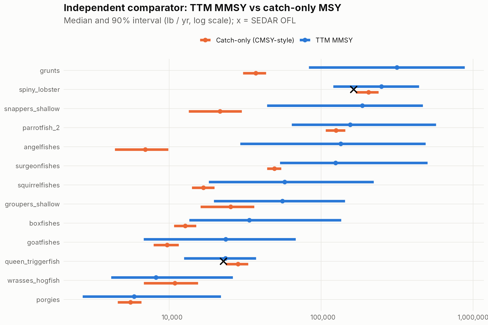{width=100%}


## Value of information

**Table. Value of information by data stream (total focus MMSY).**

| output | data_stream | S1_max | S1_sum | top_input |
| --- | --- | --- | --- | --- |
| total_focus_MMSY | Biomass surveys (NCRMP / assessment B0) | 0.128 | 0.240 | partition:benthic_predatory_inverts |
| total_focus_MMSY | Primary-production measurements | 0.116 | 0.176 | npp:colonized_pavement |
| total_focus_MMSY | Trophic transfer efficiency | 0.121 | 0.176 | tte:colonized_pavement |
| total_focus_MMSY | Food-web / detritus flows | 0.071 | 0.095 | fwf:colonized_pavement |
| total_focus_MMSY | Production/biomass (Ecopath) | 0.012 | 0.034 | pb:grunts |
| total_focus_MMSY | Other | 0.030 | 0.030 | c_to_ww |
| total_focus_MMSY | Life history (growth, maturity, selectivity) | 0.009 | 0.028 | x_msy:spiny_lobster |
| total_focus_MMSY | Habitat mapping | 0.016 | 0.022 | area:colonized_pavement |
| total_focus_MMSY | Hurricane and trap-loss impacts | 0.020 | 0.020 | dist_loss_mult |
| total_focus_MMSY | Natural mortality (life history / tagging) | 0.001 | 0.003 | M:surgeonfishes |
| total_focus_MMSY | Lionfish / Sargassum effects | 0.001 | 0.003 | env:lionfish:grunts |
| total_focus_MMSY | Historical CPUE (1980s depletion) | 0.001 | 0.003 | init_dep:wrasses_hogfish |
| total_focus_MMSY | Coral and herbivory dynamics | 0.000 | 0.001 | herbivory_elasticity |
| total_focus_MMSY | Larval connectivity / settlement | 0.000 | 0.000 | open_rec:spiny_lobster |
| total_focus_MMSY | Catch monitoring (landings, expansion) | 0.000 | 0.000 | catch_expansion |


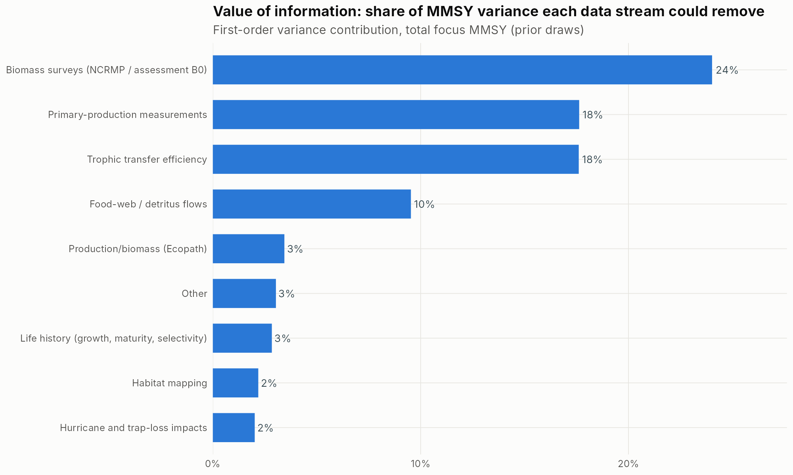{width=100%}


## Management strategy evaluation

**Table. Closed-loop MSE performance (2036–2045).**

| procedure | P_any_focus_overfished | annual_P_any_focus_overfished | min_BBmsy_p05 | min_BBmsy_p50 | focus_catch_lb_p50 | catch_AAV_p50 | effort_mult_p50 |
| --- | --- | --- | --- | --- | --- | --- | --- |
| Status_quo | 0.333 | 0.309 | 0.00 | 0.90 | 354,802 | 0.049 | 1.00 |
| Trap_minus25 | 0.307 | 0.299 | 0.00 | 0.99 | 314,801 | 0.050 | 0.88 |
| SPF_ceiling | 0.307 | 0.295 | 0.00 | 0.94 | 395,035 | 0.084 | 1.33 |
| SPF_ceiling_biased | 0.407 | 0.359 | 0.00 | 0.65 | 595,070 | 0.084 | 2.06 |
| CPUE_HCR | 0.413 | 0.356 | 0.00 | 0.72 | 492,301 | 0.066 | 1.48 |


**Table. MSE: probability each focus group falls below 0.5 B_MSY.**

| procedure | group | P_overfished | min_BBmsy_p50 |
| --- | --- | --- | --- |
| Status_quo | spiny_lobster | 0.007 | 1.63 |
| Status_quo | parrotfish_2 | 0.020 | 2.05 |
| Status_quo | surgeonfishes | 0.007 | 2.13 |
| Status_quo | queen_triggerfish | 0.167 | 1.39 |
| Status_quo | grunts | 0.000 | 2.08 |
| Status_quo | snappers_shallow | 0.000 | 1.95 |
| Status_quo | groupers_shallow | 0.013 | 1.71 |
| Status_quo | squirrelfishes | 0.000 | 2.39 |
| Status_quo | goatfishes | 0.000 | 2.13 |
| Status_quo | boxfishes | 0.000 | 2.14 |
| Status_quo | angelfishes | 0.000 | 2.19 |
| Status_quo | wrasses_hogfish | 0.127 | 1.49 |
| Status_quo | porgies | 0.060 | 1.54 |
| Trap_minus25 | spiny_lobster | 0.007 | 1.67 |
| Trap_minus25 | parrotfish_2 | 0.020 | 2.11 |
| Trap_minus25 | surgeonfishes | 0.000 | 2.17 |
| Trap_minus25 | queen_triggerfish | 0.160 | 1.50 |
| Trap_minus25 | grunts | 0.000 | 2.09 |
| Trap_minus25 | snappers_shallow | 0.000 | 1.96 |
| Trap_minus25 | groupers_shallow | 0.013 | 1.72 |
| Trap_minus25 | squirrelfishes | 0.000 | 2.44 |
| Trap_minus25 | goatfishes | 0.000 | 2.18 |
| Trap_minus25 | boxfishes | 0.000 | 2.20 |
| Trap_minus25 | angelfishes | 0.000 | 2.20 |
| Trap_minus25 | wrasses_hogfish | 0.113 | 1.54 |
| Trap_minus25 | porgies | 0.053 | 1.61 |
| SPF_ceiling | spiny_lobster | 0.007 | 1.55 |
| SPF_ceiling | parrotfish_2 | 0.020 | 2.07 |
| SPF_ceiling | surgeonfishes | 0.000 | 2.19 |
| SPF_ceiling | queen_triggerfish | 0.153 | 1.41 |
| SPF_ceiling | grunts | 0.000 | 2.11 |
| SPF_ceiling | snappers_shallow | 0.000 | 1.93 |
| SPF_ceiling | groupers_shallow | 0.013 | 1.72 |
| SPF_ceiling | squirrelfishes | 0.000 | 2.39 |
| SPF_ceiling | goatfishes | 0.000 | 2.15 |
| SPF_ceiling | boxfishes | 0.000 | 2.19 |
| SPF_ceiling | angelfishes | 0.000 | 2.20 |
| SPF_ceiling | wrasses_hogfish | 0.100 | 1.58 |
| SPF_ceiling | porgies | 0.060 | 1.56 |
| SPF_ceiling_biased | spiny_lobster | 0.007 | 1.34 |
| SPF_ceiling_biased | parrotfish_2 | 0.020 | 1.84 |
| SPF_ceiling_biased | surgeonfishes | 0.007 | 2.06 |
| SPF_ceiling_biased | queen_triggerfish | 0.200 | 1.14 |
| SPF_ceiling_biased | grunts | 0.000 | 2.07 |
| SPF_ceiling_biased | snappers_shallow | 0.000 | 1.90 |
| SPF_ceiling_biased | groupers_shallow | 0.013 | 1.60 |
| SPF_ceiling_biased | squirrelfishes | 0.000 | 2.27 |
| SPF_ceiling_biased | goatfishes | 0.000 | 2.01 |
| SPF_ceiling_biased | boxfishes | 0.000 | 2.08 |
| SPF_ceiling_biased | angelfishes | 0.000 | 2.18 |
| SPF_ceiling_biased | wrasses_hogfish | 0.153 | 1.22 |
| SPF_ceiling_biased | porgies | 0.113 | 1.24 |
| CPUE_HCR | spiny_lobster | 0.020 | 1.40 |
| CPUE_HCR | parrotfish_2 | 0.020 | 1.89 |
| CPUE_HCR | surgeonfishes | 0.007 | 2.05 |
| CPUE_HCR | queen_triggerfish | 0.233 | 1.15 |
| CPUE_HCR | grunts | 0.000 | 2.06 |
| CPUE_HCR | snappers_shallow | 0.000 | 1.93 |
| CPUE_HCR | groupers_shallow | 0.013 | 1.63 |
| CPUE_HCR | squirrelfishes | 0.000 | 2.34 |
| CPUE_HCR | goatfishes | 0.000 | 2.04 |
| CPUE_HCR | boxfishes | 0.000 | 2.08 |
| CPUE_HCR | angelfishes | 0.000 | 2.18 |
| CPUE_HCR | wrasses_hogfish | 0.187 | 1.28 |
| CPUE_HCR | porgies | 0.073 | 1.41 |


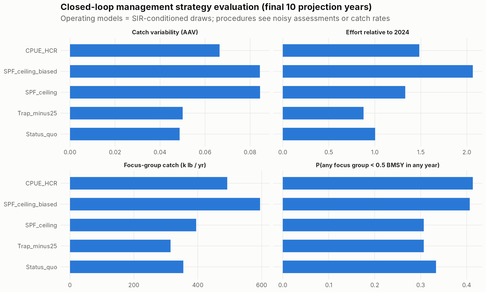{width=100%}


## Ecosystem-level indicators

**Table. Ecosystem-overfishing indices (selected years).**

| year | ryther_p50 | ryther_p05 | ryther_p95 | fogarty_permil_p50 | fogarty_permil_p05 | fogarty_permil_p95 | ryther_status | fogarty_status |
| --- | --- | --- | --- | --- | --- | --- | --- | --- |
| 1,985 | 0.753 | 0.487 | 1.177 | 0.607 | 0.373 | 0.982 | below | caution |
| 1,995 | 0.526 | 0.343 | 0.806 | 0.467 | 0.279 | 0.793 | below | caution |
| 2,005 | 0.827 | 0.577 | 1.315 | 0.725 | 0.461 | 1.270 | below | caution |
| 2,015 | 0.679 | 0.473 | 1.039 | 0.588 | 0.373 | 0.978 | below | caution |
| 2,022 | 0.646 | 0.398 | 0.977 | 0.569 | 0.335 | 0.939 | below | caution |
| 2,023 | 0.665 | 0.427 | 1.005 | 0.596 | 0.340 | 0.966 | below | caution |
| 2,024 | 0.606 | 0.395 | 0.927 | 0.557 | 0.353 | 0.939 | below | caution |
| 2,045 | 0.728 | 0.479 | 1.119 | 0.605 | 0.375 | 0.957 | below | caution |


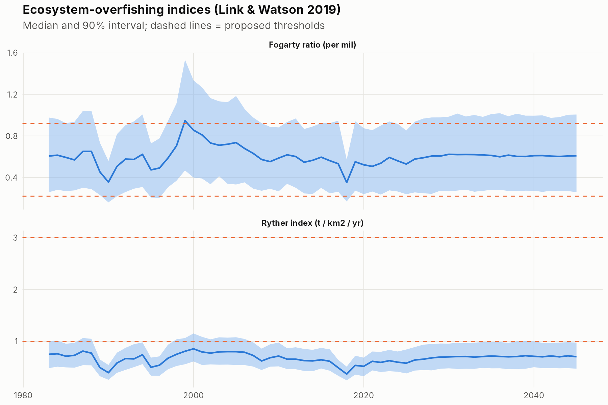{width=100%}


# Discussion


## Interpretation of the St. Croix results

**Theory changes the answer.** Two changes give the trap bycatch groups much less headroom than the original SEDAR103-DW-20 formulation did:

* replacing x = 0.5 on Ecopath P/B with per-recruit x on natural mortality;
* replacing Schaefer with Pella–Tomlinson production.

Under the earlier form, every trap group was "Below target" with P(overfishing) of at most 3.4%. Under the theory-consistent form, hogfish, porgies and queen triggerfish carry overfishing probabilities of 16–35% at current (placeholder) catch. Fish-trap and dive effort are at their multispecies ceilings.

This direction of change is what fisheries theory predicts. Gulland's x = 0.5 is an upper bound for species whose gear selectivity, maturity and steepness keep F_MSY below M (Beddington & Cooke 1983; Zhou et al. 2012). The `gulland_PB` structural variant quantifies the change.

**The binding constraint is bycatch, not lobster.** Lobster and Parrotfish 2 dominate the value of the trap fishery and have substantial headroom. The groups that limit fish-trap and dive effort are small, slow-turnover bycatch species. This matches the logic of the SEDAR 103 framework: in a multispecies, non-selective fishery, effort ceilings are set by the weakest stock the gear catches. Management options that protect choke groups without cutting all effort would raise sustainable value. Examples include escape gaps or mesh changes for small fishes, and spatial closures where those species concentrate. The model can evaluate such options as scenarios once their effect on group-specific catchability is specified.

**The lobster anchor matters most.** Lobster MMSY is 1.5× the OFL. The catch-only comparator lies between the two. Without its OFL, the energy budget overestimates lobster scale several-fold. Lobster is a large-bodied invertivore that shares the invertivore pools with abundant benthic predatory invertebrates, and the biomass of those competitors is the single largest driver of total MMSY. Fishery-independent estimates of lobster and invertebrate-competitor biomass, and the SEDAR 57 CPUE as a fitted index, are therefore the most valuable additions for the trap fishery.

**Climate effects are large but uncertain.** Projected MMSY declines of 16–43% under SSP5-8.5 come mainly from the thermal-performance curves. These are realized-niche curves, so the magnitudes are assumptions (Appendix B, A18). They are tested by the `no_thermal` ensemble variant. The direction is robust: every focus group has an optimum near or below current St. Croix temperatures. The magnitude would benefit from physiological thermal-performance data for the key species.

**Management procedures.**

* The closed-loop results caution against relying on catch-rate rules for this fishery. CPUE in a multispecies trap fishery is dominated by the abundant groups, so it can stay high while choke groups decline.
* The SPF effort-ceiling rule tracks the choke groups and performs better, but only with unbiased assessments.
* In none of the procedures tested is the risk to queen triggerfish and hogfish below about 10–15%. Achieving that would need lower effort on the gears that catch them, or gear and area measures that reduce their catchability.


## What the model can and cannot say

CaribTTM answers one question: **how much yield can each part of the St. Croix food web sustain, given the energy its habitats produce and how that energy is shared?** Its strengths:

* **Absolute scale from energy, not catch history alone.** Primary production and transfer efficiency bound total yield independently of the landings record. Assessment OFLs and catch feasibility then set how it is shared. This is most valuable for the many unassessed complexes, where landings-only approaches cannot separate low productivity from low exploitation.
* **Explicit mechanisms for conditions that are changing.** Coral loss, warming, hurricanes, lionfish, *Sargassum*, nursery degradation and fishing on herbivores all enter through documented pathways. Their projected effects can be compared by scenario.
* **Consistency between the yield cap and the dynamics.** The x priors and production shapes come from the same per-recruit analysis. Status calls (B/B_MSY) and yield caps therefore rest on one theory.
* **Gear-level outputs.** Effort ceilings and choke groups translate group caps into the units a trap-fishery manager controls.

Its limitations are equally important:

* **Groups, not species.** Biomass pools cannot represent size structure, growth overfishing (except through the per-recruit priors), sex change in groupers and parrotfishes, or spawning-aggregation dynamics.
* **No functional responses.** Pools are shared by demand weight, not by predator–prey functional responses. Strong top-down effects such as predator release are represented only through bottom-up fishing feedback.
* **Absolute production rates are transferred.** Benthic NPP values come from other Caribbean (and, for the reef range, Indian Ocean) sites. Food-web fraction and TTE are not measured for St. Croix. Together these set the overall scale, which the two OFL anchors pin only for their own groups.
* **Placeholder fishery data.** Until real landings, effort and assessment indices are used, the unassessed complexes' MMSY, the gear choke analysis and the MSE are demonstrations of the method.
* **Spatial aggregation.** The shelf is one spatial unit, with habitats as compartments. Lang Bank, the north and south shelves and the no-take areas are not spatially explicit.

## Relationship to assessments

CaribTTM does not replace single-species assessments.

* **For the two assessed stocks**, it uses their OFLs as anchors and adds ecosystem context: how their productive capacity depends on habitat, temperature and competitors, and how it may change. An OFL is a catch at F_MSY given current biomass, not an equilibrium MSY, so the model's MMSY and the OFL should agree only within the uncertainty that the CV of 0.4 allows.
* **For unassessed complexes**, it gives an energetically bounded estimate that can be compared with ACLs and, once data allow, with data-limited assessments.

The independent catch-only comparator shows where the energy budget and the catch history agree or disagree. Disagreement identifies which assumptions drive a result.

## Issues a CIE panel is likely to raise

The project's review-readiness and code-review documents (Appendix D) map anticipated critiques to responses. The most substantive are:

1. **Is the absolute scale credible?** The answer rests on:
   - the OFL anchors, tested by leave-one-out;
   - the structural ensemble (TTE, food-web fraction, x, production shape);
   - the catch-only comparator.
2. **Is the posterior dominated by a few draws?** The effective sample size, Pareto-k diagnostic and weight-truncation flag are reported. Wider adaptive sampling, or a sequential Monte Carlo sampler, would increase precision.
3. **Are ecological effects double-counted?** Nursery, refuge, *Sargassum* and lionfish effects act multiplicatively on capacity. Their combined effect is bounded by the structural variants that switch each off.
4. **How were placeholders chosen, and do they matter?** Every placeholder is listed with its value and basis (Appendix B). The value-of-information analysis ranks which ones matter most for MMSY.


# Assumptions

Every assumption is listed in Appendix B with:

* its value or form;
* its basis: a citation, data product or explicit expert judgement;
* its type: theory, data-derived, literature value, expert judgement, placeholder or statistical convention;
* how its influence is tested, and what would replace it.

The most consequential are:

1. **Absolute production.**
   - transferred benthic NPP rates (A26);
   - the food-web fraction (A4);
   - transfer efficiency (A3).
2. **Calibration.** The OFLs are treated as observations of MMSY (C1), and placeholder landings set the catch-feasibility constraint (B1, B2).
3. **Population theory.**
   - the per-recruit priors for x and B_MSY/B₀ (A6–A10), especially the steepness and trap-selectivity assumptions;
   - the open-recruitment fraction for lobster (A11).
4. **Ecological placeholder magnitudes.** Nursery elasticity, herbivory elasticity, lionfish and *Sargassum* effects, ghost-trap efficiency and no-take shares (A13, A16, A19, A20; B4, B5).

# Data needs and research priorities

The data needed are grouped by type. Each is listed with the file and column to update, the current placeholder, a suggested source and a priority.


Every input in the St. Croix project has a value, so the model runs end to end. The items below are **placeholders** (flagged `PLACEHOLDER` in the `data_status` column) or **approximations** that should be replaced with real data before results are used for management. They are grouped by data type, with the file and columns to update and a suggested source.

Priority: **H** = strongly affects MMSY scale or status; **M** = affects dynamics, scenarios or allocation; **L** = minor or sensitivity only.

### A. Fishery-dependent data (confidential; no public API)

| # | Item | File / columns | Current placeholder | Suggested source | Priority |
|---|---|---|---|---|---|
| A1 | Commercial landings by year × gear × FMP group, 1983–2024 | `landings.csv: landings_lb` | synthetic series scaled to recent ACL-era magnitudes (only queen conch 2021 = 30,535 lb is real) | SEFSC Caribbean Commercial Landings (CCL) / St. Croix trip tickets, species mapped to FMP complexes | **H** |
| A2 | Landings observation error | `landings.csv: cv` or `settings: landings_cv` (0.2) | assumed 0.2 | CCL vs TIP or MER Consultants catch-validation comparisons | M |
| A3 | Reporting expansion factor | `settings: catch_expansion` (1.5 ± 25%) | assumed (Puerto Rico ≈ 2.0; USVI unquantified) | SEFSC expansion studies; MER Consultants Sampling and Catch Validation Project | **H** |
| A4 | Effort by gear (trips; ideally trap-hauls, soak days, dive hours) | `effort.csv: effort` | synthetic trips per gear | CCL trip tickets; TIP | **H** (projections, gear allocation) |
| A5 | Effort observation error | `effort.csv: cv` or `settings: effort_cv` (0.1) | assumed | trip-ticket audits | L |
| A6 | Gear split of each group's landings (fish trap vs lobster trap vs dive vs hook-and-line) | implicit in A1 | assumed splits (e.g., lobster 30/15/55 lobster-trap/fish-trap/dive) | CCL gear codes; TIP | **H** (choke groups) |
| A7 | Recreational / subsistence removals | add to `landings.csv` (gear = `recreational`) | none | MRIP-equivalent surveys if available; household surveys | M |

### B. Assessment indices and benchmarks (published; transcribe from reports)

| # | Item | File / columns | Current placeholder | Suggested source | Priority |
|---|---|---|---|---|---|
| B1 | St. Croix spiny lobster standardized trap CPUE | `indices.csv` (`SEDAR57_lobster_trap_CPUE`) | synthetic 2012–2021 | SEDAR 57 / SEDAR 57 Update (SEDAR91-RD20). Leave-one-out validation shows lobster scale is not identified without assessment information, so this is the top-priority item | **H** |
| B2 | St. Croix queen triggerfish commercial trap index | `indices.csv` (`SEDAR80_QT_trap_CPUE`) | synthetic 1985–2019 | SEDAR 80 Stock Assessment Report | **H** |
| B3 | Yellowtail snapper index / reference points | `indices.csv`, `benchmarks.csv` | none | SEDAR 84 (St. Croix yellowtail snapper) | M |
| B4 | Spiny lobster and queen triggerfish B₀ / SSB₀ (for `fixed_biomass` partitioning) | `groups.csv: B0_fixed_t` | not used (biomass priors instead) | SEDAR 57 Update; SEDAR 80 | M |
| B5 | Natural mortality / P/B for assessed stocks | `groups.csv: pb` | lobster 0.8, queen triggerfish 0.6 | SEDAR 57 (M ≈ 0.34 + F); SEDAR 80 | M |

Already real: lobster OFL/ABC/ACL, queen triggerfish OFL/ABC/ACL, Parrotfish 2, Snapper 1–3, queen conch and dolphinfish ACLs (`benchmarks.csv`).

### C. Fishery-independent biological data

| # | Item | File / columns | Current placeholder | Suggested source | Priority |
|---|---|---|---|---|---|
| C1 | Biomass density (t km⁻² = g m⁻²) by FMP group and habitat, for partitioning | `groups.csv: partition_value` | **now derived** from Opitz (1996) VI species biomass × mass-balance factor; conch, pelagics and deepwater snappers still placeholders | NCRMP St. Croix fish surveys: the ingestion pipeline (`ncrmp_fish` method, stratified estimator) is built and tested; NCEI downloads were unavailable (HTTP 503) during development | **H** |
| C2 | Parrotfish biomass density index | `indices.csv` (`NCRMP_parrotfish_density`) | synthetic biennial 2013–2023 | NCRMP St. Croix Scaridae density | M |
| C3 | Queen conch density / abundance surveys | `indices.csv`, `groups.csv` | none | St. Croix conch surveys (DPNR / SEFSC) | M |
| C4 | Non-fishery competitor biomass | `groups.csv: partition_value` | **now from** Opitz (1996) balanced 50-box model | local invertebrate surveys to update | M |
| C5 | P/B for unassessed groups | `groups.csv: pb`, `pb_cv` | **now** geometric mean of Opitz (1996) P/B and FishBase M (Then et al. 2015) | SEDAR-specific M where available | L |
| C6 | Diet composition by trophic-level pool | `diet.csv` | **now** matched to FishBase trophic levels | stable isotopes for St. Croix | L |
| C7 | Habitat preferences | `habitat_preference.csv` | expert-informed | NCRMP occupancy by habitat stratum; telemetry studies | M |
| C8 | Refuge dependence on coral habitat quality | `groups.csv: refuge_dependence` | expert guesses (0–0.7) | NCRMP fish–rugosity relationships | M |
| C9 | x_msy (MMSY fraction) by group | `groups.csv: x_msy` | 0.5 (0.4 conch) | literature on reef MSY/M·B₀ ratios; sensitivity runs | M |
| C10 | Initial depletion in 1983 | `groups.csv: init_depletion` | assumed 0.4–0.8 | historical CPUE; earliest SEDAR biomass estimates | M |
| C11 | Immigration / connectivity | `groups.csv: immigration_t` | 25 t yr⁻¹ for pelagics only | larval connectivity models; Greater Caribbean model | L |

### D. Habitat and primary production

| # | Item | File / columns | Current value | Suggested source | Priority |
|---|---|---|---|---|---|
| D1 | Deeper-shelf habitat | `habitats.csv` (`deep_hardbottom`) | **resolved**: 41.4 km² at 30–100 m from ETOPO 2022 (the 388 km² NCCOS "Unknown" class was mostly off-shelf); NPP light-limited (~165 t C km⁻² yr⁻¹, CV 0.6). The 2017 NCCOS shelf map covers St. Thomas/St. John only | mesophotic surveys of Lang Bank for composition | M |
| D2 | St. Croix-specific benthic net production by habitat | `habitats.csv: npp_value` | Caribbean literature values (Adey & Steneck 1985 is St. Croix) | local metabolism studies; Buck Island / East End measurements | M |
| D3 | Food-web fraction of NPP by habitat | `food_web_fraction` | 0.2–0.5 assumed (tested in the structural ensemble ×0.67/×1.5) | Ecopath detritus/EE flows (Opitz 1996) | **H** |
| D4 | Trophic transfer efficiency | `tte` | 0.15 ± 20% (SEDAR103-DW-20 default) | sensitivity 0.10–0.20 | **H** |
| D5 | Coral cover before 2000 | `env_covariates.csv: coral_cover` | PLACEHOLDER 1983–1999 (0.22 → 0.13 after Hugo/Marilyn) | historical St. Croix reef surveys (Buck Island NPS, Rogers et al.), TCRMP baseline | M |
| D6 | Coral cover 2000–2024 (exact values) | `coral_cover` | approximate (TCRMP / NCRMP magnitudes) | TCRMP and NCRMP St. Croix benthic data | M |
| D7 | Coral growth, bleaching mortality per DHW, SCTLD mortality | `settings`, `scenarios.csv` | literature-typical | NCRMP / TCRMP before–after bleaching surveys | M |

### E. Environmental drivers and disturbances

All environmental covariates are now acquired from APIs (Section F). What remains are the *effects* of the drivers:

| # | Item | File / columns | Current placeholder | Suggested source | Priority |
|---|---|---|---|---|---|
| E1 | Thermal sensitivities of groups | `env_response.csv` | **now** AquaMaps temperature preferences (FishBase); lobster and conch have none (SeaLifeBase pending) | physiological thermal-performance studies | M |
| E2 | Hurricane loss magnitudes (NPP, coral, trap effort, lobster production) and recovery half-lives | `disturbances.csv` templates | 25% NPP, 15% coral, 60% trap loss, half-lives 1.5–2 years | post-Hugo/Marilyn/Maria damage surveys; trap-loss reports; disaster-assistance records | M |
| E3 | Future bleaching frequency and DHW magnitude | `scenarios.csv` (`cov_set dhw`) | assumed event years | Coral Reef Watch / CMIP6-based bleaching projections (e.g., van Hooidonk et al.) | M |
| E4 | Pelagic NPP absolute level | `habitats.csv: npp_value` (pelagic) | 85 g C m⁻² yr⁻¹ (SEDAR103-DW-20 regional magnitude); the computed shelf ensemble is ~130–240 (shelf chlorophyll is likely biased high by bottom reflectance) | St. Croix-domain extraction of the Ryan-Keogh et al. (2023) ensemble | M |

### G. Ecological-process magnitudes added in the theory review (placeholders; see Ecological Review)

| # | Item | File / columns | Current placeholder | Suggested source | Priority |
|---|---|---|---|---|---|
| G1 | Spiny lobster open-recruitment fraction and larval-supply index | `groups.csv: open_recruitment`, `recruit_covariate` | 0.8 ± 25%; no supply index | biophysical connectivity model output (Kough et al. 2013 framework); puerulus collector time series | **H** |
| G2 | No-take (MPA) share of each habitat | `habitats.csv: closed_fraction` | approximate (reef 0.25, pavement 0.15, …) | GIS overlay of Buck Island Reef NM and East End Marine Park no-take zones on the NCCOS habitat map | M |
| G3 | Nursery dependence of each group | `groups.csv: nursery_habitat`, `nursery_dependence` | 0.2–0.5 expert-informed | structured expert elicitation; juvenile surveys; Nagelkerken-type nursery-value studies | M |
| G4 | Herbivory–coral feedback strength | `settings: herbivory_elasticity` | 1 ± 50% | coral recruitment / macroalgae vs parrotfish biomass (NCRMP benthic + fish) | M |
| G5 | Ghost-trap efficiency and decay | `settings: ghost_efficiency`, `ghost_half_life` | 0.2, 1.5 yr | USVI derelict-trap studies (Renchen et al. 2010; Clark et al. 2012; Arthur et al. 2014); trap-loss reports after Maria | L |
| G6 | Lionfish invasion timeline and effect | `env_covariates.csv: lionfish`; `env_response.csv` | timeline 2009–2012; −10% / −5% K | NCRMP lionfish densities; fishers' LEK timelines | M |
| G7 | Sargassum before 2016 and its effects | `env_covariates.csv: sargassum` (2011–2015); `env_response.csv` | Wang et al. 2019 relative magnitudes; −3% K per index unit | USF SaWS monthly bulletins (2011–2015); nursery-habitat surveys after inundation | L |
| G8 | Trap selectivity (L50) by group | `data-raw/build_life_history_priors.R` | 15 cm TL (cap 0.6 L∞), CV 0.3 | trap selectivity studies for USVI mesh; TIP length compositions | M |
| G9 | CPUE hyperstability and creep | `indices.csv: hyperstability, creep` | β = 1, creep 2% yr⁻¹ | SEDAR 57 / 80 standardization diagnostics | M |

### F. Already acquired automatically (no action needed; refresh with `acquire_project_data()`)

| Data | Source | Years |
|---|---|---|
| SST (annual mean) | NOAA Coral Reef Watch CoralTemp monthly; AVHRR Pathfinder 5.3 for 1983–84 (PIFSC OceanWatch ERDDAP) | 1983–2024 |
| Degree heating weeks (annual max) | NOAA Coral Reef Watch (PIFSC) | 1985–2024 |
| Pelagic NPP index | computed VGPM + Eppley-VGPM from ESA OC-CCI chlorophyll, CRW SST and SeaWiFS/MODIS PAR (PIFSC) | 1998–2024 (earlier years held at the mean) |
| Chlorophyll-a, Kd490 | ESA OC-CCI v6 (PIFSC) | 1998–2024 |
| SST and NPP projections | CMIP6 CESM2 + ACCESS-ESM1-5, SSP2-4.5 and SSP5-8.5, delta method (PIFSC) | 2025–2045 |
| Benthic habitat areas | NOAA NCCOS USVI 2002 benthic habitat map (ArcGIS REST) | static |
| Hurricane disturbances | NOAA NHC HURDAT2 | 1983–2024 |
| Pelagic Sargassum index | USF AFAI 7-day composites (NOAA AOML ERDDAP) | 2016–2024 |

Optional sources that are configured but disabled, because they need credentials or were unreachable from the development container:

* GLORYS12 bottom temperature (Copernicus Marine; free account).
* MOM6-NWA12 (NOAA CEFI THREDDS).
* Pre-computed PFEG NPP products.


# Conclusions


1. CaribTTM provides a habitat-resolved, energetically bounded and theory-consistent estimate of multispecies sustainable yield for every functional group, guild and gear in an island fishery. It carries full uncertainty propagation and the diagnostics a CIE review expects.

2. The data pipeline is automated and reproducible for every input that has a public source: temperature, bleaching stress, chlorophyll, water clarity, primary production, climate projections, habitat areas, bathymetry, hurricanes, *Sargassum* and species traits. The model can therefore be applied to St. Thomas/St. John, Puerto Rico or other regions by changing a bounding box and a few input tables.

3. For St. Croix, the model reproduces the two assessed stocks within their uncertainty. Queen triggerfish passes out-of-sample validation. The model identifies small trap-bycatch groups (hogfish, porgies, queen triggerfish) as the binding constraints on fish-trap, dive and lobster-trap effort.

4. Climate warming is the largest projected stressor. Nursery loss, open-access effort and optimistic assessments are the main avoidable risks.

5. The results are conditional on placeholder landings, effort and indices and on several expert-judgement process magnitudes. All are documented and tested. The highest-value next steps are:
   * enter the confidential landings and effort by gear;
   * fit the SEDAR 57 and SEDAR 80 standardized CPUE;
   * ingest NCRMP fish and invertebrate surveys, including as absolute biomass indices;
   * obtain St. Croix-specific benthic production and transfer-efficiency estimates;
   * replace the placeholder process magnitudes through structured expert elicitation and fishers' knowledge.


# References {-}


### Framework

* Karnauskas, M., Woodstock, M., Agar, J., Solis, D., Vandermeulen, R. (2026). US Caribbean Application of Alternate Assessment Methods: An integrated trophic frontier framework for managing U.S. Caribbean fisheries. SEDAR103-DW-20. SEDAR, North Charleston, SC. 19 pp.
* Karnauskas, M., et al. (2026). An integrated trophic frontier framework for managing U.S. Caribbean fisheries. Presentation, SEDAR 103 Data Workshop, August 17–21, 2026.
* Southeast Integrated Ecosystem Assessment Program (2025). Caribbean Ecosystem Status Report. NOAA Tech. Memo. NMFS-792. 61 p.
* Caribbean Fishery Management Council (2016). Puerto Rico Commercial Snapper Unit 2 Federal Permit Program: Scoping document. NMFS.
* Caribbean Fishery Management Council (2019). Comprehensive Fishery Management Plan for the St. Croix Exclusive Economic Zone. Final rule: Federal Register 87(176), 13 Sep 2022 (2022-19409).

### Trophic transfer, MSY and data-limited methods

* Beddington, J. R., Cooke, J. G. (1983). The potential yield of fish stocks. FAO Fish. Tech. Pap. 242.
* Garcia, S., Sparre, P., Csirke, J. (1989). Estimating surplus production and maximum sustainable yield from biomass data when catch and effort time series are not available. Fisheries Research 8: 13–23.
* Gulland, J. A. (1971). The Fish Resources of the Ocean. Fishing News Books, West Byfleet.
* Kimura, D. K., Tagart, J. V. (1982). Stock reduction analysis, another solution to the catch equations. Can. J. Fish. Aquat. Sci. 39: 1467–1472.
* Lindeman, R. L. (1942). The trophic-dynamic aspect of ecology. Ecology 23: 399–417.
* Martell, S., Froese, R. (2013). A simple method for estimating MSY from catch and resilience. Fish and Fisheries 14: 504–514.
* McClanahan, T. R., et al. (2011). Critical thresholds and tangible targets for ecosystem-based management of coral reef fisheries. PNAS 108: 17230–17233.
* Munro, J. L., Williams, D. McB. (1985). Assessment and management of coral reef fisheries: biological, environmental and socio-economic aspects. Proc. 5th Int. Coral Reef Congr. 4: 545–581.
* Opitz, S. (1996). Trophic interactions in Caribbean coral reefs. ICLARM Tech. Rep. 43. 341 p.
* Pauly, D., Christensen, V. (1995). Primary production required to sustain global fisheries. Nature 374: 255–257.
* Randall, J. E. (1967). Food habits of reef fishes of the West Indies. Stud. Trop. Oceanogr. 5: 665–847.
* Rubin, D. B. (1988). Using the SIR algorithm to simulate posterior distributions. Bayesian Statistics 3: 395–402.
* Schaefer, M. B. (1954). Some aspects of the dynamics of populations important to the management of the commercial marine fisheries. Bull. Inter-Am. Trop. Tuna Comm. 1: 27–56.
* Walters, C. J., Christensen, V., Martell, S. J., Kitchell, J. F. (2005). Possible ecosystem impacts of applying MSY policies from single-species assessment. ICES J. Mar. Sci. 62: 558–568.
* Walters, C. J., Martell, S. J. D., Korman, J. (2006). A stochastic approach to stock reduction analysis. Can. J. Fish. Aquat. Sci. 63: 212–223.

### Stochastic production frontiers (downstream)

* Aigner, D., Lovell, C. A. K., Schmidt, P. (1977). Formulation and estimation of stochastic frontier production function models. J. Econometrics 6: 21–37.
* Kumbhakar, S. C., Lovell, C. A. K. (2000). Stochastic Frontier Analysis. Cambridge University Press.

### Primary production: pelagic

* Behrenfeld, M. J., Falkowski, P. G. (1997). Photosynthetic rates derived from satellite-based chlorophyll concentration. Limnol. Oceanogr. 42: 1–20.
* Ryan-Keogh, T. J., Thomalla, S. J., Chang, N., Moalusi, T. (2023). A new global oceanic multi-model net primary productivity data product. Earth Syst. Sci. Data 15: 4829–4848.
* Silsbe, G. M., Behrenfeld, M. J., Halsey, K. H., Milligan, A. J., Westberry, T. K. (2016). The CAFE model: A net production model for global ocean phytoplankton. Global Biogeochem. Cycles 30: 1756–1777.
* Westberry, T., Behrenfeld, M. J., Siegel, D. A., Boss, E. (2008). Carbon-based primary productivity modeling with vertically resolved photoacclimation. Global Biogeochem. Cycles 22: GB2024.

### Primary production: benthic (habitat-specific)

> Several entries below were compiled from a literature synthesis (NotebookLM) of Caribbean benthic productivity. Full titles, volumes and pages marked with partial details should be verified against the original publications before formal citation.

* Adey, W. H., Steneck, R. S. (1985). Highly productive eastern Caribbean reefs: synergistic effects of biological, chemical, physical, and geological factors. In: The Ecology of Coral Reefs (M. L. Reaka, ed.), NOAA Symp. Ser. Undersea Res. 3: 163–187. *(St. Croix fore-reef metabolism)*
* Cortés, J., et al. (2014). CARICOMP synthesis of seagrass productivity. *(as cited in van Tussenbroek et al. 2014)*
* Douglas, A. E. (2001). The productivity of corals. In: Oceanography (Vol. II), Encyclopedia of Life Support Systems (EOLSS).
* Duarte, C. M. (1990). Seagrass nutrient content. Mar. Ecol. Prog. Ser. 67: 201–207.
* Duarte, C. M., Marbà, N., Gacia, E., et al. (2010). Seagrass community metabolism: assessing the carbon sink capacity of seagrass meadows. Global Biogeochem. Cycles 24: GB4032.
* Eidens, C., Bayraktarov, E., Pizarro, V., Wilke, T., Wild, C. (2012, 2014). Seasonal upwelling stimulates primary production of Colombian Caribbean coral reefs. Proc. 12th ICRS; Coral Reefs.
* Gattuso, J.-P., Frankignoulle, M., Wollast, R. (1998). Carbon and carbonate metabolism in coastal aquatic ecosystems. Annu. Rev. Ecol. Syst. 29: 405–434.
* Gomis, E., Strydom, S., Foster, N. R., Montemayor, D., Mateo, M. A., Serrano, E., Serrano, O. (2025). Global estimates of seagrass blue carbon stocks in biomass and net primary production. Nature Communications 16: 9530.
* Hatcher, B. G. (1990). Coral reef primary productivity: a hierarchy of pattern and process. Trends Ecol. Evol. 5: 149–155.
* Lewis, J. B. (1977). Processes of organic production on coral reefs. Biol. Rev. 52: 305–347.
* López-Calderón, J., et al. (2013). Decadal monitoring of *Thalassia testudinum* growth, Bocas del Toro, Panama.
* Loría-Naranjo, M., Samper-Villarreal, J., Cortés, J. (2018). Long-term changes in seagrass at Cahuita, Costa Rica.
* Lugo, A. E., Snedaker, S. C. (1974). The ecology of mangroves. Annu. Rev. Ecol. Syst. 5: 39–64.
* Naumann, M. S., Jantzen, C., Haas, A. F., Iglesias-Prieto, R., Wild, C. (2013). Benthic primary production budget of a Caribbean reef lagoon (Puerto Morelos, Mexico). PLoS ONE 8: e82923.
* Paynter, C. K., Cortés, J., Engels, M. (2001). Biomass, productivity and density of the seagrass *Thalassia testudinum* at three sites in Cahuita National Park, Costa Rica. Rev. Biol. Trop. 49 (Suppl. 2): 265–272.
* Ramachandran Nair, P. V., Pillai, C. S. G. (1972). Primary productivity of some coral reefs in the Indian seas. Proc. Symp. Corals and Coral Reefs: 33–42.
* Rogers, C. S. (1979). The productivity of San Cristobal Reef, Puerto Rico. Limnol. Oceanogr. 24: 342–349.
* van Tussenbroek, B. I., et al. (2014). Caribbean-wide, long-term study of seagrass beds reveals local variations, shifts in community structure and occasional collapse. PLoS ONE 9: e90600.
* Wanders, J. B. W. (1976). The role of benthic algae in the shallow reef of Curaçao (Netherlands Antilles). I: Primary productivity in the coral reef. Aquat. Bot. 2: 235–270.

### St. Croix assessments, benchmarks and monitoring

* SEDAR (2019). SEDAR 57 – Caribbean Spiny Lobster (St. Croix). SEDAR, North Charleston, SC.
* SEFSC (2022). SEDAR 57 Stock Assessment Update – St. Croix Caribbean Spiny Lobster (SEDAR91-RD20); OFL/ABC adopted in Federal Register 2024-09227 (30 Apr 2024).
* SEDAR (2024). SEDAR 80 – U.S. Caribbean Queen Triggerfish. CFMC SSC April 2024 meeting summary (OFL/ABC); Framework Action 3 final rule, Federal Register 2026-05251 (18 Mar 2026).
* SEDAR (2025). SEDAR 84 – U.S. Caribbean Yellowtail Snapper, St. Croix.
* NOAA Fisheries. Annual Catch Limit Monitoring under the St. Croix Fishery Management Plan (web page; queen conch and pelagic ACLs and landings).
* NOAA NCCOS (2001). Benthic Habitat Maps of the U.S. Virgin Islands – St. Croix, prepared by visual interpretation from remote sensing imagery collected by NOAA, 1999.
* NOAA National Coral Reef Monitoring Program (NCRMP). Status of coral reefs in the U.S. Virgin Islands (benthic and fish monitoring, 2013–2023).
* NOAA Coral Reef Watch. Degree Heating Week products.

### Ocean models

* Jean-Michel, L., et al. (2021). The Copernicus Global 1/12° Oceanic and Sea Ice GLORYS12 Reanalysis. Front. Earth Sci. 9: 698876.
* Ross, A. C., et al. (2023). A high-resolution ocean model for the Northwest Atlantic (MOM6-NWA12). Geosci. Model Dev. 16: 6943–6985.

### Robustness, validation and evidence synthesis

* Cochran, W. G. (1977). Sampling Techniques, 3rd ed. Wiley. *(stratified estimator for NCRMP data)*
* Froese, R., Binohlan, C. (2000). Empirical relationships to estimate asymptotic length, length at first maturity and length at maximum yield per recruit in fishes. J. Fish Biol. 56: 758–773.
* Froese, R., Pauly, D. (eds) (2024). FishBase, version 24.07 (www.fishbase.org); tables accessed via the rfishbase data release on Hugging Face (datasets/cboettig/fishbase).
* Kaschner, K., et al. (2019). AquaMaps: predicted range maps for aquatic species (temperature preferences via FishBase).
* Juman, R. A. (2005a). The structure and productivity of the *Thalassia testudinum* community in Bon Accord Lagoon, Tobago. Rev. Biol. Trop. 53 (Suppl. 1): 219–227. (Productivity 3.9–4.9 g DW m⁻² d⁻¹; a nutrient-enriched lagoon.)
* Juman, R. A. (2005b). Biomass, litterfall and decomposition rates for the fringed *Rhizophora mangle* forest lining the Bon Accord Lagoon, Tobago. Rev. Biol. Trop. 53 (Suppl. 1): 207–217.
* Link, J. S., Watson, R. A. (2019). Global ecosystem overfishing: clear delineation within real limits to production. Science Advances 5: eaav0474.
* McAllister, M. K., Ianelli, J. N. (1997). Bayesian stock assessment using catch-age data and the sampling-importance resampling algorithm. Can. J. Fish. Aquat. Sci. 54: 284–300.
* Mohn, R. (1999). The retrospective problem in sequential population analysis. ICES J. Mar. Sci. 56: 473–488.
* Morel, A., Huot, Y., Gentili, B., Werdell, P. J., Hooker, S. B., Franz, B. A. (2007). Examining the consistency of products derived from various ocean color sensors in open ocean (Case 1) waters. Remote Sens. Environ. 111: 69–88. *(Kd(PAR) from Kd(490))*
* NOAA NCEI (2022). ETOPO 2022 15 Arc-Second Global Relief Model. doi:10.25921/fd45-gt74.
* Owen, A., Zhou, Y. (2000). Safe and effective importance sampling. J. Am. Stat. Assoc. 95: 135–143.
* Saltelli, A., et al. (2008). Global Sensitivity Analysis: The Primer. Wiley.
* Sathyendranath, S., et al. (2019). An ocean-colour time series for use in climate studies: the experience of the Ocean-Colour Climate Change Initiative (OC-CCI). Sensors 19: 4285.
* Then, A. Y., Hoenig, J. M., Hall, N. G., Hewitt, D. A. (2015). Evaluating the predictive performance of empirical estimators of natural mortality rate using information on over 200 fish species. ICES J. Mar. Sci. 72: 82–92.
* Vehtari, A., Simpson, D., Gelman, A., Yao, Y., Gabry, J. (2024). Pareto smoothed importance sampling. J. Mach. Learn. Res. 25(72): 1–58 (arXiv:1507.02646, 2015).

### Ecological and fisheries-theory additions

* Adams, A. J., et al. (2006). Nursery function of tropical back-reef systems. Mar. Ecol. Prog. Ser. 318: 287–301.
* Albins, M. A. (2013). Effects of invasive Pacific red lionfish *Pterois volitans* versus a native predator on Bahamian coral-reef fish communities. Biol. Invasions 15: 29–43.
* Albins, M. A., Hixon, M. A. (2008). Invasive Indo-Pacific lionfish *Pterois volitans* reduce recruitment of Atlantic coral-reef fishes. Mar. Ecol. Prog. Ser. 367: 233–238.
* Beddington, J. R., Cooke, J. G. (1983). The potential yield of fish stocks. FAO Fish. Tech. Pap. 242.
* Clark, W. G. (1991). Groundfish exploitation rates based on life history parameters. Can. J. Fish. Aquat. Sci. 48: 734–750.
* Froese, R., Demirel, N., Coro, G., Kleisner, K. M., Winker, H. (2017). Estimating fisheries reference points from catch and resilience. Fish Fish. 18: 506–526.
* Green, S. J., Akins, J. L., Maljković, A., Côté, I. M. (2012). Invasive lionfish drive Atlantic coral reef fish declines. PLoS ONE 7: e32596.
* Harley, S. J., Myers, R. A., Dunn, A. (2001). Is catch-per-unit-effort proportional to abundance? Can. J. Fish. Aquat. Sci. 58: 1760–1772.
* Hu, C., Feng, L., Hardy, R. F., Hochberg, E. J. (2015). Spectral and spatial requirements of remote measurements of pelagic *Sargassum* macroalgae. Remote Sens. Environ. 167: 229–246.
* Kough, A. S., Paris, C. B., Butler, M. J. IV (2013). Larval connectivity and the international management of fisheries. PLoS ONE 8: e64970.
* Mace, P. M., Doonan, I. J. (1988). A generalised bioeconomic simulation model for fish population dynamics. NZ Fish. Assess. Res. Doc. 88/4.
* Maunder, M. N., Punt, A. E. (2004). Standardizing catch and effort data: a review of recent approaches. Fish. Res. 70: 141–159.
* Mumby, P. J., et al. (2004). Mangroves enhance the biomass of coral reef fish communities in the Caribbean. Nature 427: 533–536.
* Mumby, P. J., et al. (2006). Fishing, trophic cascades, and the process of grazing on coral reefs. Science 311: 98–101.
* Mumby, P. J., Hastings, A., Edwards, H. J. (2007). Thresholds and the resilience of Caribbean coral reefs. Nature 450: 98–101.
* Myers, R. A., Bowen, K. G., Barrowman, N. J. (1999). Maximum reproductive rate of fish at low population sizes. Can. J. Fish. Aquat. Sci. 56: 2404–2419.
* Nagelkerken, I., et al. (2002). How important are mangroves and seagrass beds for coral-reef fish? The nursery hypothesis tested on an island scale. Mar. Ecol. Prog. Ser. 244: 299–305.
* Oakley, J. E., O'Hagan, A. (2004). Probabilistic sensitivity analysis of complex models: a Bayesian approach. J. R. Stat. Soc. B 66: 751–769.
* Palomares, M. L. D., Pauly, D. (2019). On the creeping increase of vessels' fishing power. Ecol. Soc. 24: 31.
* Shertzer, K. W., Conn, P. B. (2012). Spawner-recruit relationships of demersal marine fishes: prior distribution of steepness. Bull. Mar. Sci. 88: 39–50.
* Smith, V. L. (1969). On models of commercial fishing. J. Polit. Econ. 77: 181–198.
* Stoner, A. W., Ray-Culp, M. (2000). Evidence for Allee effects in an over-harvested marine gastropod: density-dependent mating and egg production. Mar. Ecol. Prog. Ser. 202: 297–302.
* van Tussenbroek, B. I., et al. (2017). Severe impacts of brown tides caused by *Sargassum* spp. on near-shore Caribbean seagrass communities. Mar. Pollut. Bull. 122: 272–281.
* Wang, M., Hu, C., Barnes, B. B., Mitchum, G., Lapointe, B., Montoya, J. P. (2019). The great Atlantic *Sargassum* belt. Science 365: 83–87.
* Zhou, S., Yin, S., Thorson, J. T., Smith, A. D. M., Fuller, M. (2012). Linking fishing mortality reference points to life history traits: an empirical study. Can. J. Fish. Aquat. Sci. 69: 1292–1301.
* Casazza, T. L., Ross, S. W. (2008). Fishes associated with pelagic *Sargassum* and open water lacking *Sargassum* in the Gulf Stream off North Carolina. Fish. Bull. 106: 348–363.
* Schofield, P. J. (2010). Update on geographic spread of invasive lionfishes (*Pterois volitans* and *P. miles*) in the Western North Atlantic Ocean, Caribbean Sea and Gulf of Mexico. Aquat. Invasions 5 (Suppl. 1): S117–S122.

### Additional primary sources (code-review audit)

* Arthur, C., Sutton-Grier, A. E., Murphy, P., Bamford, H. (2014). Out of sight but not out of mind: harmful effects of derelict traps in selected U.S. coastal waters. Mar. Pollut. Bull. 86: 19–28.
* Clark, R., Pittman, S. J., Battista, T. A., Caldow, C. (eds) (2012). Survey and impact assessment of derelict fish traps in St. Thomas and St. John, U.S. Virgin Islands. NOAA Technical Memorandum NOS NCCOS 147.
* Duarte, C. M. (1991). Seagrass depth limits. Aquat. Bot. 40: 363–377.
* Eppley, R. W. (1972). Temperature and phytoplankton growth in the sea. Fish. Bull. 70: 1063–1085.
* Forsythe, W. C., Rykiel, E. J., Stahl, R. S., Wu, H., Schoolfield, R. M. (1995). A model comparison for daylength as a function of latitude and day of year. Ecol. Model. 80: 87–95.
* Gower, J., Young, E., King, S. (2013). Satellite images suggest a new *Sargassum* source region in 2011. Remote Sens. Lett. 4: 764–773.
* Ionides, E. L. (2008). Truncated importance sampling. J. Comput. Graph. Stat. 17: 295–311.
* Link, J. S., Watson, R. A. (2019). Global ecosystem overfishing: clear delineation within real limits to production. Sci. Adv. 5: eaav0474.
* Morel, A., Berthon, J.-F. (1989). Surface pigments, algal biomass profiles, and potential production of the euphotic layer: relationships reinvestigated in view of remote-sensing applications. Limnol. Oceanogr. 34: 1545–1562.
* Nair, P. V. R., Pillai, C. S. G. (1972). Primary productivity of some coral reefs in the Indian seas. Proc. Symp. Corals and Coral Reefs, Marine Biological Association of India: 33–42. *(Indian Ocean values, used only to bracket the reef NPP range)*
* Palomares, M. L. D., Bailly, N. (eds) (2024). SeaLifeBase, version 24.07 (www.sealifebase.org); AquaMaps temperature preferences for *Panulirus argus* and *Aliger gigas*.
* Renchen, G. F., Pittman, S. J., Brandt, M. E., et al. (2010). A field study of the ecological impacts of derelict fish traps in the US Virgin Islands. Proc. Gulf Caribb. Fish. Inst. 63. *(confirm page range)*
* Wang, M., Hu, C. (2016). Mapping and quantifying *Sargassum* distribution and coverage in the Central West Atlantic using MODIS observations. Remote Sens. Environ. 183: 350–367.
* Zhang, J., Stephens, M. A. (2009). A new and efficient estimation method for the generalized Pareto distribution. Technometrics 51: 316–325.
* Allen, K. R. (1971). Relation between production and biomass. J. Fish. Res. Board Can. 28: 1573–1581.
* Christensen, V., Walters, C. J. (2004). Ecopath with Ecosim: methods, capabilities and limitations. Ecol. Model. 172: 109–139.
* Fletcher, R. I. (1978). On the restructuring of the Pella-Tomlinson system. Fish. Bull. 76: 515–521.
* Pella, J. J., Tomlinson, P. K. (1969). A generalized stock production model. Inter-Am. Trop. Tuna Comm. Bull. 13: 419–496.
* Thorson, J. T., Cope, J. M., Branch, T. A., Jensen, O. P. (2012). Spawning biomass reference points for exploited marine fishes, incorporating taxonomic and body size information. Can. J. Fish. Aquat. Sci. 69: 1556–1568.


# Appendix A. Notation {-}

| Symbol | Meaning | Units |
|---|---|---|
| $A_h$ | area of habitat h | km² |
| NPP$_h$ | net primary production of habitat h | t C km⁻² yr⁻¹ |
| $f_h$ | food-web fraction of NPP | – |
| $c$ | carbon to wet weight | g WW g C⁻¹ |
| $E_{h,k}$ | production of trophic-level pool k in habitat h | t WW yr⁻¹ |
| $\tau_h$ | trophic transfer efficiency | – |
| $D_{ik}$ | diet fraction of group i from pool k | – |
| $\pi_{ih}$ | habitat preference | – |
| $w_i$ | demand weight (biomass density × P/B) | t km⁻² yr⁻¹ |
| $P_i$ | production of group i | t WW yr⁻¹ |
| $M_i$ | natural mortality | yr⁻¹ |
| $K_i$, $K_{0,i}$ | carrying capacity (prevailing; no fishing feedback) | t |
| $\rho_i$, $\bar Q_i$ | refuge exponent; habitat quality experienced | – |
| $\nu_i$, $N_i$ | nursery elasticity; nursery index | – |
| $x_i$ | MSY/(M·B₀) | – |
| $\beta_i$, $n_i$ | B_MSY/K; Pella–Tomlinson shape | – |
| $\phi_i$, $s_i$ | open-recruitment fraction; supply index | – |
| $C_i$, $G_i$, $I_i$ | catch; ghost-fishing removals; immigration | t yr⁻¹ |
| $q_{gi}$, $E_g$ | catchability; effort of gear g | yr⁻¹ per unit effort; trips |
| $f_i$ | fishable (non-no-take) fraction | – |
| $\Gamma$, $G$, $\gamma$ | herbivory multiplier on coral growth; grazing index; elasticity | – |
| MMSY | multispecies maximum sustainable yield, $x M K$ | t (lb) yr⁻¹ |

# Appendix B. Assumptions register {-}


This register lists every assumption in CaribTTM and the St. Croix case study. Each row gives:

* the value or form used;
* its **basis** (a citation where one exists, or "expert judgement");
* its **type**;
* how its influence is **tested** and what would **replace** it.

Each input row also carries its own `data_status` and `reference` columns in `Projects/StCroix_Trap/data/` (see St. Croix Input Values).

**Type legend:**

* **T**: standard theory or a model form from the literature.
* **D**: derived from data (API or published dataset).
* **L**: literature value transferred from another place or system.
* **E**: expert judgement (an assumption).
* **P**: placeholder awaiting data.
* **S**: statistical convention.

**Test legend:**

* **ens:x**: structural-ensemble variant x.
* **GSA**: global sensitivity analysis on sampled CVs.
* **VOI**: value of information.
* **CV**: sampled with the stated CV.

### A. Model structure

| ID | Assumption | Value / form | Basis | Type | Tested / replaced by |
|---|---|---|---|---|---|
| A1 | Energy moves through four trophic-level pools per pathway (benthic, pelagic) in annual steps with monthly biomass sub-steps | Lindeman pools; 12 sub-steps | Lindeman (1942); SEDAR103-DW-20 | T | Standard trophic-transfer abstraction; not varied |
| A2 | A pool is shared among consumers in proportion to biomass-weighted demand × diet × habitat preference (no predator functional response) | $w_i D_{ik} \pi_{ih}$ | Ecopath-style mass balance (Christensen & Walters 2004) | T/E | GSA on partitions; partition CV 0.5–1.0 |
| A3 | Trophic transfer efficiency is constant within a pathway | 0.15 ± 20% | SEDAR103-DW-20 default; global mean ≈ 0.10 (Pauly & Christensen 1995) | L | CV; ens: tte_0.10, tte_0.20 |
| A4 | Only a fraction of net primary production enters the grazing/detrital food web used by fished groups | 0.20–0.50 by habitat | Expert judgement, informed by Ecopath detritus flows | E | CV 0.3; ens: fwf_low, fwf_high; VOI |
| A5 | Unfished biomass turns over at natural mortality, so K = P/M | — | Equilibrium P/B = Z, and Z = M when unfished (Allen 1971) | T | ens: gulland_PB (original P/B form) |
| A6 | Sustainable yield cap MMSY = x·M·K | x from per-recruit theory (0.17–0.32) | Gulland (1971); Beddington & Cooke (1983); Zhou et al. (2012) | T/D | CV on x; ens: gulland_PB, x_msy_low |
| A7 | Surplus production is Pella–Tomlinson with B_MSY/K equal to the per-recruit B_MSY/B₀ | 0.29–0.38 | Pella & Tomlinson (1969); Fletcher (1978); per-recruit analysis | T/D | ens: schaefer_shape |
| A8 | Stock–recruitment steepness for the x prior | h ~ N(0.75, 0.1) | Below the meta-analytic centre for demersal fishes (≈ 0.8; Shertzer & Conn 2012). Chosen as a precaution. | E/L | Carried into x_msy CV |
| A9 | Trap retention length (knife-edge-like logistic) | L50 = 15 cm TL (≤ 0.6 L∞), CV 0.3; lobster 8.9 cm CL (legal minimum) | Expert judgement for 1.5–2 in. mesh; USVI lobster size limit | E/P | Data need G8 |
| A10 | Maturity length from L∞ | Lm = 10^(0.8979 log L∞ − 0.0782) | Froese & Binohlan (2000) | L | — |
| A11 | Spiny lobster recruitment is mostly imported | φ = 0.8 ± 25% | Kough, Paris & Butler (2013) | L/P | ens: closed_population; data need G1 |
| A12 | The open-recruitment component relaxes to K at rate 2xM, so its yield at F = 2xM equals x·M·K | — | Model construction: keeps one reference-point definition. It understates an open population's MSY, which is conservative. | E | ens: closed_population |
| A13 | Capacity scales with nursery-habitat area × quality | elasticity ν = 0.2–0.5 | Nagelkerken et al. (2002); Mumby et al. (2004); Adams et al. (2006). Magnitudes are expert judgement. | E/P | ens: no_nursery; data need G3 |
| A14 | Capacity scales with structural refuge (coral cover) | ρ = 0–0.7 | Expert judgement | E | GSA; data need C8 |
| A15 | Relative habitat preferences | 0–1 matrix, CV 0.2 | Expert judgement from habitat descriptions (Randall 1967; FishBase/SeaLifeBase) | E | `pref_cv`; data need C7 |
| A16 | Coral recovery scales with herbivore grazing (projections only, capped at 2×) | γ = 1 ± 50% | Mumby et al. (2006, 2007). Magnitude is expert judgement. | E/P | ens: no_herbivory_feedback; data need G4 |
| A17 | Coral cover dynamics | growth 0.10 ± 30% yr⁻¹, cap 0.30, bleaching 3% per DHW above 4 °C-weeks | Literature-typical Caribbean values. Coral cover is observed in all historical years, so this matters only in projections. | L/E | CV; scenarios |
| A18 | Thermal responses follow AquaMaps temperature-preference curves (realized niche, not physiology) | Gaussian; σ = (max − min)/2 | FishBase / SeaLifeBase AquaMaps fields | D/E | ens: no_thermal |
| A19 | Lionfish reduce K of small-prey groups (−10%) and mesopredators (−5%) at full invasion | timeline 2009–2012 | Albins & Hixon (2008); Green et al. (2012); Albins (2013); Schofield (2010). Magnitudes are expert judgement. | E/P | ens: no_lionfish_sargassum; data need G6 |
| A20 | Sargassum degrades nursery groups (−3% K per index unit) and benefits pelagics (+3%) | AFAI index 2016–2024; 2011–2015 relative magnitudes | Index: data (Hu et al. 2015; AOML ERDDAP). Effects: van Tussenbroek et al. (2017); Casazza & Ross (2008). Magnitudes and pre-2016 values are placeholders. | D/E/P | ens: no_lionfish_sargassum; data need G7 |
| A21 | Seagrass and macroalgae production scale with bottom light from Kd490 | depths 4 m / 8 m; elasticity 1; held at 1 before 1998 | Kd(PAR) from Morel et al. (2007); light limitation (Duarte 1991). Depths and elasticity are assumptions. | D/E | Effect ±2%; not varied |
| A22 | Stressor effects combine multiplicatively | — | Multiplicative null model | E | Recommended interaction variant |
| A23 | Last year's catch is removed from the trophic-level pool it fed on (bottom-up fishing feedback only) | — | SEDAR103-DW-20 | T/E | Earlier ensemble: < 0.1% effect on trap groups |
| A24 | Process error is lognormal, independent across years and groups | σ = 0.05–0.15 | Statistical convention | S | — |
| A25 | Deeper-shelf (30–100 m) production is light-limited | NPP from Kd(PAR), PAR and a tanh P–I curve, CV 0.6 | Morel et al. (2007); ETOPO 2022 | D/E | CV |
| A26 | Benthic NPP rates transferred from Caribbean (and, for the reef range, Indian Ocean) studies | see habitats.csv | Adey & Steneck (1985, St. Croix); Naumann et al. (2013); Juman (2005); Wanders (1976); Gattuso et al. (1998); Nair & Pillai (1972) | L | CV 0.3–0.6; VOI; data need D2 |
| A27 | Carbon-to-wet-weight conversion | 9 ± 10% | Pauly & Christensen (1995) | L | CV |

### B. Fishery and observation processes

| ID | Assumption | Value / form | Basis | Type | Tested / replaced by |
|---|---|---|---|---|---|
| B1 | Reported landings understate removals by a constant factor | 1.5 ± 25% | Puerto Rico ≈ 2.0; USVI unquantified (SEDAR103-DW-20) | L/E | CV; VOI; data need A3 |
| B2 | Landings and effort records have lognormal observation error | CV 0.2 / 0.1 | Expert judgement for self-reported trip tickets | E | CV |
| B3 | Catchability is constant and estimated from the last 3 historical years; projected F = qE | — | Standard effort-driven projection | S/E | MSE robustness |
| B4 | No-take areas remove a fixed share of each habitat from fishing. Historical catch is capped at 90% of fishable biomass per month, implicitly allowing spillover. | reef 0.25, pavement 0.15, … | Placeholder approximating Buck Island Reef NM and East End Marine Park no-take zones | P | Scenario MPA_expansion; data need G2 |
| B5 | Derelict traps keep fishing | efficiency 0.2 ± 50%; half-life 1.5 yr; chronic loss 10% yr⁻¹; storm losses from disturbance templates | Chronic loss: Clark et al. (2012) data. Ghost fishing observed: Renchen et al. (2010); Arthur et al. (2014). Efficiency and half-life are placeholders. | D/P | ens: no_ghost_fishing; data need G5 |
| B6 | Fishery-dependent CPUE has catchability creep, and CPUE may be hyperstable | creep 2% yr⁻¹; β = 1 | Palomares & Pauly (2019); Harley et al. (2001) | L/E | Data need G9 |
| B7 | Initial (1983) depletion | B/K = 0.4–0.8 by group, CV 0.2–0.3 | Expert judgement | E | GSA; data need C10 |
| B8 | Hurricane losses (NPP, coral, traps, lobster production) and recovery half-lives | 25% / 15% / 60% / …, half-lives 1.5–2 yr; intensity CV 0.3; common loss multiplier CV 0.5 | Placeholders; intensity from HURDAT2 data | P/D | CV; data need E2 |
| B9 | Effort responds to catch rate only in the Open_access_effort scenario | elasticity 0.5 | Smith (1969) | T/E | Scenario |

### C. Calibration and statistics

| ID | Assumption | Value / form | Basis | Type | Tested / replaced by |
|---|---|---|---|---|---|
| C1 | **An assessment OFL is treated as an observation of MMSY** (2022–2024 mean) with lognormal CV 0.4 | lobster 163,823 lb; queen triggerfish 22,773 lb | An OFL is F_MSY × current biomass, which equals MSY only at B = B_MSY. CV 0.4 absorbs the mismatch. | S/E | Leave-one-benchmark-out validation |
| C2 | Historical landings must be supportable (stock-reduction logic) | penalty on the largest annual shortfall, CV 0.25 | Kimura & Tagart (1982); Walters et al. (2006); Martell & Froese (2013) | T | Self-test; feasibility diagnostics |
| C3 | Only trap-fishery groups and assessed stocks constrain calibration; others are carried but not calibrated | 13 + 2 groups | Project scope | E | Reported as "Outside focus (uncalibrated)" |
| C4 | 1980s Opitz (1996) Ecopath biomasses, scaled by the mass-balance factor 0.239, centre the 1983 partition priors | lognormal CV 0.5 (1.0 where weak) | Opitz (1996) | L/E | Wide CVs; VOI; data need C1 |
| C5 | Group P/B is the geometric mean of Opitz (1996) P/B and FishBase M | CV = max(0.25, \|log ratio\| / 2) | Opitz (1996); Then et al. (2015) | L | CV |
| C6 | The posterior is represented by importance-weighted prior draws | adaptive factorized proposals; Pareto smoothing, or truncation when k ≥ 0.7 | Owen & Zhou (2000); Vehtari et al. (2024); Ionides (2008) | S | ESS, Pareto k and raw ESS reported |
| C7 | Reference period and management percentile | 2022–2024; P* = 0.40 | SEDAR103-DW-20 example | E | Settings |
| C8 | Status thresholds | overfished if B < 0.5 B_MSY; Ryther ≈ 1 (3 extreme) t km⁻² yr⁻¹; Fogarty 0.22–0.92‰ | MSST proxy; Link & Watson (2019) | L | — |
| C9 | Placeholder indices are held out (role = validate) rather than fitted | — | Avoids fitting synthetic data | S | Replace with SEDAR 57/80 CPUE |

### D. Decision tools

| ID | Assumption | Value / form | Basis | Type |
|---|---|---|---|---|
| D1 | Catch-only comparator: Schaefer dynamics; resilience range from M; start depletion 0.5–0.9; end depletion 0.2–0.8 | — | Martell & Froese (2013); Froese et al. (2017) defaults | L/E |
| D2 | Value of information uses first-order (main-effect) variance shares; interactions are ignored | 20 quantile bins, bias-corrected | Saltelli et al. (2008); Oakley & O'Hagan (2004) | S |
| D3 | MSE assessment error and decision rules | MMSY CV 0.3 (and a +50% bias case); every 3 years; ±25% change cap; P* = 0.4 | Expert judgement; typical of data-limited MSE | E |
| D4 | MSE operating models are the SIR-retained draws under the Baseline scenario | 150 draws | — | S |

### Where assumptions are stated

* **Input files:** every row has `data_status` (derived / published / API / PLACEHOLDER / ASSUMPTION) and `reference`. `settings.csv` notes label ASSUMPTION and PLACEHOLDER values.
* **Placeholders to replace:** Data Needs (A1–G9).
* **Process-level rationale and gaps:** Ecological Review.
* **Equations:** Model Description.


# Appendix C. Complete St. Croix input tables {-}

The tables below are generated from `Projects/StCroix_Trap/data/` and are the inputs used for the results in Section 10.


Generated by `docs/build_input_tables.R` from `Projects/StCroix_Trap/data/`. Do not edit by hand.
Values flagged `PLACEHOLDER` must be replaced with real data before management use.

### settings.csv

| key | value | notes |
| --- | --- | --- |
| project_name | St. Croix trap fishery case study | Shown in outputs |
| hist_start | 1983 | First historical year: start of the commercial landings series used in SEDAR 80 (1983-2019); public satellite SST from 1981 (Pathfinder) / 1985 (CRW) |
| hist_end | 2024 | Last historical year; reference points use the final ref_years |
| proj_end | 2045 | Final projection year (effort-driven) |
| ref_years | 3 | Years averaged for reference points (2022-2024) |
| substeps | 12 | Monthly Euler steps for biomass dynamics |
| c_to_ww | 9 | g wet weight per g C (Pauly & Christensen 1995) |
| c_to_ww_cv | 0.1 | ASSUMPTION: 10% uncertainty on the C:WW conversion |
| n_draws | 12000 | Monte Carlo draws per sampling round (prior + adaptive rounds) |
| seed | 103 | Random seed (SEDAR 103) |
| diet_concentration | 40 | Dirichlet concentration for diet uncertainty |
| catch_expansion | 1.5 | Reported-to-total landings expansion (PR logbook expansion ~2.0; USVI unquantified - SEDAR103-DW-20) |
| catch_expansion_cv | 0.25 | ASSUMPTION: +/-25% on the unquantified USVI expansion factor |
| fishing_feedback | TRUE | Remove previous-year catch from TL pools |
| pstar | 0.40 | Percentile of MMSY used as management target (SEDAR103-DW-20 example) |
| gear_alloc_method | catch_share | catch_share or slide |
| q_years | 3 | Years used to estimate projection catchability |
| coral_growth | 0.10 | Coral cover intrinsic growth (yr-1) |
| coral_max_cover | 0.30 | Coral cover carrying capacity (proportion) |
| bleach_dhw_threshold | 4 | DHW (degC-weeks) where bleaching mortality starts |
| bleach_mort_per_dhw | 0.03 | Proportional coral loss per DHW above threshold |
| bleach_mort_cv | 0.3 | ASSUMPTION: 30% uncertainty on bleaching mortality per DHW |
| dhw_variable | dhw | Covariate name holding annual max DHW |
| sir_resample | 2000 | Number of SIR resamples (0 = off) |
| index_min_cv | 0.2 | Minimum CV applied to index observations |
| sir_catch_feasibility | TRUE | Stock-reduction-analysis penalty when simulated stock cannot support observed landings |
| catch_feasibility_cv | 0.25 | Tolerance of the catch-feasibility penalty (self-reported landings with ~20% error) |
| bbmsy_overfished | 0.5 | B/BMSY threshold for Overfished status (MSST proxy) |
| domain_lon_min | -65.0 | St. Croix shelf bounding box (data acquisition) |
| domain_lon_max | -64.4 | St. Croix shelf bounding box (east) |
| domain_lat_min | 17.6 | St. Croix shelf bounding box (south) |
| domain_lat_max | 17.95 | St. Croix shelf bounding box (north) |
| use_acquired | TRUE | Merge API-acquired data in data/acquired/ (user values take precedence) |
| landings_cv | 0.2 | Observation CV of each landings record (self-reported trip tickets) |
| effort_cv | 0.1 | Observation CV of each effort record |
| pref_cv | 0.2 | CV on habitat preferences |
| coral_growth_cv | 0.3 | ASSUMPTION: 30% uncertainty on intrinsic coral growth |
| disturbance_loss_cv | 0.5 | Uncertainty (CV) of a common multiplier on hurricane loss magnitudes (placeholder losses) |
| holdout_from_year |  | Set (e.g. 2015) to hold later index observations out of calibration; validation designs are also evaluated by re-weighting |
| ryther_low | 1 | Practical not-to-exceed Ryther index ~1 t/km2/yr (range 0.3-1.1; Link & Watson 2019) |
| ryther_high | 3 | Extreme Ryther threshold (3 t/km2/yr; Link & Watson 2019) |
| fogarty_low | 0.22 | Fogarty ratio thresholds (per mil; Link & Watson 2019) |
| fogarty_high | 0.92 | Upper Fogarty threshold (0.92 per mil; Link & Watson 2019) |
| sir_adaptive_rounds | 4 | Adaptive importance-sampling rounds (proposal refit on partition priors; exact mixture correction) |
| sir_feasibility_groups | trap | Calibration focuses on the trap fishery: only trap-relevant groups (and assessed stocks) constrain the posterior |
| cores | 4 | Parallel cores for Stage-1 draws |
| effort_creep | 0.02 | Annual catchability creep applied to fishery-dependent CPUE indices (~2%/yr; Palomares & Pauly 2019) |
| effort_response | 0 | Elasticity of projected effort to catch rate; 0 = scenario-driven effort (see Open_access_effort scenario) |
| ghost_efficiency | 0.2 | PLACEHOLDER: lost-trap catch rate relative to active traps (derelict traps in USVI kept fishing: Renchen et al. 2010; Clark et al. 2012; Arthur et al. 2014) |
| ghost_efficiency_cv | 0.5 | ASSUMPTION: wide (50%) uncertainty on ghost-trap efficiency |
| ghost_half_life | 1.5 | ASSUMPTION: years for half of lost traps to stop fishing (trap degradation; replace with USVI decay data) |
| ghost_gears | trap_fish;trap_lobster | Gears whose lost traps keep fishing |
| herbivore_groups | parrotfish_1;parrotfish_2;surgeonfishes | Grazers controlling coral recovery (Mumby et al. 2006) |
| herbivory_elasticity | 1 | Coral growth x (grazing/reference)^gamma in projections (PLACEHOLDER magnitude) |
| herbivory_elasticity_cv | 0.5 | ASSUMPTION: wide (50%) uncertainty on herbivory elasticity |
| psis | TRUE | Pareto-smoothed importance weights |
| ghost_background_loss | 0.10 | Annual trap loss outside storms ~10% (about 650 of 6,500 traps per year in St. Thomas/St. John; Clark et al. 2012) |

### habitats.csv

| habitat | type | area_km2 | area_cv | npp_value | npp_unit | npp_cv | food_web_fraction | food_web_fraction_cv | tte | tte_cv | quality_model | quality_covariate | quality_ref | init_quality | p1_quality_elasticity | npp_covariate | closed_fraction | data_status | reference |
| --- | --- | --- | --- | --- | --- | --- | --- | --- | --- | --- | --- | --- | --- | --- | --- | --- | --- | --- | --- |
| coral_reef | benthic |  |  | 1500 | t_C_km2_yr | 0.5 | 0.35 | 0.3 | 0.15 | 0.2 | coral | coral_cover | 0.08 | 0.14 | 0 |  | 0.25 | area from NCCOS API; NPP published range; closed_fraction PLACEHOLDER (approximate BIRNM + EEMP no-take share; replace with GIS overlay) | NPP: Caribbean reef net production 986-4108 t C (Adey & Steneck 1985 St. Croix); 1200-3000 for Indian Ocean reefs (Nair & Pillai 1972) |
| colonized_pavement | benthic |  |  | 181 | mmol_O2_m2_d | 0.4 | 0.35 | 0.3 | 0.15 | 0.2 | none |  | 1 | 1 | 0 |  | 0.15 | area from NCCOS API; NPP published; closed_fraction PLACEHOLDER (approximate BIRNM + EEMP no-take share; replace with GIS overlay) | Turf/macroalgae-dominated hardbottom; lagoon-wide Pn 181 +/- 28 mmol O2 m-2 d-1 (Naumann et al. 2013) |
| seagrass | benthic |  |  | 4.2 | g_DW_m2_d | 0.5 | 0.35 | 0.3 | 0.15 | 0.2 | none |  | 1 | 1 | 0 | light_seagrass | 0.1 | area from NCCOS API; NPP published; closed_fraction PLACEHOLDER (approximate BIRNM + EEMP no-take share; replace with GIS overlay) | Thalassia production 4.2 g DW m-2 d-1, annual mean of 3.9-4.9 (Juman 2005a, Tobago; nutrient-enriched lagoon, so the high end of the CARICOMP range - ASSUMPTION that it applies to St. Croix; CV 0.5); CARICOMP <200->2000 g DW m-2 yr-1 (van Tussenbroek et al. 2014); annual NPP index from bottom light (OC-CCI Kd490; build_light_index.R; depth ASSUMPTION) |
| macroalgae | benthic |  |  | 582 | mmol_O2_m2_d | 0.5 | 0.25 | 0.3 | 0.15 | 0.2 | none |  | 1 | 1 | 0 | light_macroalgae | 0.15 | area from NCCOS API; NPP published; closed_fraction PLACEHOLDER (approximate BIRNM + EEMP no-take share; replace with GIS overlay) | Caribbean macroalgal beds Pn 582 mmol O2 m-2 d-1 (Wanders 1976 via Naumann et al. 2013); annual NPP index from bottom light (OC-CCI Kd490; build_light_index.R; depth ASSUMPTION) |
| sand | benthic |  |  | 7 | mmol_O2_m2_d | 0.6 | 0.5 | 0.3 | 0.15 | 0.2 | none |  | 1 | 1 | 0 |  | 0.2 | area from NCCOS API; NPP published; closed_fraction PLACEHOLDER (approximate BIRNM + EEMP no-take share; replace with GIS overlay) | Microphytobenthos Pn 7 +/- 4 mmol O2 m-2 d-1 (Naumann et al. 2013) |
| mangrove | benthic |  |  | 400 | mmol_O2_m2_d | 0.3 | 0.2 | 0.4 | 0.15 | 0.2 | none |  | 1 | 1 | 0 |  | 0 | area from NCCOS API; NPP published | Caribbean mangrove Pn 400 +/- 83 mmol O2 m-2 d-1 (Gattuso et al. 1998); food_web_fraction = litter export |
| deep_hardbottom | benthic |  |  |  |  |  | 0.35 | 0.3 | 0.15 | 0.2 | none |  | 1 | 1 | 0 |  | 0.1 | API: area from ETOPO 30-100 m; NPP light-limited from Kd490 + PAR; closed_fraction PLACEHOLDER (approximate BIRNM + EEMP no-take share; replace with GIS overlay) | Mesophotic hardbottom 30-100 m (incl. Lang Bank). NPP = colonized pavement NPP scaled by light at depth (Morel et al. 2007 KdPAR; tanh P-I curve) |
| pelagic | pelagic | 1500 | 0.2 | 85 | g_C_m2_yr | 0.25 | 0.4 | 0.3 | 0.15 | 0.2 | none |  | 1 | 1 | 0 | npp_pelagic_index | 0 | area PLACEHOLDER; NPP derived | Shelf + 10 km buffer; regional satellite NPP ensemble (SEDAR103-DW-20 App. A; Ryan-Keogh et al. 2023) ~70-100 g C m-2 yr-1 |

### groups.csv

| group | fmp_complex | guild | group_type | include | harvest_allowed | trap_relevant | data_tier | pb | pb_cv | x_msy | x_msy_cv | partition_method | partition_value | partition_cv | B0_fixed_t | B0_fixed_cv | init_depletion | init_depletion_cv | refuge_dependence | immigration_t | process_sd | energy_density_kJ_g | open_recruitment | open_recruitment_cv | recruit_covariate | nursery_habitat | nursery_dependence | data_status | reference | m_nat | m_nat_cv | bmsy_k |
| --- | --- | --- | --- | --- | --- | --- | --- | --- | --- | --- | --- | --- | --- | --- | --- | --- | --- | --- | --- | --- | --- | --- | --- | --- | --- | --- | --- | --- | --- | --- | --- | --- |
| spiny_lobster | Spiny lobster | Invertivores | fmp | TRUE | TRUE | TRUE | 1 | 1 | 0.2 | 0.323 | 0.2 | biomass | 3.27 | 0.5 |  |  | 0.5 | 0.25 | 0.5 | 0 | 0.15 | 4.5 | 0.8 | 0.25 |  | macroalgae;seagrass | 0.3 | derived: Opitz (1996) balanced model; nursery_dependence PLACEHOLDER; open_recruitment PLACEHOLDER magnitude; x_msy/M derived (life-history) | Opitz 1996 Table 3.22 Lobsters (B 3.27 g/m2, P/B 1.0); SEDAR 57 M ~0.34; x_msy, M: per-recruit life-history prior (data-raw/build_life_history_priors.R); open recruitment 0.8 (larval supply largely from upstream; Kough, Paris & Butler 2013); x blends per-recruit h=0.99 (open) and h=0.75 (local); nursery dependence expert-informed (Nagelkerken et al. 2002; Mumby et al. 2004; Adams et al. 2006) - PLACEHOLDER magnitude; bmsy_k = per-recruit B_MSY/B0 | 0.34 | 0.2 | 0.315 |
| queen_conch | Queen conch | Herbivores | fmp | TRUE | TRUE | FALSE | 2 | 0.6 | 0.25 | 0.4 | 0.25 | biomass | 3 | 1 |  |  | 0.4 | 0.3 | 0 | 0 | 0.15 | 4 |  |  |  | seagrass | 0.5 | PLACEHOLDER; prior re-centred by catch-feasibility check; wide prior (floor-density or no direct data); nursery_dependence PLACEHOLDER | Low x_msy reflects depensation/Allee effects; nursery dependence expert-informed (Nagelkerken et al. 2002; Mumby et al. 2004; Adams et al. 2006) - PLACEHOLDER magnitude |  |  |  |
| parrotfish_1 | Parrotfish 1 (blue midnight rainbow) | Herbivores | fmp | TRUE | FALSE | TRUE | 3 | 0.36 | 0.25 | 0.18 | 0.2 | biomass | 18 | 0.5 |  |  | 0.8 | 0.15 | 0.5 | 0 | 0.1 | 4.5 |  |  |  | mangrove;seagrass | 0.4 | derived: Opitz (1996) VI species biomass x mass-balance factor; nursery_dependence PLACEHOLDER; x_msy/M derived (life-history) | Opitz 1996 Table 3.6 (raw 75.31 g/m2) x 0.239 (Table 3.22 balance); P/B = geomean(Opitz 0.38, FishBase M_Then 0.34); x_msy, M: per-recruit life-history prior (data-raw/build_life_history_priors.R); nursery dependence expert-informed (Nagelkerken et al. 2002; Mumby et al. 2004; Adams et al. 2006) - PLACEHOLDER magnitude; bmsy_k = per-recruit B_MSY/B0 | 0.339 | 0.3 | 0.346 |
| parrotfish_2 | Parrotfish 2 | Herbivores | fmp | TRUE | TRUE | TRUE | 2 | 0.926 | 0.25 | 0.226 | 0.29 | biomass | 7.62 | 0.5 |  |  | 0.6 | 0.25 | 0.5 | 0 | 0.1 | 4.5 |  |  |  | seagrass | 0.2 | derived: Opitz (1996) VI species biomass x mass-balance factor; nursery_dependence PLACEHOLDER; x_msy/M derived (life-history) | Opitz 1996 Table 3.6 (raw 31.93 g/m2) x 0.239 (Table 3.22 balance); P/B = geomean(Opitz 1.05, FishBase M_Then 0.82); x_msy, M: per-recruit life-history prior (data-raw/build_life_history_priors.R); nursery dependence expert-informed (Nagelkerken et al. 2002; Mumby et al. 2004; Adams et al. 2006) - PLACEHOLDER magnitude; bmsy_k = per-recruit B_MSY/B0 | 0.73 | 0.3 | 0.328 |
| surgeonfishes | Surgeonfish | Herbivores | fmp | TRUE | TRUE | TRUE | 3 | 0.79 | 0.25 | 0.214 | 0.23 | biomass | 2.94 | 0.5 |  |  | 0.7 | 0.2 | 0.4 | 0 | 0.1 | 4.5 |  |  |  |  |  | derived: Opitz (1996) VI species biomass x mass-balance factor; x_msy/M derived (life-history) | Opitz 1996 Table 3.6 (raw 12.30 g/m2) x 0.239 (Table 3.22 balance); P/B = geomean(Opitz 0.71, FishBase M_Then 0.88); x_msy, M: per-recruit life-history prior (data-raw/build_life_history_priors.R); bmsy_k = per-recruit B_MSY/B0 | 0.78 | 0.3 | 0.352 |
| queen_triggerfish | Triggerfish (queen triggerfish) | Invertivores | fmp | TRUE | TRUE | TRUE | 1 | 0.442 | 0.31 | 0.189 | 0.2 | biomass | 0.219 | 0.5 |  |  | 0.6 | 0.25 | 0.3 | 0 | 0.12 | 4.5 |  |  |  |  |  | derived: Opitz (1996) VI species biomass x mass-balance factor; x_msy/M derived (life-history) | Opitz 1996 Table 3.6 (raw 0.92 g/m2) x 0.239 (Table 3.22 balance); P/B = geomean(Opitz 0.60, FishBase M_Then 0.33); x_msy, M: per-recruit life-history prior (data-raw/build_life_history_priors.R); bmsy_k = per-recruit B_MSY/B0 | 0.325 | 0.3 | 0.352 |
| grunts | Grunts | Invertivores | fmp | TRUE | TRUE | TRUE | 3 | 0.677 | 0.39 | 0.221 | 0.2 | biomass | 6.4 | 0.5 |  |  | 0.6 | 0.2 | 0.6 | 0 | 0.1 | 4.5 |  |  |  | seagrass;mangrove | 0.5 | derived: Opitz (1996) VI species biomass x mass-balance factor; nursery_dependence PLACEHOLDER; x_msy/M derived (life-history) | Opitz 1996 Table 3.6 (raw 26.80 g/m2) x 0.239 (Table 3.22 balance); P/B = geomean(Opitz 1.00, FishBase M_Then 0.46); x_msy, M: per-recruit life-history prior (data-raw/build_life_history_priors.R); nursery dependence expert-informed (Nagelkerken et al. 2002; Mumby et al. 2004; Adams et al. 2006) - PLACEHOLDER magnitude; bmsy_k = per-recruit B_MSY/B0 | 0.4 | 0.3 | 0.361 |
| snappers_shallow | Snapper 3 (lane gray mutton schoolmaster) | Mesopredators | fmp | TRUE | TRUE | TRUE | 3 | 0.378 | 0.53 | 0.177 | 0.2 | biomass | 6.04 | 0.5 |  |  | 0.5 | 0.25 | 0.5 | 0 | 0.12 | 5 |  |  |  | mangrove;seagrass | 0.4 | derived: Opitz (1996) VI species biomass x mass-balance factor; nursery_dependence PLACEHOLDER; x_msy/M derived (life-history) | Opitz 1996 Table 3.6 (raw 25.32 g/m2) x 0.239 (Table 3.22 balance); P/B = geomean(Opitz 0.64, FishBase M_Then 0.22); x_msy, M: per-recruit life-history prior (data-raw/build_life_history_priors.R); nursery dependence expert-informed (Nagelkerken et al. 2002; Mumby et al. 2004; Adams et al. 2006) - PLACEHOLDER magnitude; bmsy_k = per-recruit B_MSY/B0 | 0.206 | 0.3 | 0.356 |
| yellowtail_snapper | Snapper 4 (yellowtail) | Mesopredators | fmp | TRUE | TRUE | FALSE | 2 | 0.414 | 0.44 | 0.255 | 0.2 | biomass | 6.04 | 0.5 |  |  | 0.6 | 0.25 | 0.3 | 0 | 0.12 | 5 |  |  |  | seagrass | 0.3 | derived: Opitz (1996) VI species biomass x mass-balance factor; nursery_dependence PLACEHOLDER; x_msy/M derived (life-history) | Opitz 1996 Table 3.6 (raw 25.33 g/m2) x 0.239 (Table 3.22 balance); P/B = geomean(Opitz 0.64, FishBase M_Then 0.27); x_msy, M: per-recruit life-history prior (data-raw/build_life_history_priors.R); nursery dependence expert-informed (Nagelkerken et al. 2002; Mumby et al. 2004; Adams et al. 2006) - PLACEHOLDER magnitude; bmsy_k = per-recruit B_MSY/B0 | 0.268 | 0.3 | 0.349 |
| snappers_deep | Snapper 1 & 2 (deepwater) | Piscivores | fmp | TRUE | TRUE | FALSE | 3 | 0.402 | 0.25 | 0.269 | 0.2 | biomass | 2 | 1 |  |  | 0.5 | 0.25 | 0.1 | 0 | 0.12 | 5 |  |  |  |  |  | PLACEHOLDER; prior re-centred by catch-feasibility check; wide prior (floor-density or no direct data); x_msy/M derived (life-history) | Hook-and-line fishery; minor trap bycatch; P/B = geomean(Opitz 0.40, FishBase M_Then 0.40); x_msy, M: per-recruit life-history prior (data-raw/build_life_history_priors.R); bmsy_k = per-recruit B_MSY/B0 | 0.374 | 0.3 | 0.342 |
| groupers_shallow | Groupers (red hind coney graysby) | Piscivores | fmp | TRUE | TRUE | TRUE | 2 | 0.314 | 0.38 | 0.174 | 0.2 | biomass | 2.08 | 0.5 |  |  | 0.4 | 0.25 | 0.7 | 0 | 0.15 | 5 |  |  |  |  |  | derived: Opitz (1996) VI species biomass x mass-balance factor; x_msy/M derived (life-history) | Opitz 1996 Table 3.6 (raw 8.72 g/m2) x 0.239 (Table 3.22 balance); P/B = geomean(Opitz 0.46, FishBase M_Then 0.21); x_msy, M: per-recruit life-history prior (data-raw/build_life_history_priors.R); bmsy_k = per-recruit B_MSY/B0 | 0.236 | 0.3 | 0.352 |
| squirrelfishes | Squirrelfish | Invertivores | fmp | TRUE | TRUE | TRUE | 3 | 1.03 | 0.25 | 0.249 | 0.32 | biomass | 0.666 | 0.5 |  |  | 0.7 | 0.2 | 0.6 | 0 | 0.1 | 4.5 |  |  |  |  |  | derived: Opitz (1996) VI species biomass x mass-balance factor; x_msy/M derived (life-history) | Opitz 1996 Table 3.6 (raw 2.79 g/m2) x 0.239 (Table 3.22 balance); P/B = geomean(Opitz 0.90, FishBase M_Then 1.19); x_msy, M: per-recruit life-history prior (data-raw/build_life_history_priors.R); bmsy_k = per-recruit B_MSY/B0 | 0.973 | 0.3 | 0.328 |
| goatfishes | Goatfish | Invertivores | fmp | TRUE | TRUE | TRUE | 3 | 0.699 | 0.36 | 0.214 | 0.2 | biomass | 0.528 | 0.5 |  |  | 0.7 | 0.2 | 0.2 | 0 | 0.1 | 4.5 |  |  |  |  |  | derived: Opitz (1996) VI species biomass x mass-balance factor; x_msy/M derived (life-history) | Opitz 1996 Table 3.6 (raw 2.21 g/m2) x 0.239 (Table 3.22 balance); P/B = geomean(Opitz 1.00, FishBase M_Then 0.49); x_msy, M: per-recruit life-history prior (data-raw/build_life_history_priors.R); bmsy_k = per-recruit B_MSY/B0 | 0.541 | 0.3 | 0.344 |
| boxfishes | Boxfish | Invertivores | fmp | TRUE | TRUE | TRUE | 3 | 0.8 | 0.25 | 0.214 | 0.4 | biomass | 0.708 | 0.5 |  |  | 0.7 | 0.2 | 0.2 | 0 | 0.1 | 4 |  |  |  |  |  | derived: Opitz (1996) VI species biomass x mass-balance factor; x_msy/bmsy_k ASSUMPTION (median of other groups) | Opitz 1996 Table 3.6 (raw 2.97 g/m2) x 0.239 (Table 3.22 balance); x_msy: median per-recruit prior of other groups (no FishBase growth data) |  |  | 0.352 |
| angelfishes | Angelfish | Invertivores | fmp | TRUE | TRUE | TRUE | 3 | 0.411 | 0.53 | 0.192 | 0.2 | biomass | 3.54 | 0.5 |  |  | 0.7 | 0.2 | 0.5 | 0 | 0.1 | 4.5 |  |  |  |  |  | derived: Opitz (1996) VI species biomass x mass-balance factor; x_msy/M derived (life-history) | Opitz 1996 Table 3.6 (raw 14.85 g/m2) x 0.239 (Table 3.22 balance); P/B = geomean(Opitz 0.70, FishBase M_Then 0.24); x_msy, M: per-recruit life-history prior (data-raw/build_life_history_priors.R); bmsy_k = per-recruit B_MSY/B0 | 0.284 | 0.3 | 0.363 |
| wrasses_hogfish | Wrasses (hogfish) | Invertivores | fmp | TRUE | TRUE | TRUE | 3 | 0.515 | 0.44 | 0.198 | 0.2 | biomass | 0.0475 | 1 |  |  | 0.5 | 0.25 | 0.3 | 0 | 0.1 | 4.5 |  |  |  | seagrass | 0.2 | derived: Opitz (1996) VI species biomass x mass-balance factor; wide prior (floor-density or no direct data); nursery_dependence PLACEHOLDER; x_msy/M derived (life-history) | Opitz 1996 Table 3.6 (raw 0.20 g/m2) x 0.239 (Table 3.22 balance); P/B = geomean(Opitz 0.80, FishBase M_Then 0.33); x_msy, M: per-recruit life-history prior (data-raw/build_life_history_priors.R); nursery dependence expert-informed (Nagelkerken et al. 2002; Mumby et al. 2004; Adams et al. 2006) - PLACEHOLDER magnitude; bmsy_k = per-recruit B_MSY/B0 | 0.284 | 0.3 | 0.356 |
| jacks | Jacks | Piscivores | fmp | TRUE | TRUE | FALSE | 3 | 0.481 | 0.73 | 0.26 | 0.2 | biomass | 7.89 | 0.5 |  |  | 0.6 | 0.25 | 0 | 0 | 0.15 | 5.5 |  |  |  |  |  | derived: Opitz (1996) VI species biomass x mass-balance factor; x_msy/M derived (life-history) | Opitz 1996 Table 3.6 (raw 33.05 g/m2) x 0.239 (Table 3.22 balance); P/B = geomean(Opitz 1.00, FishBase M_Then 0.23); x_msy, M: per-recruit life-history prior (data-raw/build_life_history_priors.R); bmsy_k = per-recruit B_MSY/B0 | 0.275 | 0.3 | 0.379 |
| porgies | Porgies | Invertivores | fmp | TRUE | TRUE | TRUE | 3 | 0.527 | 0.42 | 0.203 | 0.2 | biomass | 0.0612 | 1 |  |  | 0.7 | 0.2 | 0.1 | 0 | 0.1 | 4.5 |  |  |  |  |  | derived: Opitz (1996) VI species biomass x mass-balance factor; wide prior (floor-density or no direct data); x_msy/M derived (life-history) | Opitz 1996 Table 3.6 (raw 0.26 g/m2) x 0.239 (Table 3.22 balance); P/B = geomean(Opitz 0.80, FishBase M_Then 0.35); x_msy, M: per-recruit life-history prior (data-raw/build_life_history_priors.R); bmsy_k = per-recruit B_MSY/B0 | 0.334 | 0.3 | 0.356 |
| pelagics | Pelagics (dolphinfish wahoo) | Pelagic piscivores | fmp | TRUE | TRUE | FALSE | 3 | 0.841 | 0.58 | 0.309 | 0.22 | biomass | 0.3 | 1 |  |  | 0.7 | 0.2 | 0 | 25 | 0.2 | 6 |  |  |  |  |  | PLACEHOLDER; wide prior (floor-density or no direct data); x_msy/M derived (life-history) | Highly migratory; immigration term represents regional supply (Greater Caribbean model); P/B = geomean(Opitz 1.50, FishBase M_Then 0.47); x_msy, M: per-recruit life-history prior (data-raw/build_life_history_priors.R); bmsy_k = per-recruit B_MSY/B0 | 0.438 | 0.3 | 0.29 |
| zooplankton |  | Non-fishery | nonfishery | TRUE | FALSE | FALSE | 3 | 40 | 0.3 | 0.5 | 0.1 | biomass | 32 | 0.5 |  |  | 0.95 | 0.03 | 0 | 0 | 0.05 | 3 |  |  |  |  |  | derived: Opitz (1996) balanced model | Opitz 1996 Table 3.22 (biomass-weighted P/B of matched groups) |  |  |  |
| benthic_grazers |  | Non-fishery | nonfishery | TRUE | FALSE | FALSE | 3 | 1.26 | 0.3 | 0.5 | 0.1 | biomass | 209 | 0.5 |  |  | 0.95 | 0.03 | 0.2 | 0 | 0.05 | 3 |  |  |  |  |  | derived: Opitz (1996) balanced model | Opitz 1996 Table 3.22 (biomass-weighted P/B of matched groups) |  |  |  |
| benthic_detritivores_filter |  | Non-fishery | nonfishery | TRUE | FALSE | FALSE | 3 | 1.74 | 0.3 | 0.5 | 0.1 | biomass | 1160 | 0.5 |  |  | 0.95 | 0.03 | 0 | 0 | 0.05 | 3 |  |  |  |  |  | derived: Opitz (1996) balanced model | Opitz 1996 Table 3.22 (biomass-weighted P/B of matched groups) |  |  |  |
| small_reef_fish |  | Non-fishery | nonfishery | TRUE | FALSE | FALSE | 3 | 2.02 | 0.3 | 0.5 | 0.1 | biomass | 12 | 0.5 |  |  | 0.95 | 0.03 | 0.5 | 0 | 0.05 | 4.5 |  |  |  |  |  | derived: Opitz (1996) balanced model | Opitz 1996 Table 3.22 (biomass-weighted P/B of matched groups) |  |  |  |
| small_pelagics |  | Non-fishery | nonfishery | TRUE | FALSE | FALSE | 3 | 3.2 | 0.3 | 0.5 | 0.1 | biomass | 14.6 | 0.5 |  |  | 0.95 | 0.03 | 0 | 0 | 0.05 | 5 |  |  |  |  |  | derived: Opitz (1996) balanced model | Opitz 1996 Table 3.22 (biomass-weighted P/B of matched groups) |  |  |  |
| other_reef_predators |  | Non-fishery | nonfishery | TRUE | FALSE | FALSE | 3 | 0.38 | 0.3 | 0.5 | 0.1 | biomass | 2.52 | 0.5 |  |  | 0.95 | 0.03 | 0.3 | 0 | 0.05 | 5 |  |  |  |  |  | derived: Opitz (1996) balanced model | Opitz 1996 Table 3.22 (biomass-weighted P/B of matched groups) |  |  |  |
| sharks_apex |  | Non-fishery | nonfishery | TRUE | FALSE | FALSE | 3 | 0.298 | 0.3 | 0.5 | 0.1 | biomass | 0.714 | 0.5 |  |  | 0.95 | 0.03 | 0 | 0 | 0.05 | 5 |  |  |  |  |  | derived: Opitz (1996) balanced model | Opitz 1996 Table 3.22 (biomass-weighted P/B of matched groups) |  |  |  |
| benthic_predatory_inverts |  | Non-fishery | nonfishery | TRUE | FALSE | FALSE | 3 | 1.39 | 0.3 | 0.5 | 0.1 | biomass | 62.4 | 0.5 |  |  | 0.95 | 0.03 | 0.2 | 0 | 0.05 | 4.5 |  |  |  |  |  | derived: Opitz (1996) balanced model | Opitz 1996 Table 3.22 (biomass-weighted P/B of matched groups) |  |  |  |
| other_invertivore_fishes |  | Non-fishery | nonfishery | TRUE | FALSE | FALSE | 3 | 1.2 | 0.3 | 0.5 | 0.1 | biomass | 8 | 0.5 |  |  | 0.95 | 0.03 | 0.2 | 0 | 0.05 | 4.5 |  |  |  |  |  | ASSUMPTION (no matched Opitz group; wide prior) | Pufferfishes, mojarras, small wrasses, flounders (non-FMP). B = 8 t/km2 and P/B = 1.2 are assumed values within the range of Opitz (1996) small invertivore fish groups; partition CV 0.5 |  |  |  |
| squids_pelagic_predators |  | Non-fishery | nonfishery | TRUE | FALSE | FALSE | 3 | 1.3 | 0.3 | 0.5 | 0.1 | biomass | 1.5 | 0.5 |  |  | 0.95 | 0.03 | 0 | 0 | 0.05 | 4.5 |  |  |  |  |  | derived: Opitz (1996) balanced model | Opitz 1996 Table 3.22 (biomass-weighted P/B of matched groups) |  |  |  |

### diet.csv

| group | B_TL1 | B_TL2 | B_TL3 | B_TL4 | P_TL1 | P_TL2 | P_TL3 | P_TL4 | data_status | reference |
| --- | --- | --- | --- | --- | --- | --- | --- | --- | --- | --- |
| spiny_lobster | 0.1 | 0.7 | 0.2 | 0 | 0 | 0 | 0 | 0 | derived (Randall 1967 food habits; pools matched to FishBase TL) | Randall 1967; Opitz 1996 (mollusks echinoderms crustaceans) |
| queen_conch | 1 | 0 | 0 | 0 | 0 | 0 | 0 | 0 | derived (Randall 1967 food habits; pools matched to FishBase TL) | Algae/detritus grazer (diet category from Randall 1967; pools set to match FishBase trophic level) |
| parrotfish_1 | 1 | 0 | 0 | 0 | 0 | 0 | 0 | 0 | derived (Randall 1967 food habits; pools matched to FishBase TL) | Herbivore/detritivore (diet category from Randall 1967; pools set to match FishBase trophic level) |
| parrotfish_2 | 1 | 0 | 0 | 0 | 0 | 0 | 0 | 0 | derived (Randall 1967 food habits; pools matched to FishBase TL) | Herbivore/detritivore (diet category from Randall 1967; pools set to match FishBase trophic level) |
| surgeonfishes | 0.832 | 0.168 | 0 | 0 | 0 | 0 | 0 | 0 | derived (Randall 1967 food habits; pools matched to FishBase TL) | Herbivore; shifted to FishBase TL 2.17 (was 2.00) |
| queen_triggerfish | 0 | 0.281 | 0.619 | 0.1 | 0 | 0 | 0 | 0 | derived (Randall 1967 food habits; pools matched to FishBase TL) | Urchins crabs mollusks (Randall 1967); shifted to FishBase TL 3.82 (was 3.15) |
| grunts | 0 | 0.494 | 0.367 | 0.038 | 0 | 0.062 | 0.038 | 0 | derived (Randall 1967 food habits; pools matched to FishBase TL) | Nocturnal benthic invertivores (seagrass foraging); shifted to FishBase TL 3.48 (was 3.10) |
| snappers_shallow | 0 | 0.137 | 0.391 | 0.272 | 0 | 0 | 0.091 | 0.109 | derived (Randall 1967 food habits; pools matched to FishBase TL) | Crustaceans + fish; shifted to FishBase TL 4.24 (was 3.70) |
| yellowtail_snapper | 0 | 0.094 | 0.247 | 0.159 | 0 | 0.141 | 0.253 | 0.106 | derived (Randall 1967 food habits; pools matched to FishBase TL) | Plankton + benthic prey; shifted to FishBase TL 4.03 (was 3.50) |
| snappers_deep | 0 | 0 | 0.352 | 0.048 | 0 | 0.176 | 0.376 | 0.048 | derived (Randall 1967 food habits; pools matched to FishBase TL) | Fish + pelagic invertebrates; shifted to FishBase TL 3.92 (was 3.80) |
| groupers_shallow | 0 | 0.151 | 0.451 | 0.298 | 0 | 0 | 0.05 | 0.05 | derived (Randall 1967 food habits; pools matched to FishBase TL) | Crabs + reef fish; shifted to FishBase TL 4.20 (was 3.70) |
| squirrelfishes | 0 | 0.349 | 0.351 | 0 | 0 | 0.15 | 0.15 | 0 | derived (Randall 1967 food habits; pools matched to FishBase TL) | Nocturnal crustacean feeders; shifted to FishBase TL 3.50 (was 3.00) |
| goatfishes | 0 | 0.69 | 0.31 | 0 | 0 | 0 | 0 | 0 | derived (Randall 1967 food habits; pools matched to FishBase TL) | Infaunal invertivores; shifted to FishBase TL 3.31 (was 3.00) |
| boxfishes | 0.114 | 0.542 | 0.344 | 0 | 0 | 0 | 0 | 0 | derived (Randall 1967 food habits; pools matched to FishBase TL) | Benthic invertebrates + algae; shifted to FishBase TL 3.23 (was 2.80) |
| angelfishes | 0.08 | 0.743 | 0.176 | 0 | 0 | 0 | 0 | 0 | derived (Randall 1967 food habits; pools matched to FishBase TL) | Sponges (TL2 benthic); shifted to FishBase TL 3.10 (was 2.90) |
| wrasses_hogfish | 0 | 0.349 | 0.651 | 0 | 0 | 0 | 0 | 0 | derived (Randall 1967 food habits; pools matched to FishBase TL) | Mollusks crustaceans; shifted to FishBase TL 3.65 (was 3.00) |
| jacks | 0 | 0 | 0.358 | 0.142 | 0 | 0 | 0.358 | 0.142 | derived (Randall 1967 food habits; pools matched to FishBase TL) | Piscivores; shifted to FishBase TL 4.28 (was 4.00) |
| porgies | 0 | 0.564 | 0.436 | 0 | 0 | 0 | 0 | 0 | derived (Randall 1967 food habits; pools matched to FishBase TL) | Benthic invertebrates; shifted to FishBase TL 3.44 (was 3.00) |
| pelagics | 0 | 0 | 0 | 0 | 0 | 0 | 0.6 | 0.4 | derived (Randall 1967 food habits; pools matched to FishBase TL) | Dolphinfish/wahoo: small pelagics squid (diet category from Randall 1967; pools set to match FishBase trophic level) |
| zooplankton | 0.1 | 0 | 0 | 0 | 0.9 | 0 | 0 | 0 | derived (Randall 1967 food habits; pools matched to FishBase TL) | Phytoplankton + benthic detritus (diet category from Randall 1967; pools set to match FishBase trophic level) |
| benthic_grazers | 1 | 0 | 0 | 0 | 0 | 0 | 0 | 0 | derived (aggregated to TL pools; ASSUMPTION: pooling) | Pooled from the Opitz (1996) Virgin Islands Ecopath diet matrix to trophic-level pools |
| benthic_detritivores_filter | 0.7 | 0 | 0 | 0 | 0.3 | 0 | 0 | 0 | derived (aggregated to TL pools; ASSUMPTION: pooling) | Pooled from the Opitz (1996) Virgin Islands Ecopath diet matrix to trophic-level pools |
| small_reef_fish | 0.3 | 0.4 | 0 | 0 | 0 | 0.3 | 0 | 0 | derived (aggregated to TL pools; ASSUMPTION: pooling) | Pooled from the Opitz (1996) Virgin Islands Ecopath diet matrix to trophic-level pools |
| small_pelagics | 0 | 0 | 0 | 0 | 0 | 1 | 0 | 0 | derived (aggregated to TL pools; ASSUMPTION: pooling) | Pooled from the Opitz (1996) Virgin Islands Ecopath diet matrix to trophic-level pools |
| other_reef_predators | 0 | 0.2 | 0.6 | 0 | 0 | 0 | 0.2 | 0 | derived (aggregated to TL pools; ASSUMPTION: pooling) | Pooled from the Opitz (1996) Virgin Islands Ecopath diet matrix to trophic-level pools |
| sharks_apex | 0 | 0 | 0.3 | 0.3 | 0 | 0 | 0.2 | 0.2 | derived (aggregated to TL pools; ASSUMPTION: pooling) | Pooled from the Opitz (1996) Virgin Islands Ecopath diet matrix to trophic-level pools |
| benthic_predatory_inverts | 0.2 | 0.6 | 0.2 | 0 | 0 | 0 | 0 | 0 | derived (aggregated to TL pools; ASSUMPTION: pooling) | Pooled from the Opitz (1996) Virgin Islands Ecopath diet matrix to trophic-level pools |
| other_invertivore_fishes | 0 | 0.9 | 0 | 0 | 0 | 0.1 | 0 | 0 | derived (aggregated to TL pools; ASSUMPTION: pooling) | Pooled from the Opitz (1996) Virgin Islands Ecopath diet matrix to trophic-level pools |
| squids_pelagic_predators | 0 | 0 | 0 | 0 | 0 | 0.5 | 0.5 | 0 | derived (aggregated to TL pools; ASSUMPTION: pooling) | Pooled from the Opitz (1996) Virgin Islands Ecopath diet matrix to trophic-level pools |

### habitat_preference.csv

| group | coral_reef | colonized_pavement | seagrass | macroalgae | sand | mangrove | deep_hardbottom | data_status | reference |
| --- | --- | --- | --- | --- | --- | --- | --- | --- | --- |
| spiny_lobster | 1 | 0.8 | 0.6 | 0.4 | 0.2 | 0.3 | 0.5 | ASSUMPTION (expert judgement) | Relative habitat affinity (0-1) from species habitat descriptions (Randall 1967; FishBase/SeaLifeBase habitat fields); replace with NCRMP occupancy by habitat stratum; uncertainty via settings pref_cv |
| queen_conch | 0 | 0.3 | 1 | 0.5 | 0.8 | 0 | 0 | ASSUMPTION (expert judgement) | Relative habitat affinity (0-1) from species habitat descriptions (Randall 1967; FishBase/SeaLifeBase habitat fields); replace with NCRMP occupancy by habitat stratum; uncertainty via settings pref_cv |
| parrotfish_1 | 1 | 0.7 | 0.3 | 0.3 | 0 | 0.5 | 0.2 | ASSUMPTION (expert judgement) | Relative habitat affinity (0-1) from species habitat descriptions (Randall 1967; FishBase/SeaLifeBase habitat fields); replace with NCRMP occupancy by habitat stratum; uncertainty via settings pref_cv |
| parrotfish_2 | 1 | 0.8 | 0.5 | 0.5 | 0 | 0.2 | 0.3 | ASSUMPTION (expert judgement) | Relative habitat affinity (0-1) from species habitat descriptions (Randall 1967; FishBase/SeaLifeBase habitat fields); replace with NCRMP occupancy by habitat stratum; uncertainty via settings pref_cv |
| surgeonfishes | 1 | 1 | 0.3 | 0.4 | 0 | 0 | 0.3 | ASSUMPTION (expert judgement) | Relative habitat affinity (0-1) from species habitat descriptions (Randall 1967; FishBase/SeaLifeBase habitat fields); replace with NCRMP occupancy by habitat stratum; uncertainty via settings pref_cv |
| queen_triggerfish | 0.8 | 1 | 0.5 | 0.3 | 0.6 | 0 | 0.6 | ASSUMPTION (expert judgement) | Relative habitat affinity (0-1) from species habitat descriptions (Randall 1967; FishBase/SeaLifeBase habitat fields); replace with NCRMP occupancy by habitat stratum; uncertainty via settings pref_cv |
| grunts | 1 | 0.6 | 1 | 0.3 | 0.7 | 0.6 | 0.2 | ASSUMPTION (expert judgement) | Relative habitat affinity (0-1) from species habitat descriptions (Randall 1967; FishBase/SeaLifeBase habitat fields); replace with NCRMP occupancy by habitat stratum; uncertainty via settings pref_cv |
| snappers_shallow | 1 | 0.7 | 0.6 | 0.3 | 0.4 | 0.7 | 0.3 | ASSUMPTION (expert judgement) | Relative habitat affinity (0-1) from species habitat descriptions (Randall 1967; FishBase/SeaLifeBase habitat fields); replace with NCRMP occupancy by habitat stratum; uncertainty via settings pref_cv |
| yellowtail_snapper | 1 | 0.8 | 0.5 | 0.3 | 0.2 | 0.2 | 0.6 | ASSUMPTION (expert judgement) | Relative habitat affinity (0-1) from species habitat descriptions (Randall 1967; FishBase/SeaLifeBase habitat fields); replace with NCRMP occupancy by habitat stratum; uncertainty via settings pref_cv |
| snappers_deep | 0 | 0.3 | 0 | 0 | 0 | 0 | 1 | ASSUMPTION (expert judgement) | Relative habitat affinity (0-1) from species habitat descriptions (Randall 1967; FishBase/SeaLifeBase habitat fields); replace with NCRMP occupancy by habitat stratum; uncertainty via settings pref_cv |
| groupers_shallow | 1 | 0.8 | 0.1 | 0.2 | 0 | 0 | 0.7 | ASSUMPTION (expert judgement) | Relative habitat affinity (0-1) from species habitat descriptions (Randall 1967; FishBase/SeaLifeBase habitat fields); replace with NCRMP occupancy by habitat stratum; uncertainty via settings pref_cv |
| squirrelfishes | 1 | 0.6 | 0 | 0 | 0 | 0 | 0.5 | ASSUMPTION (expert judgement) | Relative habitat affinity (0-1) from species habitat descriptions (Randall 1967; FishBase/SeaLifeBase habitat fields); replace with NCRMP occupancy by habitat stratum; uncertainty via settings pref_cv |
| goatfishes | 0.2 | 0.4 | 0.8 | 0.3 | 1 | 0 | 0.2 | ASSUMPTION (expert judgement) | Relative habitat affinity (0-1) from species habitat descriptions (Randall 1967; FishBase/SeaLifeBase habitat fields); replace with NCRMP occupancy by habitat stratum; uncertainty via settings pref_cv |
| boxfishes | 0.7 | 0.5 | 0.8 | 0.3 | 0.6 | 0 | 0 | ASSUMPTION (expert judgement) | Relative habitat affinity (0-1) from species habitat descriptions (Randall 1967; FishBase/SeaLifeBase habitat fields); replace with NCRMP occupancy by habitat stratum; uncertainty via settings pref_cv |
| angelfishes | 1 | 0.8 | 0 | 0.2 | 0 | 0 | 0.5 | ASSUMPTION (expert judgement) | Relative habitat affinity (0-1) from species habitat descriptions (Randall 1967; FishBase/SeaLifeBase habitat fields); replace with NCRMP occupancy by habitat stratum; uncertainty via settings pref_cv |
| wrasses_hogfish | 0.8 | 1 | 0.5 | 0.3 | 0.3 | 0 | 0.3 | ASSUMPTION (expert judgement) | Relative habitat affinity (0-1) from species habitat descriptions (Randall 1967; FishBase/SeaLifeBase habitat fields); replace with NCRMP occupancy by habitat stratum; uncertainty via settings pref_cv |
| jacks | 0.6 | 0.5 | 0.2 | 0.1 | 0.3 | 0.2 | 0.5 | ASSUMPTION (expert judgement) | Relative habitat affinity (0-1) from species habitat descriptions (Randall 1967; FishBase/SeaLifeBase habitat fields); replace with NCRMP occupancy by habitat stratum; uncertainty via settings pref_cv |
| porgies | 0.3 | 0.5 | 0.8 | 0.3 | 1 | 0 | 0.2 | ASSUMPTION (expert judgement) | Relative habitat affinity (0-1) from species habitat descriptions (Randall 1967; FishBase/SeaLifeBase habitat fields); replace with NCRMP occupancy by habitat stratum; uncertainty via settings pref_cv |
| zooplankton | 1 | 1 | 1 | 1 | 1 | 1 | 1 | ASSUMPTION (expert judgement) | Relative habitat affinity (0-1) from species habitat descriptions (Randall 1967; FishBase/SeaLifeBase habitat fields); replace with NCRMP occupancy by habitat stratum; uncertainty via settings pref_cv |
| benthic_grazers | 1 | 1 | 1 | 1 | 0.5 | 0.5 | 0.6 | ASSUMPTION (expert judgement) | Relative habitat affinity (0-1) from species habitat descriptions (Randall 1967; FishBase/SeaLifeBase habitat fields); replace with NCRMP occupancy by habitat stratum; uncertainty via settings pref_cv |
| benthic_detritivores_filter | 0.6 | 0.8 | 1 | 0.8 | 1 | 1 | 0.8 | ASSUMPTION (expert judgement) | Relative habitat affinity (0-1) from species habitat descriptions (Randall 1967; FishBase/SeaLifeBase habitat fields); replace with NCRMP occupancy by habitat stratum; uncertainty via settings pref_cv |
| small_reef_fish | 1 | 0.8 | 0.5 | 0.5 | 0.2 | 0.5 | 0.6 | ASSUMPTION (expert judgement) | Relative habitat affinity (0-1) from species habitat descriptions (Randall 1967; FishBase/SeaLifeBase habitat fields); replace with NCRMP occupancy by habitat stratum; uncertainty via settings pref_cv |
| small_pelagics | 0 | 0 | 0 | 0 | 0 | 0 | 0 | ASSUMPTION (expert judgement) | Relative habitat affinity (0-1) from species habitat descriptions (Randall 1967; FishBase/SeaLifeBase habitat fields); replace with NCRMP occupancy by habitat stratum; uncertainty via settings pref_cv |
| other_reef_predators | 1 | 0.8 | 0.5 | 0.4 | 0.4 | 0.5 | 0.6 | ASSUMPTION (expert judgement) | Relative habitat affinity (0-1) from species habitat descriptions (Randall 1967; FishBase/SeaLifeBase habitat fields); replace with NCRMP occupancy by habitat stratum; uncertainty via settings pref_cv |
| sharks_apex | 0.8 | 0.6 | 0.4 | 0.2 | 0.3 | 0.3 | 0.8 | ASSUMPTION (expert judgement) | Relative habitat affinity (0-1) from species habitat descriptions (Randall 1967; FishBase/SeaLifeBase habitat fields); replace with NCRMP occupancy by habitat stratum; uncertainty via settings pref_cv |
| pelagics | 0 | 0 | 0 | 0 | 0 | 0 | 0 | ASSUMPTION (expert judgement) | Relative habitat affinity (0-1) from species habitat descriptions (Randall 1967; FishBase/SeaLifeBase habitat fields); replace with NCRMP occupancy by habitat stratum; uncertainty via settings pref_cv |
| benthic_predatory_inverts | 1 | 1 | 1 | 0.8 | 0.8 | 0.8 | 0.8 | ASSUMPTION (expert judgement) | Relative habitat affinity (0-1) from species habitat descriptions (Randall 1967; FishBase/SeaLifeBase habitat fields); replace with NCRMP occupancy by habitat stratum; uncertainty via settings pref_cv |
| other_invertivore_fishes | 0.6 | 0.6 | 1 | 0.5 | 1 | 0.6 | 0.3 | ASSUMPTION (expert judgement) | Relative habitat affinity (0-1) from species habitat descriptions (Randall 1967; FishBase/SeaLifeBase habitat fields); replace with NCRMP occupancy by habitat stratum; uncertainty via settings pref_cv |
| squids_pelagic_predators | 0 | 0 | 0 | 0 | 0 | 0 | 0 | ASSUMPTION (expert judgement) | Relative habitat affinity (0-1) from species habitat descriptions (Randall 1967; FishBase/SeaLifeBase habitat fields); replace with NCRMP occupancy by habitat stratum; uncertainty via settings pref_cv |

### gears.csv

| gear | description | effort_units |
| --- | --- | --- |
| trap_fish | Fish traps (chevron/wire; reef fish complexes) | trips |
| trap_lobster | Lobster traps (often mixed with fish traps in TIP records) | trips |
| dive | Free/SCUBA diving (spear and hand) | trips |
| hook_line | Hook and line (handline rod-and-reel bottom and troll) | trips |

### env_response.csv

| group | variable | type | target | baseline | sensitivity | sensitivity_cv | t_opt | t_width | threshold | data_status | reference |
| --- | --- | --- | --- | --- | --- | --- | --- | --- | --- | --- | --- |
| pelagics | npp_pelagic_index | loglinear | K |  | 0.5 | 0.5 |  |  |  | PLACEHOLDER | Example: pelagic forage availability |
| angelfishes | sst | thermal_performance | production |  |  | 0 | 27.028 | 2.04 |  | derived: FishBase/AquaMaps temperature preference | AquaMaps (via FishBase v24.07) TempPref min/mean/max = 24.0/27.0/28.1 degC; width = (max-min)/2 |
| boxfishes | sst | thermal_performance | production |  |  | 0 | 25.749 | 2.53 |  | derived: FishBase/AquaMaps temperature preference | AquaMaps (via FishBase v24.07) TempPref min/mean/max = 22.9/25.7/28.0 degC; width = (max-min)/2 |
| goatfishes | sst | thermal_performance | production |  |  | 0 | 26.554 | 2.37 |  | derived: FishBase/AquaMaps temperature preference | AquaMaps (via FishBase v24.07) TempPref min/mean/max = 23.3/26.6/28.0 degC; width = (max-min)/2 |
| groupers_shallow | sst | thermal_performance | production |  |  | 0 | 27.018 | 1.76 |  | derived: FishBase/AquaMaps temperature preference | AquaMaps (via FishBase v24.07) TempPref min/mean/max = 24.5/27.0/28.0 degC; width = (max-min)/2 |
| grunts | sst | thermal_performance | production |  |  | 0 | 26.909 | 1.55 |  | derived: FishBase/AquaMaps temperature preference | AquaMaps (via FishBase v24.07) TempPref min/mean/max = 24.9/26.9/28.0 degC; width = (max-min)/2 |
| jacks | sst | thermal_performance | production |  |  | 0 | 26.79 | 2.44 |  | derived: FishBase/AquaMaps temperature preference | AquaMaps (via FishBase v24.07) TempPref min/mean/max = 23.1/26.8/28.0 degC; width = (max-min)/2 |
| parrotfish_1 | sst | thermal_performance | production |  |  | 0 | 27.3 | 2.2 |  | derived: FishBase/AquaMaps temperature preference | AquaMaps (via FishBase v24.07) TempPref min/mean/max = 23.7/27.3/28.1 degC; width = (max-min)/2 |
| parrotfish_2 | sst | thermal_performance | production |  |  | 0 | 27.447 | 1.03 |  | derived: FishBase/AquaMaps temperature preference | AquaMaps (via FishBase v24.07) TempPref min/mean/max = 26.2/27.4/28.2 degC; width = (max-min)/2 |
| pelagics | sst | thermal_performance | production |  |  | 0 | 26.05 | 5.1 |  | derived: FishBase/AquaMaps temperature preference | AquaMaps (via FishBase v24.07) TempPref min/mean/max = 18.1/26.1/28.4 degC; width = (max-min)/2 |
| porgies | sst | thermal_performance | production |  |  | 0 | 26.381 | 2.47 |  | derived: FishBase/AquaMaps temperature preference | AquaMaps (via FishBase v24.07) TempPref min/mean/max = 22.9/26.4/27.9 degC; width = (max-min)/2 |
| queen_triggerfish | sst | thermal_performance | production |  |  | 0 | 25.9 | 2.75 |  | derived: FishBase/AquaMaps temperature preference | AquaMaps (via FishBase v24.07) TempPref min/mean/max = 22.5/25.9/28.0 degC; width = (max-min)/2 |
| snappers_shallow | sst | thermal_performance | production |  |  | 0 | 25.938 | 2.72 |  | derived: FishBase/AquaMaps temperature preference | AquaMaps (via FishBase v24.07) TempPref min/mean/max = 22.4/25.9/27.8 degC; width = (max-min)/2 |
| squirrelfishes | sst | thermal_performance | production |  |  | 0 | 27.262 | 2.11 |  | derived: FishBase/AquaMaps temperature preference | AquaMaps (via FishBase v24.07) TempPref min/mean/max = 23.9/27.3/28.1 degC; width = (max-min)/2 |
| surgeonfishes | sst | thermal_performance | production |  |  | 0 | 27.22 | 1.96 |  | derived: FishBase/AquaMaps temperature preference | AquaMaps (via FishBase v24.07) TempPref min/mean/max = 24.1/27.2/28.1 degC; width = (max-min)/2 |
| wrasses_hogfish | sst | thermal_performance | production |  |  | 0 | 26.8 | 2.16 |  | derived: FishBase/AquaMaps temperature preference | AquaMaps (via FishBase v24.07) TempPref min/mean/max = 23.7/26.8/28.0 degC; width = (max-min)/2 |
| yellowtail_snapper | sst | thermal_performance | production |  |  | 0 | 25.9 | 3.1 |  | derived: FishBase/AquaMaps temperature preference | AquaMaps (via FishBase v24.07) TempPref min/mean/max = 21.7/25.9/27.9 degC; width = (max-min)/2 |
| squirrelfishes | lionfish | loglinear | K | 0 | -0.1 | 1 |  |  |  | PLACEHOLDER magnitude | Lionfish predation on small reef fish and recruits (Albins & Hixon 2008; Green et al. 2012); 10% K reduction at full invasion |
| goatfishes | lionfish | loglinear | K | 0 | -0.1 | 1 |  |  |  | PLACEHOLDER magnitude | Lionfish predation on small reef fish and recruits (Albins & Hixon 2008; Green et al. 2012); 10% K reduction at full invasion |
| wrasses_hogfish | lionfish | loglinear | K | 0 | -0.1 | 1 |  |  |  | PLACEHOLDER magnitude | Lionfish predation on small reef fish and recruits (Albins & Hixon 2008; Green et al. 2012); 10% K reduction at full invasion |
| grunts | lionfish | loglinear | K | 0 | -0.1 | 1 |  |  |  | PLACEHOLDER magnitude | Lionfish predation on small reef fish and recruits (Albins & Hixon 2008; Green et al. 2012); 10% K reduction at full invasion |
| parrotfish_2 | lionfish | loglinear | K | 0 | -0.1 | 1 |  |  |  | PLACEHOLDER magnitude | Lionfish predation on small reef fish and recruits (Albins & Hixon 2008; Green et al. 2012); 10% K reduction at full invasion |
| angelfishes | lionfish | loglinear | K | 0 | -0.1 | 1 |  |  |  | PLACEHOLDER magnitude | Lionfish predation on small reef fish and recruits (Albins & Hixon 2008; Green et al. 2012); 10% K reduction at full invasion |
| groupers_shallow | lionfish | loglinear | K | 0 | -0.05 | 1 |  |  |  | PLACEHOLDER magnitude | Lionfish competition with native mesopredators (Albins 2013) |
| snappers_shallow | lionfish | loglinear | K | 0 | -0.05 | 1 |  |  |  | PLACEHOLDER magnitude | Lionfish competition with native mesopredators (Albins 2013) |
| grunts | sargassum | loglinear | K | 0 | -0.03 | 1 |  |  |  | PLACEHOLDER magnitude | Sargassum inundation degrades nearshore seagrass/mangrove nurseries (van Tussenbroek et al. 2017); per unit of relative AFAI index |
| snappers_shallow | sargassum | loglinear | K | 0 | -0.03 | 1 |  |  |  | PLACEHOLDER magnitude | Sargassum inundation degrades nearshore seagrass/mangrove nurseries (van Tussenbroek et al. 2017); per unit of relative AFAI index |
| queen_conch | sargassum | loglinear | K | 0 | -0.03 | 1 |  |  |  | PLACEHOLDER magnitude | Sargassum inundation degrades nearshore seagrass/mangrove nurseries (van Tussenbroek et al. 2017); per unit of relative AFAI index |
| parrotfish_1 | sargassum | loglinear | K | 0 | -0.03 | 1 |  |  |  | PLACEHOLDER magnitude | Sargassum inundation degrades nearshore seagrass/mangrove nurseries (van Tussenbroek et al. 2017); per unit of relative AFAI index |
| spiny_lobster | sargassum | loglinear | K | 0 | -0.03 | 1 |  |  |  | PLACEHOLDER magnitude | Sargassum inundation degrades nearshore seagrass/mangrove nurseries (van Tussenbroek et al. 2017); per unit of relative AFAI index |
| pelagics | sargassum | loglinear | K | 0 | 0.03 | 1 |  |  |  | PLACEHOLDER magnitude | Pelagic Sargassum is habitat for dolphinfish and juveniles of other pelagics (Casazza & Ross 2008) |
| spiny_lobster | sst | thermal_performance | production |  |  | 0 | 26.7 | 2.15 |  | derived: SeaLifeBase/AquaMaps temperature preference | AquaMaps (via SeaLifeBase v24.07, SpecCode 26102) TempPref min/mean/max = 23.7/26.7/28.0 degC; width = (max-min)/2 |
| queen_conch | sst | thermal_performance | production |  |  | 0 | 27 | 1.35 |  | derived: SeaLifeBase/AquaMaps temperature preference | AquaMaps (via SeaLifeBase v24.07, SpecCode 2799) TempPref min/mean/max = 25.3/27.0/28.0 degC; width = (max-min)/2 |

### disturbances.csv

| year | event | intensity | habitat | p1_loss | quality_loss | half_life_yr | gear | effort_loss | effort_half_life_yr | group | production_loss | data_status | notes |
| --- | --- | --- | --- | --- | --- | --- | --- | --- | --- | --- | --- | --- | --- |
|  | major_hurricane | 1 | coral_reef;colonized_pavement;seagrass;macroalgae;mangrove | 0.25 | 0.15 | 2 | trap_fish;trap_lobster | 0.6 | 1.5 | spiny_lobster | 0.2 | template | Template used by scenarios (year supplied by scenario) |
|  | major_hurricane_other_gears | 1 | none | 0 | 0 | 1 | dive;hook_line | 0.3 | 1 |  | 0 | template | Template used by scenarios |

### benchmarks.csv

| group | metric | value_lb | use_in_sir | sir_cv | year | data_status | reference |
| --- | --- | --- | --- | --- | --- | --- | --- |
| spiny_lobster | OFL | 163823 | TRUE | 0.4 | 2024 | published | SEDAR 57 Update; Federal Register 2024-09227 (St. Croix FMP) |
| spiny_lobster | ABC | 144478 | FALSE |  | 2024 | published | SEDAR 57 Update; Federal Register 2024-09227 |
| spiny_lobster | ACL | 137254 | FALSE |  | 2024 | published | Framework action (2024-2026) St. Croix spiny lobster ACL |
| queen_triggerfish | OFL | 22773 | TRUE | 0.4 | 2025 | published | SEDAR 80; CFMC SSC April 2024 meeting summary |
| queen_triggerfish | ABC | 18808 | FALSE |  | 2025 | published | SEDAR 80; CFMC SSC April 2024 (Tier 3b) |
| queen_triggerfish | ACL | 18808 | FALSE |  | 2026 | published | Framework Action 3 final rule (Federal Register 2026-05251) |
| parrotfish_2 | ACL | 72365 | FALSE |  | 2022 | published | St. Croix FMP final rule (Federal Register 2022-19409) |
| snappers_shallow | ACL | 14156 | FALSE |  | 2022 | published | St. Croix FMP final rule (Snapper 3) |
| snappers_deep | ACL | 69366 | FALSE |  | 2022 | published | St. Croix FMP: Snapper 1 (61455) + Snapper 2 (7911) |
| queen_conch | ACL | 50000 | FALSE |  | 2021 | published | NOAA ACL monitoring page (St. Croix FMP) |
| pelagics | ACL | 86633 | FALSE |  | 2021 | published | NOAA ACL monitoring page (dolphinfish only) |

### scenarios.csv

| scenario | driver | target | start_year | end_year | value | notes |
| --- | --- | --- | --- | --- | --- | --- |
| Climate_SSP245 | cov_from | sst=sst_ssp245 | 2025 | 2045 |  | CMIP6 (CESM2 + ACCESS-ESM1-5) SST delta projection |
| Climate_SSP245 | cov_from | npp_pelagic_index=npp_pelagic_index_ssp245 | 2025 | 2045 |  | CMIP6 integrated NPP delta projection |
| Climate_SSP245 | cov_set | dhw | 2032 | 2032 | 10 | Bleaching year (PLACEHOLDER frequency/magnitude) |
| Climate_SSP245 | cov_set | dhw | 2041 | 2041 | 10 | Bleaching year (PLACEHOLDER) |
| Climate_SSP585 | cov_from | sst=sst_ssp585 | 2025 | 2045 |  | CMIP6 SST delta projection |
| Climate_SSP585 | cov_from | npp_pelagic_index=npp_pelagic_index_ssp585 | 2025 | 2045 |  | CMIP6 integrated NPP delta projection |
| Climate_SSP585 | cov_set | dhw | 2028 | 2028 | 12 | Bleaching year (PLACEHOLDER frequency/magnitude) |
| Climate_SSP585 | cov_set | dhw | 2033 | 2033 | 14 | Bleaching year (PLACEHOLDER) |
| Climate_SSP585 | cov_set | dhw | 2038 | 2038 | 14 | Bleaching year (PLACEHOLDER) |
| Climate_SSP585 | cov_set | dhw | 2043 | 2043 | 16 | Bleaching year (PLACEHOLDER) |
| Major_hurricane_2030 | disturbance | major_hurricane | 2030 | 2030 | 1 | Hurricane template from disturbances.csv (PLACEHOLDER loss magnitudes) |
| Major_hurricane_2030 | disturbance | major_hurricane_other_gears | 2030 | 2030 | 1 | Hurricane template from disturbances.csv (PLACEHOLDER loss magnitudes) |
| Trap_effort_plus30 | effort_mult | trap_fish;trap_lobster | 2025 | 2045 | 1.3 | Unmanaged trap effort surge |
| Trap_reduction_minus25 | effort_mult | trap_fish;trap_lobster | 2025 | 2045 | 0.75 | Trap reduction program (cf. St. Thomas) |
| Coral_disease_SCTLD | coral_disease | coral_reef | 2025 | 2032 | 0.08 | Continued SCTLD-driven coral loss (PLACEHOLDER rate) |
| Combined_stress | cov_from | sst=sst_ssp585 | 2025 | 2045 |  | CMIP6 SSP5-8.5 delta projection (API) |
| Combined_stress | cov_from | npp_pelagic_index=npp_pelagic_index_ssp585 | 2025 | 2045 |  | CMIP6 SSP5-8.5 delta projection (API) |
| Combined_stress | cov_set | dhw | 2030 | 2030 | 12 | Bleaching year (PLACEHOLDER magnitude) |
| Combined_stress | disturbance | major_hurricane | 2033 | 2033 | 1 | Hurricane template from disturbances.csv (PLACEHOLDER loss magnitudes) |
| Combined_stress | disturbance | major_hurricane_other_gears | 2033 | 2033 | 1 | Hurricane template from disturbances.csv (PLACEHOLDER loss magnitudes) |
| Combined_stress | effort_mult | trap_fish;trap_lobster | 2025 | 2045 | 1.3 | Trap effort x1.3 (hypothetical) |
| MPA_expansion | closed_fraction | coral_reef | 2026 | 2045 | 0.4 | No-take reef area raised to 40% (from 25%) |
| MPA_expansion | closed_fraction | colonized_pavement | 2026 | 2045 | 0.3 | No-take pavement raised to 30% (from 15%) |
| Open_access_effort | effort_response | all | 2025 | 2045 | 0.5 | Effort follows catch rate (elasticity 0.5; Smith 1969 open-access dynamics) |
| Parrotfish_harvest_plus50 | effort_mult | dive | 2025 | 2045 | 1.5 | Dive effort (main parrotfish gear) +50%: tests herbivory-coral feedback |
| Seagrass_loss_Halophila | area_trend | seagrass | 2025 | 2045 | -0.02 | Native seagrass loss 2%/yr (invasive Halophila stipulacea displacement; PLACEHOLDER rate) |

### landings.csv (summary: mean 2022-2024, lb; PLACEHOLDER)

| group | gear | mean_landings_lb_2022_2024 |
| --- | --- | --- |
| angelfishes | dive | 425 |
| angelfishes | trap_fish | 3332 |
| boxfishes | trap_fish | 5706 |
| boxfishes | trap_lobster | 674 |
| goatfishes | dive | 987 |
| goatfishes | trap_fish | 4156 |
| groupers_shallow | dive | 3003 |
| groupers_shallow | hook_line | 3952 |
| groupers_shallow | trap_fish | 6652 |
| grunts | dive | 1999 |
| grunts | hook_line | 3777 |
| grunts | trap_fish | 13662 |
| jacks | dive | 2188 |
| jacks | hook_line | 12079 |
| jacks | trap_fish | 4279 |
| parrotfish_1 | trap_fish | 0 |
| parrotfish_2 | dive | 29453 |
| parrotfish_2 | trap_fish | 35971 |
| pelagics | hook_line | 84975 |
| porgies | hook_line | 984 |
| porgies | trap_fish | 2087 |
| queen_conch | dive | 28024 |
| queen_triggerfish | dive | 1520 |
| queen_triggerfish | hook_line | 754 |
| queen_triggerfish | trap_fish | 11253 |
| queen_triggerfish | trap_lobster | 830 |
| snappers_deep | hook_line | 44981 |
| snappers_shallow | dive | 2981 |
| snappers_shallow | hook_line | 4946 |
| snappers_shallow | trap_fish | 4807 |
| spiny_lobster | dive | 58448 |
| spiny_lobster | trap_fish | 16752 |
| spiny_lobster | trap_lobster | 32481 |
| squirrelfishes | hook_line | 2670 |
| squirrelfishes | trap_fish | 5859 |
| surgeonfishes | dive | 9686 |
| surgeonfishes | trap_fish | 14617 |
| wrasses_hogfish | dive | 4316 |
| wrasses_hogfish | trap_fish | 2051 |
| yellowtail_snapper | dive | 2140 |
| yellowtail_snapper | hook_line | 29141 |
| yellowtail_snapper | trap_fish | 7530 |

### effort.csv (summary: mean 2022-2024, trips; PLACEHOLDER)

| gear | effort |
| --- | --- |
| dive | 1546 |
| hook_line | 2074 |
| trap_fish | 2211 |
| trap_lobster | 916 |

### env_covariates.csv

| year | variable | value | units | data_status |
| --- | --- | --- | --- | --- |
| 1983 | sst | 27.218 | degC | PLACEHOLDER |
| 1984 | sst | 27.227 | degC | PLACEHOLDER |
| 1985 | sst | 27.169 | degC | PLACEHOLDER |
| 1986 | sst | 27.306 | degC | PLACEHOLDER |
| 1987 | sst | 27.322 | degC | PLACEHOLDER |
| 1988 | sst | 27.526 | degC | PLACEHOLDER |
| 1989 | sst | 27.398 | degC | PLACEHOLDER |
| 1990 | sst | 27.608 | degC | PLACEHOLDER |
| 1991 | sst | 27.375 | degC | PLACEHOLDER |
| 1992 | sst | 27.286 | degC | PLACEHOLDER |
| 1993 | sst | 27.33 | degC | PLACEHOLDER |
| 1994 | sst | 27.486 | degC | PLACEHOLDER |
| 1995 | sst | 27.226 | degC | PLACEHOLDER |
| 1996 | sst | 27.733 | degC | PLACEHOLDER |
| 1997 | sst | 27.566 | degC | PLACEHOLDER |
| 1998 | sst | 27.686 | degC | PLACEHOLDER |
| 1999 | sst | 27.388 | degC | PLACEHOLDER |
| 2000 | sst | 27.737 | degC | PLACEHOLDER |
| 2001 | sst | 27.73 | degC | PLACEHOLDER |
| 2002 | sst | 27.574 | degC | PLACEHOLDER |
| 2003 | sst | 27.711 | degC | PLACEHOLDER |
| 2004 | sst | 27.631 | degC | PLACEHOLDER |
| 2005 | sst | 28.353 | degC | PLACEHOLDER |
| 2006 | sst | 27.593 | degC | PLACEHOLDER |
| 2007 | sst | 27.451 | degC | PLACEHOLDER |
| 2008 | sst | 27.739 | degC | PLACEHOLDER |
| 2009 | sst | 27.93 | degC | PLACEHOLDER |
| 2010 | sst | 28.095 | degC | PLACEHOLDER |
| 2011 | sst | 27.824 | degC | PLACEHOLDER |
| 2012 | sst | 27.91 | degC | PLACEHOLDER |
| 2013 | sst | 27.909 | degC | PLACEHOLDER |
| 2014 | sst | 27.767 | degC | PLACEHOLDER |
| 2015 | sst | 27.792 | degC | PLACEHOLDER |
| 2016 | sst | 27.889 | degC | PLACEHOLDER |
| 2017 | sst | 28.102 | degC | PLACEHOLDER |
| 2018 | sst | 28.033 | degC | PLACEHOLDER |
| 2019 | sst | 28.223 | degC | PLACEHOLDER |
| 2020 | sst | 28.057 | degC | PLACEHOLDER |
| 2021 | sst | 28.106 | degC | PLACEHOLDER |
| 2022 | sst | 28.04 | degC | PLACEHOLDER |
| 2023 | sst | 28.891 | degC | PLACEHOLDER |
| 2024 | sst | 28.63 | degC | PLACEHOLDER |
| 1983 | dhw | 1.1 | degC-weeks | PLACEHOLDER |
| 1984 | dhw | 0.76 | degC-weeks | PLACEHOLDER |
| 1985 | dhw | 1.85 | degC-weeks | PLACEHOLDER |
| 1986 | dhw | 0.75 | degC-weeks | PLACEHOLDER |
| 1987 | dhw | 1.72 | degC-weeks | PLACEHOLDER |
| 1988 | dhw | 1.58 | degC-weeks | PLACEHOLDER |
| 1989 | dhw | 1.3 | degC-weeks | PLACEHOLDER |
| 1990 | dhw | 0.96 | degC-weeks | PLACEHOLDER |
| 1991 | dhw | 0.38 | degC-weeks | PLACEHOLDER |
| 1992 | dhw | 0.59 | degC-weeks | PLACEHOLDER |
| 1993 | dhw | 1.78 | degC-weeks | PLACEHOLDER |
| 1994 | dhw | 1.73 | degC-weeks | PLACEHOLDER |
| 1995 | dhw | 0.41 | degC-weeks | PLACEHOLDER |
| 1996 | dhw | 2.26 | degC-weeks | PLACEHOLDER |
| 1997 | dhw | 0.38 | degC-weeks | PLACEHOLDER |
| 1998 | dhw | 0 | degC-weeks | PLACEHOLDER |
| 1999 | dhw | 0 | degC-weeks | PLACEHOLDER |
| 2000 | dhw | 0.26 | degC-weeks | PLACEHOLDER |
| 2001 | dhw | 1.16 | degC-weeks | PLACEHOLDER |
| 2002 | dhw | 1.28 | degC-weeks | PLACEHOLDER |
| 2003 | dhw | 1.25 | degC-weeks | PLACEHOLDER |
| 2004 | dhw | 0.64 | degC-weeks | PLACEHOLDER |
| 2005 | dhw | 12 | degC-weeks | PLACEHOLDER |
| 2006 | dhw | 1.83 | degC-weeks | PLACEHOLDER |
| 2007 | dhw | 1.28 | degC-weeks | PLACEHOLDER |
| 2008 | dhw | 0.5 | degC-weeks | PLACEHOLDER |
| 2009 | dhw | 1.71 | degC-weeks | PLACEHOLDER |
| 2010 | dhw | 6 | degC-weeks | PLACEHOLDER |
| 2011 | dhw | 0.59 | degC-weeks | PLACEHOLDER |
| 2012 | dhw | 0 | degC-weeks | PLACEHOLDER |
| 2013 | dhw | 0.74 | degC-weeks | PLACEHOLDER |
| 2014 | dhw | 0 | degC-weeks | PLACEHOLDER |
| 2015 | dhw | 1.69 | degC-weeks | PLACEHOLDER |
| 2016 | dhw | 1.78 | degC-weeks | PLACEHOLDER |
| 2017 | dhw | 3 | degC-weeks | PLACEHOLDER |
| 2018 | dhw | 0.33 | degC-weeks | PLACEHOLDER |
| 2019 | dhw | 6 | degC-weeks | PLACEHOLDER |
| 2020 | dhw | 4 | degC-weeks | PLACEHOLDER |
| 2021 | dhw | 1.95 | degC-weeks | PLACEHOLDER |
| 2022 | dhw | 1.79 | degC-weeks | PLACEHOLDER |
| 2023 | dhw | 16 | degC-weeks | PLACEHOLDER |
| 2024 | dhw | 10 | degC-weeks | PLACEHOLDER |
| 1983 | npp_pelagic_index | 0.966 | relative | PLACEHOLDER |
| 1984 | npp_pelagic_index | 1.006 | relative | PLACEHOLDER |
| 1985 | npp_pelagic_index | 0.961 | relative | PLACEHOLDER |
| 1986 | npp_pelagic_index | 0.999 | relative | PLACEHOLDER |
| 1987 | npp_pelagic_index | 0.992 | relative | PLACEHOLDER |
| 1988 | npp_pelagic_index | 1.141 | relative | PLACEHOLDER |
| 1989 | npp_pelagic_index | 0.896 | relative | PLACEHOLDER |
| 1990 | npp_pelagic_index | 1.051 | relative | PLACEHOLDER |
| 1991 | npp_pelagic_index | 1.02 | relative | PLACEHOLDER |
| 1992 | npp_pelagic_index | 0.949 | relative | PLACEHOLDER |
| 1993 | npp_pelagic_index | 0.965 | relative | PLACEHOLDER |
| 1994 | npp_pelagic_index | 1.081 | relative | PLACEHOLDER |
| 1995 | npp_pelagic_index | 1 | relative | PLACEHOLDER |
| 1996 | npp_pelagic_index | 1.066 | relative | PLACEHOLDER |
| 1997 | npp_pelagic_index | 1.008 | relative | PLACEHOLDER |
| 1998 | npp_pelagic_index | 0.889 | relative | PLACEHOLDER |
| 1999 | npp_pelagic_index | 0.986 | relative | PLACEHOLDER |
| 2000 | npp_pelagic_index | 1.182 | relative | PLACEHOLDER |
| 2001 | npp_pelagic_index | 0.919 | relative | PLACEHOLDER |
| 2002 | npp_pelagic_index | 1.128 | relative | PLACEHOLDER |
| 2003 | npp_pelagic_index | 1.071 | relative | PLACEHOLDER |
| 2004 | npp_pelagic_index | 1.054 | relative | PLACEHOLDER |
| 2005 | npp_pelagic_index | 1.019 | relative | PLACEHOLDER |
| 2006 | npp_pelagic_index | 1.081 | relative | PLACEHOLDER |
| 2007 | npp_pelagic_index | 1.035 | relative | PLACEHOLDER |
| 2008 | npp_pelagic_index | 1.062 | relative | PLACEHOLDER |
| 2009 | npp_pelagic_index | 1.35 | relative | PLACEHOLDER |
| 2010 | npp_pelagic_index | 0.935 | relative | PLACEHOLDER |
| 2011 | npp_pelagic_index | 1.068 | relative | PLACEHOLDER |
| 2012 | npp_pelagic_index | 0.915 | relative | PLACEHOLDER |
| 2013 | npp_pelagic_index | 0.982 | relative | PLACEHOLDER |
| 2014 | npp_pelagic_index | 1.18 | relative | PLACEHOLDER |
| 2015 | npp_pelagic_index | 0.959 | relative | PLACEHOLDER |
| 2016 | npp_pelagic_index | 1.014 | relative | PLACEHOLDER |
| 2017 | npp_pelagic_index | 1.227 | relative | PLACEHOLDER |
| 2018 | npp_pelagic_index | 1.188 | relative | PLACEHOLDER |
| 2019 | npp_pelagic_index | 0.935 | relative | PLACEHOLDER |
| 2020 | npp_pelagic_index | 0.984 | relative | PLACEHOLDER |
| 2021 | npp_pelagic_index | 1.3 | relative | PLACEHOLDER |
| 2022 | npp_pelagic_index | 1.052 | relative | PLACEHOLDER |
| 2023 | npp_pelagic_index | 0.944 | relative | PLACEHOLDER |
| 2024 | npp_pelagic_index | 0.981 | relative | PLACEHOLDER |
| 1983 | coral_cover | 0.22 | proportion | PLACEHOLDER |
| 1989 | coral_cover | 0.2 | proportion | PLACEHOLDER |
| 1990 | coral_cover | 0.16 | proportion | PLACEHOLDER |
| 1995 | coral_cover | 0.15 | proportion | PLACEHOLDER |
| 1996 | coral_cover | 0.13 | proportion | PLACEHOLDER |
| 2000 | coral_cover | 0.15 | proportion | approximate |
| 2004 | coral_cover | 0.14 | proportion | approximate |
| 2006 | coral_cover | 0.1 | proportion | approximate |
| 2009 | coral_cover | 0.1 | proportion | approximate |
| 2013 | coral_cover | 0.08 | proportion | approximate |
| 2015 | coral_cover | 0.075 | proportion | approximate |
| 2017 | coral_cover | 0.065 | proportion | approximate |
| 2019 | coral_cover | 0.045 | proportion | approximate |
| 2021 | coral_cover | 0.045 | proportion | approximate |
| 2023 | coral_cover | 0.035 | proportion | approximate |
| 2024 | coral_cover | 0.03 | proportion | approximate |
| 1983 | lionfish | 0 | relative invasion stage (0 = absent, 1 = established) | PLACEHOLDER (timeline from first USVI records 2008-2009; Schofield 2010) |
| 1984 | lionfish | 0 | relative invasion stage (0 = absent, 1 = established) | PLACEHOLDER (timeline from first USVI records 2008-2009; Schofield 2010) |
| 1985 | lionfish | 0 | relative invasion stage (0 = absent, 1 = established) | PLACEHOLDER (timeline from first USVI records 2008-2009; Schofield 2010) |
| 1986 | lionfish | 0 | relative invasion stage (0 = absent, 1 = established) | PLACEHOLDER (timeline from first USVI records 2008-2009; Schofield 2010) |
| 1987 | lionfish | 0 | relative invasion stage (0 = absent, 1 = established) | PLACEHOLDER (timeline from first USVI records 2008-2009; Schofield 2010) |
| 1988 | lionfish | 0 | relative invasion stage (0 = absent, 1 = established) | PLACEHOLDER (timeline from first USVI records 2008-2009; Schofield 2010) |
| 1989 | lionfish | 0 | relative invasion stage (0 = absent, 1 = established) | PLACEHOLDER (timeline from first USVI records 2008-2009; Schofield 2010) |
| 1990 | lionfish | 0 | relative invasion stage (0 = absent, 1 = established) | PLACEHOLDER (timeline from first USVI records 2008-2009; Schofield 2010) |
| 1991 | lionfish | 0 | relative invasion stage (0 = absent, 1 = established) | PLACEHOLDER (timeline from first USVI records 2008-2009; Schofield 2010) |
| 1992 | lionfish | 0 | relative invasion stage (0 = absent, 1 = established) | PLACEHOLDER (timeline from first USVI records 2008-2009; Schofield 2010) |
| 1993 | lionfish | 0 | relative invasion stage (0 = absent, 1 = established) | PLACEHOLDER (timeline from first USVI records 2008-2009; Schofield 2010) |
| 1994 | lionfish | 0 | relative invasion stage (0 = absent, 1 = established) | PLACEHOLDER (timeline from first USVI records 2008-2009; Schofield 2010) |
| 1995 | lionfish | 0 | relative invasion stage (0 = absent, 1 = established) | PLACEHOLDER (timeline from first USVI records 2008-2009; Schofield 2010) |
| 1996 | lionfish | 0 | relative invasion stage (0 = absent, 1 = established) | PLACEHOLDER (timeline from first USVI records 2008-2009; Schofield 2010) |
| 1997 | lionfish | 0 | relative invasion stage (0 = absent, 1 = established) | PLACEHOLDER (timeline from first USVI records 2008-2009; Schofield 2010) |
| 1998 | lionfish | 0 | relative invasion stage (0 = absent, 1 = established) | PLACEHOLDER (timeline from first USVI records 2008-2009; Schofield 2010) |
| 1999 | lionfish | 0 | relative invasion stage (0 = absent, 1 = established) | PLACEHOLDER (timeline from first USVI records 2008-2009; Schofield 2010) |
| 2000 | lionfish | 0 | relative invasion stage (0 = absent, 1 = established) | PLACEHOLDER (timeline from first USVI records 2008-2009; Schofield 2010) |
| 2001 | lionfish | 0 | relative invasion stage (0 = absent, 1 = established) | PLACEHOLDER (timeline from first USVI records 2008-2009; Schofield 2010) |
| 2002 | lionfish | 0 | relative invasion stage (0 = absent, 1 = established) | PLACEHOLDER (timeline from first USVI records 2008-2009; Schofield 2010) |
| 2003 | lionfish | 0 | relative invasion stage (0 = absent, 1 = established) | PLACEHOLDER (timeline from first USVI records 2008-2009; Schofield 2010) |
| 2004 | lionfish | 0 | relative invasion stage (0 = absent, 1 = established) | PLACEHOLDER (timeline from first USVI records 2008-2009; Schofield 2010) |
| 2005 | lionfish | 0 | relative invasion stage (0 = absent, 1 = established) | PLACEHOLDER (timeline from first USVI records 2008-2009; Schofield 2010) |
| 2006 | lionfish | 0 | relative invasion stage (0 = absent, 1 = established) | PLACEHOLDER (timeline from first USVI records 2008-2009; Schofield 2010) |
| 2007 | lionfish | 0 | relative invasion stage (0 = absent, 1 = established) | PLACEHOLDER (timeline from first USVI records 2008-2009; Schofield 2010) |
| 2008 | lionfish | 0 | relative invasion stage (0 = absent, 1 = established) | PLACEHOLDER (timeline from first USVI records 2008-2009; Schofield 2010) |
| 2009 | lionfish | 0.2 | relative invasion stage (0 = absent, 1 = established) | PLACEHOLDER (timeline from first USVI records 2008-2009; Schofield 2010) |
| 2010 | lionfish | 0.5 | relative invasion stage (0 = absent, 1 = established) | PLACEHOLDER (timeline from first USVI records 2008-2009; Schofield 2010) |
| 2011 | lionfish | 0.8 | relative invasion stage (0 = absent, 1 = established) | PLACEHOLDER (timeline from first USVI records 2008-2009; Schofield 2010) |
| 2012 | lionfish | 1 | relative invasion stage (0 = absent, 1 = established) | PLACEHOLDER (timeline from first USVI records 2008-2009; Schofield 2010) |
| 2013 | lionfish | 1 | relative invasion stage (0 = absent, 1 = established) | PLACEHOLDER (timeline from first USVI records 2008-2009; Schofield 2010) |
| 2014 | lionfish | 1 | relative invasion stage (0 = absent, 1 = established) | PLACEHOLDER (timeline from first USVI records 2008-2009; Schofield 2010) |
| 2015 | lionfish | 1 | relative invasion stage (0 = absent, 1 = established) | PLACEHOLDER (timeline from first USVI records 2008-2009; Schofield 2010) |
| 2016 | lionfish | 1 | relative invasion stage (0 = absent, 1 = established) | PLACEHOLDER (timeline from first USVI records 2008-2009; Schofield 2010) |
| 2017 | lionfish | 1 | relative invasion stage (0 = absent, 1 = established) | PLACEHOLDER (timeline from first USVI records 2008-2009; Schofield 2010) |
| 2018 | lionfish | 1 | relative invasion stage (0 = absent, 1 = established) | PLACEHOLDER (timeline from first USVI records 2008-2009; Schofield 2010) |
| 2019 | lionfish | 1 | relative invasion stage (0 = absent, 1 = established) | PLACEHOLDER (timeline from first USVI records 2008-2009; Schofield 2010) |
| 2020 | lionfish | 1 | relative invasion stage (0 = absent, 1 = established) | PLACEHOLDER (timeline from first USVI records 2008-2009; Schofield 2010) |
| 2021 | lionfish | 1 | relative invasion stage (0 = absent, 1 = established) | PLACEHOLDER (timeline from first USVI records 2008-2009; Schofield 2010) |
| 2022 | lionfish | 1 | relative invasion stage (0 = absent, 1 = established) | PLACEHOLDER (timeline from first USVI records 2008-2009; Schofield 2010) |
| 2023 | lionfish | 1 | relative invasion stage (0 = absent, 1 = established) | PLACEHOLDER (timeline from first USVI records 2008-2009; Schofield 2010) |
| 2024 | lionfish | 1 | relative invasion stage (0 = absent, 1 = established) | PLACEHOLDER (timeline from first USVI records 2008-2009; Schofield 2010) |
| 1983 | light_seagrass | 1 | relative bottom light (1998-2024 mean = 1) | ASSUMPTION |
| 1984 | light_seagrass | 1 | relative bottom light (1998-2024 mean = 1) | ASSUMPTION |
| 1985 | light_seagrass | 1 | relative bottom light (1998-2024 mean = 1) | ASSUMPTION |
| 1986 | light_seagrass | 1 | relative bottom light (1998-2024 mean = 1) | ASSUMPTION |
| 1987 | light_seagrass | 1 | relative bottom light (1998-2024 mean = 1) | ASSUMPTION |
| 1988 | light_seagrass | 1 | relative bottom light (1998-2024 mean = 1) | ASSUMPTION |
| 1989 | light_seagrass | 1 | relative bottom light (1998-2024 mean = 1) | ASSUMPTION |
| 1990 | light_seagrass | 1 | relative bottom light (1998-2024 mean = 1) | ASSUMPTION |
| 1991 | light_seagrass | 1 | relative bottom light (1998-2024 mean = 1) | ASSUMPTION |
| 1992 | light_seagrass | 1 | relative bottom light (1998-2024 mean = 1) | ASSUMPTION |
| 1993 | light_seagrass | 1 | relative bottom light (1998-2024 mean = 1) | ASSUMPTION |
| 1994 | light_seagrass | 1 | relative bottom light (1998-2024 mean = 1) | ASSUMPTION |
| 1995 | light_seagrass | 1 | relative bottom light (1998-2024 mean = 1) | ASSUMPTION |
| 1996 | light_seagrass | 1 | relative bottom light (1998-2024 mean = 1) | ASSUMPTION |
| 1997 | light_seagrass | 1 | relative bottom light (1998-2024 mean = 1) | ASSUMPTION |
| 1998 | light_seagrass | 1.0067 | relative bottom light (1998-2024 mean = 1) | derived |
| 1999 | light_seagrass | 1.0189 | relative bottom light (1998-2024 mean = 1) | derived |
| 2000 | light_seagrass | 1.0059 | relative bottom light (1998-2024 mean = 1) | derived |
| 2001 | light_seagrass | 1.0119 | relative bottom light (1998-2024 mean = 1) | derived |
| 2002 | light_seagrass | 0.9994 | relative bottom light (1998-2024 mean = 1) | derived |
| 2003 | light_seagrass | 0.9937 | relative bottom light (1998-2024 mean = 1) | derived |
| 2004 | light_seagrass | 0.9903 | relative bottom light (1998-2024 mean = 1) | derived |
| 2005 | light_seagrass | 0.997 | relative bottom light (1998-2024 mean = 1) | derived |
| 2006 | light_seagrass | 0.9944 | relative bottom light (1998-2024 mean = 1) | derived |
| 2007 | light_seagrass | 0.9941 | relative bottom light (1998-2024 mean = 1) | derived |
| 2008 | light_seagrass | 0.9957 | relative bottom light (1998-2024 mean = 1) | derived |
| 2009 | light_seagrass | 0.9818 | relative bottom light (1998-2024 mean = 1) | derived |
| 2010 | light_seagrass | 0.9797 | relative bottom light (1998-2024 mean = 1) | derived |
| 2011 | light_seagrass | 0.995 | relative bottom light (1998-2024 mean = 1) | derived |
| 2012 | light_seagrass | 1.0056 | relative bottom light (1998-2024 mean = 1) | derived |
| 2013 | light_seagrass | 1.0019 | relative bottom light (1998-2024 mean = 1) | derived |
| 2014 | light_seagrass | 1.0083 | relative bottom light (1998-2024 mean = 1) | derived |
| 2015 | light_seagrass | 1.003 | relative bottom light (1998-2024 mean = 1) | derived |
| 2016 | light_seagrass | 1.0044 | relative bottom light (1998-2024 mean = 1) | derived |
| 2017 | light_seagrass | 0.9958 | relative bottom light (1998-2024 mean = 1) | derived |
| 2018 | light_seagrass | 0.9861 | relative bottom light (1998-2024 mean = 1) | derived |
| 2019 | light_seagrass | 1.0041 | relative bottom light (1998-2024 mean = 1) | derived |
| 2020 | light_seagrass | 1.0087 | relative bottom light (1998-2024 mean = 1) | derived |
| 2021 | light_seagrass | 0.9954 | relative bottom light (1998-2024 mean = 1) | derived |
| 2022 | light_seagrass | 1.0001 | relative bottom light (1998-2024 mean = 1) | derived |
| 2023 | light_seagrass | 1.0076 | relative bottom light (1998-2024 mean = 1) | derived |
| 2024 | light_seagrass | 1.0143 | relative bottom light (1998-2024 mean = 1) | derived |
| 1983 | light_macroalgae | 1 | relative bottom light (1998-2024 mean = 1) | ASSUMPTION |
| 1984 | light_macroalgae | 1 | relative bottom light (1998-2024 mean = 1) | ASSUMPTION |
| 1985 | light_macroalgae | 1 | relative bottom light (1998-2024 mean = 1) | ASSUMPTION |
| 1986 | light_macroalgae | 1 | relative bottom light (1998-2024 mean = 1) | ASSUMPTION |
| 1987 | light_macroalgae | 1 | relative bottom light (1998-2024 mean = 1) | ASSUMPTION |
| 1988 | light_macroalgae | 1 | relative bottom light (1998-2024 mean = 1) | ASSUMPTION |
| 1989 | light_macroalgae | 1 | relative bottom light (1998-2024 mean = 1) | ASSUMPTION |
| 1990 | light_macroalgae | 1 | relative bottom light (1998-2024 mean = 1) | ASSUMPTION |
| 1991 | light_macroalgae | 1 | relative bottom light (1998-2024 mean = 1) | ASSUMPTION |
| 1992 | light_macroalgae | 1 | relative bottom light (1998-2024 mean = 1) | ASSUMPTION |
| 1993 | light_macroalgae | 1 | relative bottom light (1998-2024 mean = 1) | ASSUMPTION |
| 1994 | light_macroalgae | 1 | relative bottom light (1998-2024 mean = 1) | ASSUMPTION |
| 1995 | light_macroalgae | 1 | relative bottom light (1998-2024 mean = 1) | ASSUMPTION |
| 1996 | light_macroalgae | 1 | relative bottom light (1998-2024 mean = 1) | ASSUMPTION |
| 1997 | light_macroalgae | 1 | relative bottom light (1998-2024 mean = 1) | ASSUMPTION |
| 1998 | light_macroalgae | 1.0134 | relative bottom light (1998-2024 mean = 1) | derived |
| 1999 | light_macroalgae | 1.038 | relative bottom light (1998-2024 mean = 1) | derived |
| 2000 | light_macroalgae | 1.0117 | relative bottom light (1998-2024 mean = 1) | derived |
| 2001 | light_macroalgae | 1.0238 | relative bottom light (1998-2024 mean = 1) | derived |
| 2002 | light_macroalgae | 0.9987 | relative bottom light (1998-2024 mean = 1) | derived |
| 2003 | light_macroalgae | 0.9873 | relative bottom light (1998-2024 mean = 1) | derived |
| 2004 | light_macroalgae | 0.9807 | relative bottom light (1998-2024 mean = 1) | derived |
| 2005 | light_macroalgae | 0.9939 | relative bottom light (1998-2024 mean = 1) | derived |
| 2006 | light_macroalgae | 0.9887 | relative bottom light (1998-2024 mean = 1) | derived |
| 2007 | light_macroalgae | 0.9882 | relative bottom light (1998-2024 mean = 1) | derived |
| 2008 | light_macroalgae | 0.9914 | relative bottom light (1998-2024 mean = 1) | derived |
| 2009 | light_macroalgae | 0.9639 | relative bottom light (1998-2024 mean = 1) | derived |
| 2010 | light_macroalgae | 0.9598 | relative bottom light (1998-2024 mean = 1) | derived |
| 2011 | light_macroalgae | 0.99 | relative bottom light (1998-2024 mean = 1) | derived |
| 2012 | light_macroalgae | 1.0111 | relative bottom light (1998-2024 mean = 1) | derived |
| 2013 | light_macroalgae | 1.0038 | relative bottom light (1998-2024 mean = 1) | derived |
| 2014 | light_macroalgae | 1.0166 | relative bottom light (1998-2024 mean = 1) | derived |
| 2015 | light_macroalgae | 1.006 | relative bottom light (1998-2024 mean = 1) | derived |
| 2016 | light_macroalgae | 1.0088 | relative bottom light (1998-2024 mean = 1) | derived |
| 2017 | light_macroalgae | 0.9915 | relative bottom light (1998-2024 mean = 1) | derived |
| 2018 | light_macroalgae | 0.9723 | relative bottom light (1998-2024 mean = 1) | derived |
| 2019 | light_macroalgae | 1.0082 | relative bottom light (1998-2024 mean = 1) | derived |
| 2020 | light_macroalgae | 1.0174 | relative bottom light (1998-2024 mean = 1) | derived |
| 2021 | light_macroalgae | 0.9908 | relative bottom light (1998-2024 mean = 1) | derived |
| 2022 | light_macroalgae | 1.0001 | relative bottom light (1998-2024 mean = 1) | derived |
| 2023 | light_macroalgae | 1.0153 | relative bottom light (1998-2024 mean = 1) | derived |
| 2024 | light_macroalgae | 1.0288 | relative bottom light (1998-2024 mean = 1) | derived |

### indices.csv

| year | index | group | value | cv | lambda | data_status |
| --- | --- | --- | --- | --- | --- | --- |
| 2012 | SEDAR57_lobster_trap_CPUE | spiny_lobster | 1.047 | 0.35 | 0.5 | PLACEHOLDER |
| 2013 | SEDAR57_lobster_trap_CPUE | spiny_lobster | 0.903 | 0.35 | 0.5 | PLACEHOLDER |
| 2014 | SEDAR57_lobster_trap_CPUE | spiny_lobster | 0.998 | 0.35 | 0.5 | PLACEHOLDER |
| 2015 | SEDAR57_lobster_trap_CPUE | spiny_lobster | 0.993 | 0.35 | 0.5 | PLACEHOLDER |
| 2016 | SEDAR57_lobster_trap_CPUE | spiny_lobster | 1.035 | 0.35 | 0.5 | PLACEHOLDER |
| 2017 | SEDAR57_lobster_trap_CPUE | spiny_lobster | 1.008 | 0.35 | 0.5 | PLACEHOLDER |
| 2018 | SEDAR57_lobster_trap_CPUE | spiny_lobster | 0.612 | 0.35 | 0.5 | PLACEHOLDER |
| 2019 | SEDAR57_lobster_trap_CPUE | spiny_lobster | 0.901 | 0.35 | 0.5 | PLACEHOLDER |
| 2020 | SEDAR57_lobster_trap_CPUE | spiny_lobster | 0.933 | 0.35 | 0.5 | PLACEHOLDER |
| 2021 | SEDAR57_lobster_trap_CPUE | spiny_lobster | 0.995 | 0.35 | 0.5 | PLACEHOLDER |
| 1985 | SEDAR80_QT_trap_CPUE | queen_triggerfish | 0.74 | 0.35 | 0.5 | PLACEHOLDER |
| 1986 | SEDAR80_QT_trap_CPUE | queen_triggerfish | 0.82 | 0.35 | 0.5 | PLACEHOLDER |
| 1987 | SEDAR80_QT_trap_CPUE | queen_triggerfish | 0.785 | 0.35 | 0.5 | PLACEHOLDER |
| 1988 | SEDAR80_QT_trap_CPUE | queen_triggerfish | 0.817 | 0.35 | 0.5 | PLACEHOLDER |
| 1989 | SEDAR80_QT_trap_CPUE | queen_triggerfish | 0.767 | 0.35 | 0.5 | PLACEHOLDER |
| 1990 | SEDAR80_QT_trap_CPUE | queen_triggerfish | 1.238 | 0.35 | 0.5 | PLACEHOLDER |
| 1991 | SEDAR80_QT_trap_CPUE | queen_triggerfish | 1.214 | 0.35 | 0.5 | PLACEHOLDER |
| 1992 | SEDAR80_QT_trap_CPUE | queen_triggerfish | 0.921 | 0.35 | 0.5 | PLACEHOLDER |
| 1993 | SEDAR80_QT_trap_CPUE | queen_triggerfish | 0.919 | 0.35 | 0.5 | PLACEHOLDER |
| 1994 | SEDAR80_QT_trap_CPUE | queen_triggerfish | 1.091 | 0.35 | 0.5 | PLACEHOLDER |
| 1995 | SEDAR80_QT_trap_CPUE | queen_triggerfish | 1 | 0.35 | 0.5 | PLACEHOLDER |
| 1996 | SEDAR80_QT_trap_CPUE | queen_triggerfish | 0.915 | 0.35 | 0.5 | PLACEHOLDER |
| 1997 | SEDAR80_QT_trap_CPUE | queen_triggerfish | 0.826 | 0.35 | 0.5 | PLACEHOLDER |
| 1998 | SEDAR80_QT_trap_CPUE | queen_triggerfish | 0.754 | 0.35 | 0.5 | PLACEHOLDER |
| 1999 | SEDAR80_QT_trap_CPUE | queen_triggerfish | 0.961 | 0.35 | 0.5 | PLACEHOLDER |
| 2000 | SEDAR80_QT_trap_CPUE | queen_triggerfish | 1.168 | 0.35 | 0.5 | PLACEHOLDER |
| 2001 | SEDAR80_QT_trap_CPUE | queen_triggerfish | 0.918 | 0.35 | 0.5 | PLACEHOLDER |
| 2002 | SEDAR80_QT_trap_CPUE | queen_triggerfish | 1.227 | 0.35 | 0.5 | PLACEHOLDER |
| 2003 | SEDAR80_QT_trap_CPUE | queen_triggerfish | 0.968 | 0.35 | 0.5 | PLACEHOLDER |
| 2004 | SEDAR80_QT_trap_CPUE | queen_triggerfish | 1.087 | 0.35 | 0.5 | PLACEHOLDER |
| 2005 | SEDAR80_QT_trap_CPUE | queen_triggerfish | 1.046 | 0.35 | 0.5 | PLACEHOLDER |
| 2006 | SEDAR80_QT_trap_CPUE | queen_triggerfish | 1.063 | 0.35 | 0.5 | PLACEHOLDER |
| 2007 | SEDAR80_QT_trap_CPUE | queen_triggerfish | 0.971 | 0.35 | 0.5 | PLACEHOLDER |
| 2008 | SEDAR80_QT_trap_CPUE | queen_triggerfish | 1.06 | 0.35 | 0.5 | PLACEHOLDER |
| 2009 | SEDAR80_QT_trap_CPUE | queen_triggerfish | 0.748 | 0.35 | 0.5 | PLACEHOLDER |
| 2010 | SEDAR80_QT_trap_CPUE | queen_triggerfish | 0.983 | 0.35 | 0.5 | PLACEHOLDER |
| 2011 | SEDAR80_QT_trap_CPUE | queen_triggerfish | 1.193 | 0.35 | 0.5 | PLACEHOLDER |
| 2012 | SEDAR80_QT_trap_CPUE | queen_triggerfish | 1.045 | 0.35 | 0.5 | PLACEHOLDER |
| 2013 | SEDAR80_QT_trap_CPUE | queen_triggerfish | 0.975 | 0.35 | 0.5 | PLACEHOLDER |
| 2014 | SEDAR80_QT_trap_CPUE | queen_triggerfish | 1.336 | 0.35 | 0.5 | PLACEHOLDER |
| 2015 | SEDAR80_QT_trap_CPUE | queen_triggerfish | 0.902 | 0.35 | 0.5 | PLACEHOLDER |
| 2016 | SEDAR80_QT_trap_CPUE | queen_triggerfish | 1.039 | 0.35 | 0.5 | PLACEHOLDER |
| 2017 | SEDAR80_QT_trap_CPUE | queen_triggerfish | 1.08 | 0.35 | 0.5 | PLACEHOLDER |
| 2018 | SEDAR80_QT_trap_CPUE | queen_triggerfish | 0.864 | 0.35 | 0.5 | PLACEHOLDER |
| 2019 | SEDAR80_QT_trap_CPUE | queen_triggerfish | 1.318 | 0.35 | 0.5 | PLACEHOLDER |
| 2013 | NCRMP_parrotfish_density | parrotfish_1;parrotfish_2 | 1.113 | 0.35 | 0.5 | PLACEHOLDER |
| 2015 | NCRMP_parrotfish_density | parrotfish_1;parrotfish_2 | 0.944 | 0.35 | 0.5 | PLACEHOLDER |
| 2017 | NCRMP_parrotfish_density | parrotfish_1;parrotfish_2 | 0.922 | 0.35 | 0.5 | PLACEHOLDER |
| 2019 | NCRMP_parrotfish_density | parrotfish_1;parrotfish_2 | 0.821 | 0.35 | 0.5 | PLACEHOLDER |
| 2021 | NCRMP_parrotfish_density | parrotfish_1;parrotfish_2 | 1.095 | 0.35 | 0.5 | PLACEHOLDER |
| 2023 | NCRMP_parrotfish_density | parrotfish_1;parrotfish_2 | 0.764 | 0.35 | 0.5 | PLACEHOLDER |


# Appendix D. Code and report review {-}


**Scope.** This review covered:

* the CaribTTM R package (`R/`, 16 files);
* the St. Croix project inputs (`Projects/StCroix_Trap/data`, `data-raw`);
* the documentation (`docs/`).

**Methods:**

* Line-by-line reading of the simulator, likelihoods, sampler and decision tools.
* Unit tests: 124 expectations, 0 failures. New tests cover each corrected mechanism.
* An automated audit matching every author–year citation in the docs, code and input CSVs against `references.md`.
* A provenance audit of every input row (`data_status` and `reference`).
* Spot verification of high-impact citations against the published record.

### 1. Findings and resolutions

Severity: **High** = could change a management-relevant number or mislead a reviewer; **Medium** = could bias a diagnostic or report; **Low** = clarity.

| # | Area | Finding | Severity | Resolution |
|---|---|---|---|---|
| 1 | Theory | MMSY and K used Ecopath P/B (= Z = M + F for an exploited system) where Gulland's form needs natural mortality. | High | Fixed: `m_nat` gives K = P/M and MMSY = x·M·K. P/B keeps its role as the production share. |
| 2 | Theory | x = 0.5 for every group, which is an upper bound under age-structured theory. | High | Fixed: per-recruit priors (x = 0.17–0.32) built from FishBase/SEDAR traits. |
| 3 | Theory | Schaefer dynamics force B_MSY = K/2, while the per-recruit analysis implies B_MSY/B₀ ≈ 0.29–0.38, so status calls were inconsistent with the yield theory. | High | Fixed: exact Pella–Tomlinson integrator with group `bmsy_k`. B/B_MSY uses it. Variant `schaefer_shape` kept. |
| 4 | Sampler | Adaptive proposals were fitted with the joint importance correction, which injects noise from other groups and stalled adaptation. | High | Fixed: per-group marginal correction. Raw ESS rose 2.6× in the pilot at the same budget. |
| 5 | Sampler | Pareto smoothing with a degenerate tail fit (k = 352) flattened the top weights and inflated ESS from 5 to 80. | High | Fixed: when k ≥ 0.7, truncated importance sampling (Ionides 2008) is used and flagged (`weight_method`). |
| 6 | Diagnostics | Self-test truths, global sensitivity, value of information, posterior shrinkage, the "prior" curve in fig08 and `prior_reference_points()` all treated proposal-mixture draws as prior draws. | Medium | Fixed: prior/proposal importance ratios (resampling or weights) are applied throughout. |
| 7 | MSE | The summary statistic was the mean share of years with any group overfished, but it was labelled as a probability. | Medium | Fixed: `P_any_focus_overfished` (any year) and `annual_P_any_focus_overfished` reported separately. |
| 8 | Reports | Hand-copied St. Croix value tables in the input dictionary were stale (lobster P/B 0.8 and x 0.5; deep shelf 388 km² with placeholder NPP). | High | Fixed: tables are generated from the project files by `docs/build_input_tables.R`. |
| 9 | Citations | "Renchen et al. 2014, Mar. Pollut. Bull." was cited but no such paper exists. | High | Fixed: replaced by Renchen et al. (2010, GCFI), Clark et al. (2012, NOAA TM NOS NCCOS 147) and Arthur et al. (2014, Mar. Pollut. Bull.). |
| 10 | Citations | The two Juman (2005) papers (mangrove; *Thalassia*) were merged into one reference. The seagrass NPP source was ambiguous. | Medium | Fixed: split into 2005a/2005b. Seagrass value (4.2 g DW m⁻² d⁻¹) confirmed in Juman 2005a and flagged as the high end of the CARICOMP range (an assumption for St. Croix). |
| 11 | Citations | Reef NPP range attributed to "Caribbean" values from Nair & Pillai (1972), which are Indian Ocean reefs. | Low | Fixed: labelled as Indian Ocean bracketing values. |
| 12 | Citations | Nine primary sources cited in code or data were missing from the reference list: Eppley 1972, Forsythe 1995, Gower 2013, Ionides 2008, Morel & Berthon 1989, Wang & Hu 2016, Zhang & Stephens 2009, Allen 1971, Pella & Tomlinson 1969. Also missing: Fletcher 1978, Christensen & Walters 2004, Link & Watson 2019, Duarte 1991, Thorson et al. 2012 and SeaLifeBase. | Medium | Fixed: added. The audit now finds no missing author–year pairs other than false positives. |
| 13 | Citations | Ryther thresholds were marked "verify". | Low | Verified: about 1 t km⁻² yr⁻¹ is the practical not-to-exceed level (range 0.3–1.1) and 3 is extreme (Link & Watson 2019). |
| 14 | Provenance | `habitat_preference.csv` and `diet.csv` had no status or source columns. Eleven settings and eight scenario rows had no note. One group was sourced only as "literature-typical". | Medium | Fixed: every row now states its basis. Expert-judgement rows are labelled `ASSUMPTION`. |
| 15 | Provenance | Placeholder process parameters (nursery, open recruitment) were hidden behind group-level "derived" flags. | Medium | Fixed: `data_status` lists every placeholder component of each row. |
| 16 | Reports | No single place listed the assumptions. | High | Added `docs/assumptions.md`: 49 assumptions with value, basis, type (theory / data / literature / expert / placeholder / convention) and how each is tested. |
| 17 | Calibration | OFLs are used as observations of MMSY, but an OFL is F_MSY × current B. | Medium (conceptual) | Documented as assumption C1 with CV 0.4. Leave-one-benchmark-out quantifies the consequence. |
| 18 | Code | Doc comment referred to non-existent settings `ryther_thresholds` and `fogarty_thresholds`. | Low | Fixed. |
| 19 | Performance | Stage 3 (all scenarios for retained draws) ran on one core with 13 scenarios. | Low | Parallelized (reproducible per-draw RNG streams; tests pass). |

### 2. Elements that existing data can support, now added

| Element | Data | Status |
|---|---|---|
| Spiny lobster and queen conch thermal performance | SeaLifeBase / AquaMaps temperature preference (*P. argus* 23.7 / 26.7 / 28.0 °C; *A. gigas* 25.3 / 27.0 / 28.0 °C) | Added. Removes the earlier assumption that lobster is climate-insensitive. |
| Chronic ghost fishing | ≈10% of traps lost per year (Clark et al. 2012) | Added, alongside storm losses |
| Water clarity → benthic production | OC-CCI Kd490 1998–2024 (API) | Added for seagrass and macroalgae |
| B_MSY/B₀ consistent with life history | FishBase growth, maturity and selectivity via the per-recruit model | Added (Pella–Tomlinson shape) |
| Sargassum index | USF AFAI on NOAA AOML ERDDAP (API) | Added (previous review round) |
| Natural mortality | FishBase (Then et al. 2015); SEDAR 57 for lobster | Added (previous review round) |

**Still blocked or needing data:**

* NCRMP fish surveys: NCEI returns 404/503. The absolute-biomass index model is ready.
* An MPA GIS overlay: polygon service not identified.
* TIP length compositions: confidential.
* SEDAR 57/80 CPUE series: to be transcribed from the reports.
* A larval-connectivity index for lobster.

### 3. Report quality

| Criterion | Assessment after review |
|---|---|
| Every parameter has a value, unit and source | Yes. The input dictionary has the units and definitions. `stcroix_input_values.md` and the generated dictionary tables carry `data_status` and `reference` for every row. |
| Every process has an equation and citation | Yes. Model description §§3–20, with citations for each process, plus the ecological review for the rationale. |
| Assumptions are labelled as such | Yes. `ASSUMPTION` and `PLACEHOLDER` appear in input rows and settings notes, and the assumptions register lists all of them with their type. |
| Citations resolve to the reference list | Yes, by automated audit (`scratchpad` script; re-run before release). |
| Citations verified against the published record | **Partly.** See §4. |
| Numbers in reports match outputs | The case study, review-readiness page and deck are regenerated after each full run. The deck reads numbers directly from output tables. |

### 4. Citation verification status

Verified against the published record during this review (abstract, record page or full text):

* Link & Watson (2019): thresholds.
* Clark et al. (2012): memorandum number and trap-loss figures.
* Arthur et al. (2014).
* Renchen et al. (2010): GCFI paper; page range still to confirm.
* Juman (2005a, b).
* Hu et al. (2015) and the AFAI product.
* SeaLifeBase and FishBase v24.07 fields.
* Then et al. (2015).
* Kough, Paris & Butler (2013).

Entered from standard bibliographic knowledge and **not yet checked line by line**:

* the remaining NPP sources (Adey & Steneck 1985; Naumann et al. 2013; Wanders 1976; Gattuso et al. 1998; Nair & Pillai 1972);
* the theory references (Beddington & Cooke 1983; Clark 1991; Zhou et al. 2012; Pella & Tomlinson 1969; Fletcher 1978; Allen 1971);
* the ecological effect references (Mumby et al. 2004, 2006, 2007; Nagelkerken et al. 2002; Albins & Hixon 2008; Green et al. 2012; van Tussenbroek et al. 2017).

Before submission to a CIE panel, each should be checked against the PDF for the specific value it supports. The Juman case shows why: the value was correct but the reference entry was not.

### 5. Residual risks a reviewer may still raise

1. Most fishery-dependent inputs (landings, effort, CPUE) are placeholders, so absolute results are illustrative (data needs A1–A6, B1–B3).
2. Several ecological process magnitudes are expert placeholders: nursery ν, herbivory γ, lionfish and Sargassum effects, ghost efficiency, MPA fractions. Each is isolated as a structural-ensemble variant, and each should go through structured expert elicitation (Ecological Review §5).
3. The model has no age or size structure. Growth overfishing enters only through the per-recruit priors.
4. Importance sampling can still be weight-limited for 13 constrained groups. Pareto k and the raw ESS are reported, and k ≥ 0.7 triggers truncation and a flag.


# Appendix E. Software and reproducibility {-}

CaribTTM is an R package. Its source files and exported functions are listed below.

* `acquire.R`: domain_bbox, annualize_grid, erddap_griddap_url, parse_erddap_csv, fetch_erddap_series, erddap_info, erddap_time_coverage, erddap_lat_descending, ocean_source_catalog, fetch_npp_ensemble, fetch_opendap_series, fetch_copernicus_series, fetch_nccos_habitat_areas, nccos_class_map, map_habitat_classes, fetch_hurdat2, parse_hurdat2, hurricane_disturbances, acquire_project_data
* `acquire_sources.R`: erddap_meta, fetch_erddap_timeseries, vgpm_npp, day_length, fetch_vgpm_ensemble, cmip6_catalog, fetch_cmip6_series, cmip6_delta_projection, fetch_bathymetry, light_limited_npp, fetch_afai_index
* `decision.R`: catch_msy, method_comparison, value_of_information, mp_status_quo, mp_fixed, mp_spf_ceiling, mp_cpue_hcr, default_mps, run_mse
* `example.R`: ttm_example_project, write_ttm_templates
* `forcing.R`: scenario_names, build_covariates, build_drivers, env_multipliers, aggregate_gridded_covariate, read_gridded_netcdf
* `inputs.R`: ttm_pools, ttm_default_settings, read_ttm_project, validate_ttm_project, print.ttm_project
* `life_history.R`: lm_from_linf, per_recruit_xmsy, life_history_xmsy, pt_shape
* `ncrmp.R`: read_ncrmp_fish, ncrmp_stratified_biomass, ncrmp_to_inputs
* `parameters.R`: rlnorm_cv, rbeta_cv, draw_parameters, group_trophic_level
* `plots.R`: ttm_palette, ttm_status_palette, plot_energy_budget, plot_reference_points, plot_scenario_status, plot_trajectories, plot_effort_ceilings, plot_habitat_drivers, plot_sir, save_standard_plots, plot_environment, plot_disturbances, plot_sensitivity, plot_validation, plot_loo_benchmarks, plot_eco_indices, plot_ensemble, plot_method_comparison, plot_voi, plot_mse
* `psis.R`: psis_smooth
* `robustness.R`: sensitivity_analysis, sir_diagnostics, self_test, ecosystem_overfishing_indices, run_structural_ensemble, default_structural_variants
* `run.R`: run_ttm, focus_groups, has_driver_uncertainty, index_nll, benchmark_nll, catch_feasibility_nll, apply_sir, prior_results, prior_reference_points, print.ttm_results
* `simulate.R`: simulate_ttm
* `summaries.R`: get_metric, summarize_timeseries, reference_points, aggregate_mmsy, gear_allocation, ecosystem_indicators, benchmark_comparison, write_spf_inputs, process_diagnostics
* `units.R`: productivity_units, convert_productivity, t_to_lb, lb_to_t
* `validation.R`: validate_out_of_sample, loo_benchmarks, retrospective_peel

To reproduce the St. Croix results, run from the repository root:

```
Rscript -e 'devtools::load_all("."); acquire_project_data("Projects/StCroix_Trap")'   # optional: refresh API data
Rscript Projects/StCroix_Trap/run_stcroix.R            # main run, robustness, validation, MSE
Rscript Projects/StCroix_Trap/run_structural_ensemble.R 1500 4
Rscript docs/build_input_tables.R
Rscript docs/technical_memo/build_memo.R
```

Unit tests: `devtools::test()`. Acquired data are stored in `Projects/StCroix_Trap/data/acquired/` with an acquisition log. Data-raw scripts (`Projects/StCroix_Trap/data-raw/`) regenerate:

* the Opitz and FishBase priors;
* the life-history x and B_MSY/K priors;
* the light index;
* the placeholder time series.


